# 2026-06-14: research into what I want, and part picking.

Date: 2026-06-14 (Jun 14, 2026, 9:20 PM)

I loved robots and with emerging bipedals I also want to make my own. But to do so, I wanted to know how other companies did it. I went on a deep research mission, finding what others did. I looked across journals, used chatgpt for a lot of questions, and found out that big companies such as boston dynamics use hydrualics. That was out of my budget and too complex to machine. I noticed that companies such as unitree, which have their very popular G1 robot at 18k, with a 132 CM, use PMSM motors, which are within my reach, but I can barely find suitable PMSM motors to use, I don't want to machine them myself, as ones already in the market would be much better to use.

I also looks into MIT's robot dog, that Katz made, using the now popular QDD (quasi direct drive) system, where he literally placed a 6:1 planetary gearbox inside the stator of his assembly.

Looking online, I found the best and cheapest motors that were available and had high torque would be pancake style drone motors- such as the 10018 DJI 77kv motor with 15+ NM of torque at the shaft, and the 8318 motor with 5+ NM, and the 6374 which is more for skateboards, not a pancake, but also the cheapest ($40) producing 5+ nm advertised torque at 170kv. I also explored some other options, such as the 5065 motor, which was a little too weak for my taste.

My goals were to maximize torque. Currently, I was only interested in building the LEGs of the robot. Researching, I found out that the unitree g1 and similar humanoids use 12-DOF legs, 2 for ankle, 1 knee, and 3 for hips. I found out that I also wanted to do the same. I contemplated a lot on whether to use 2-DOF for ankle or only 1-DOF, and after a lot of thinking, I thought of using a **differential system,** for my ankles. I wanted to start building it from the ankles and up, which would be the easiest for me, and how I do it in previous projects. I learned about torque, the lever arm, and how my differential system idea is very good, as the weight of the motors will be in the calves, reducing hip load, and how I will use 2 actuators per calve to control both ROLL and PITCH using a rod linkage systems. Big companies do not say their specific specs of their joints, motors, and linkage systems. I found that the new 1X Neo uses a tendon-drive system, which I will look into later, but right now I have chosen this direct drive gearbox motor system as best. I did explore different option for my knees too, from placing the knee motor in the knee, to placing it where your quads were. I'll have flexibility on that regardless on how I design my ankles, and the 3 hip motors, I knew where to place them, I won't have much flexibility on that, but due to the lever arm effect, I decided on placing my knee motors in the quads/lower glutes are.

Right now though, I had to research into actuators. Before I even start building my robot, I had to make a compact actuator targeted towards my ankles. My decision came down to using either a C6374 motor, or a 5065 motor, as they are not pancake-style wide, and to place in the calves, they can't be too wide. 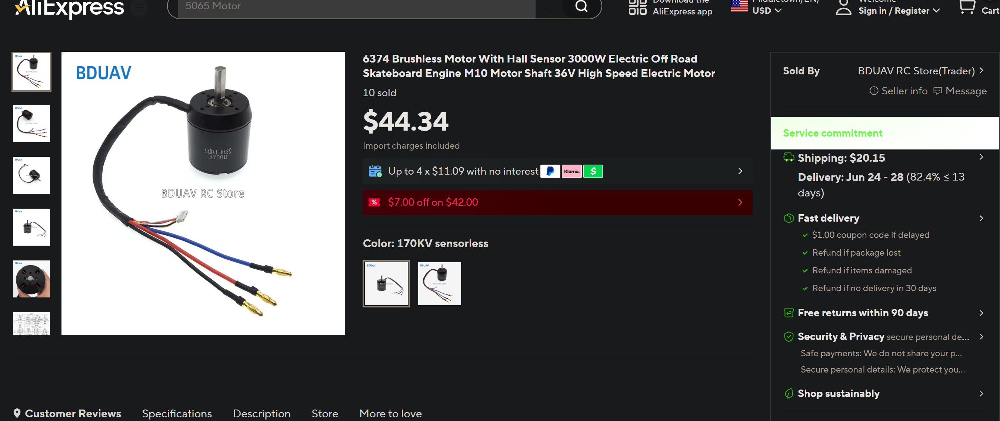

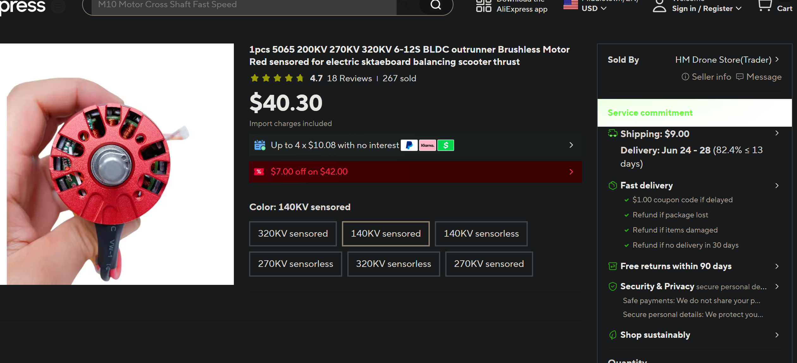

A change that i'm not sure to make:

The cyclodial motor I made can be a sub-project in forge but I do not want to do that as it will lose its "imported from macondo" and the timeline of me making it was before forge.

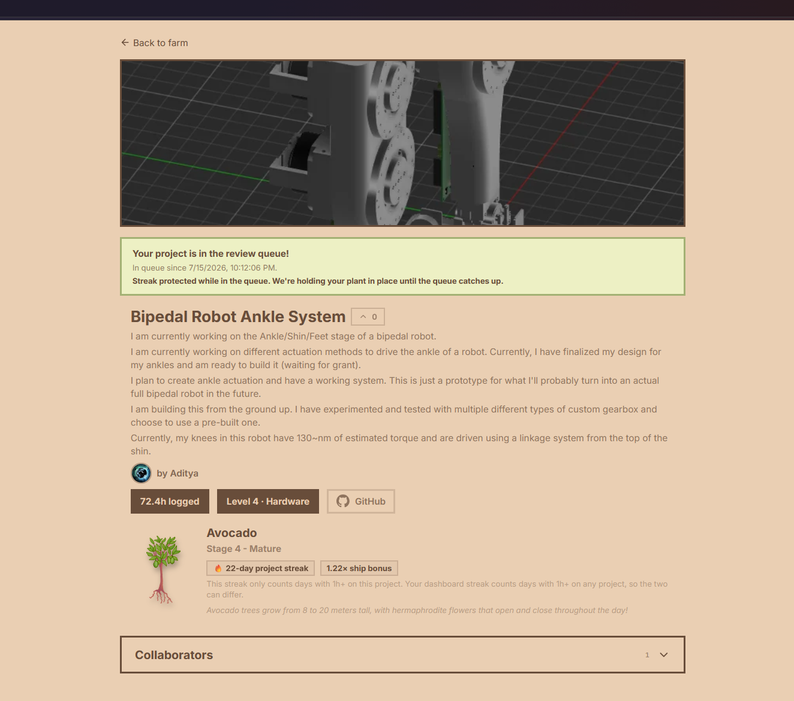

**Total time spent: 2.8h**

# 2026-06-15: Designing bottom-up, researching optimal design choices

Date: 2026-06-15 (Jun 15, 2026, 10:41 PM)

A lot of physics and calculations were needed for this build. I needed to design a 2 axis bearing based joint. I chose 608 bearings because they are cheap, common, and strong. I will use hardened steel shafts. I did put a lot of thought into this. both legs, 2 bearings per axis, 4 608 bearings total for supporting total body weight (assuming 40kg, if it were to jump, assuming 2-6x force from jumping, it would take max 240kg). In total though, the 608 bearings can handle over 500kg, 280kg recommended according to my calculations. The steel rod will not be the limitation according to my design, but rather the bearings, as the rods span not longer than 60mm for my ankle joints. Here is a picture of a foot base I was making for the robot leg assembly:

I had to pick where my ankles would be based on calculations and previous research papers that helped me determine that an optimal place for my ankle would be 30-40 percent of my heel to toe distance.

This is the research paper I was reading:

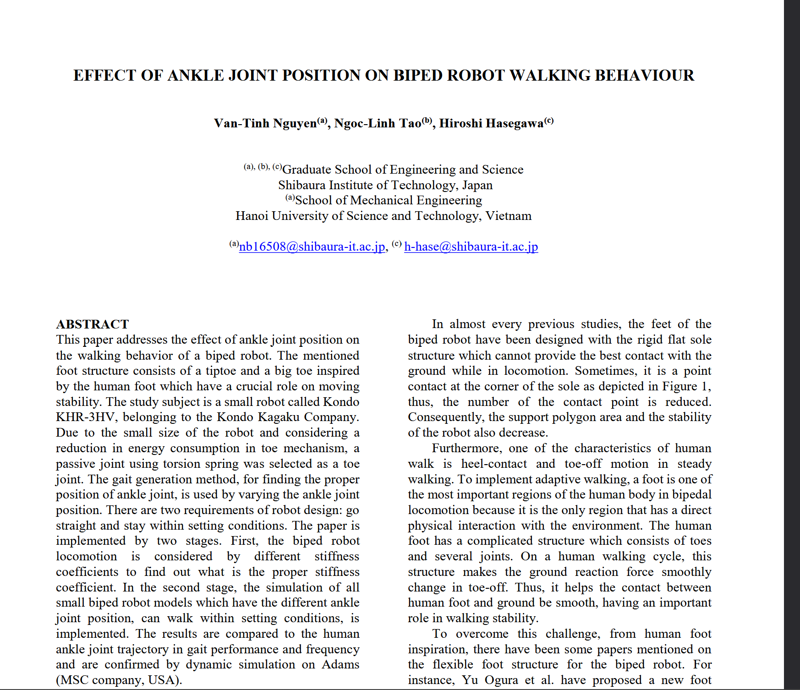

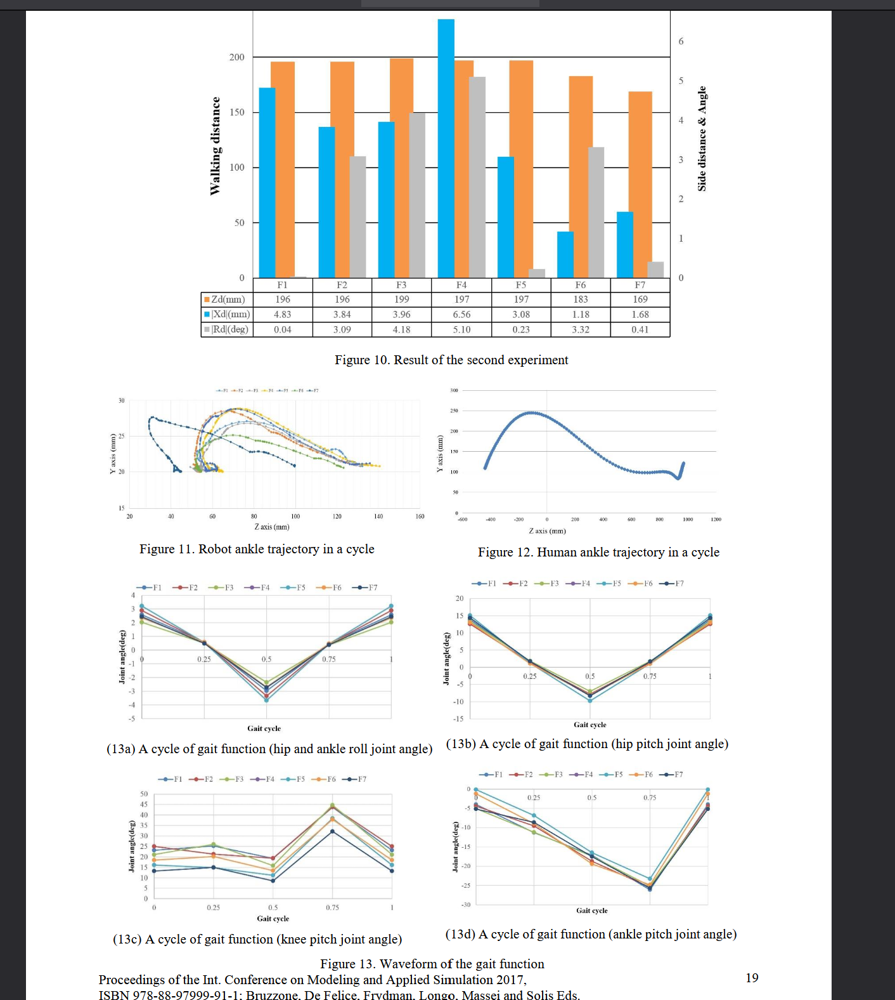

This was my design that I was making:

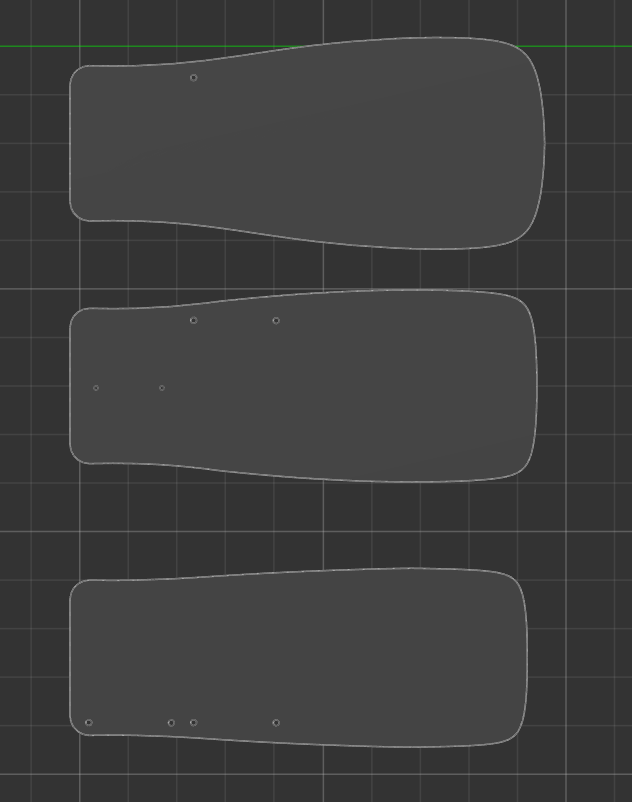

I am working on adding the ankle joint bearing system currently:

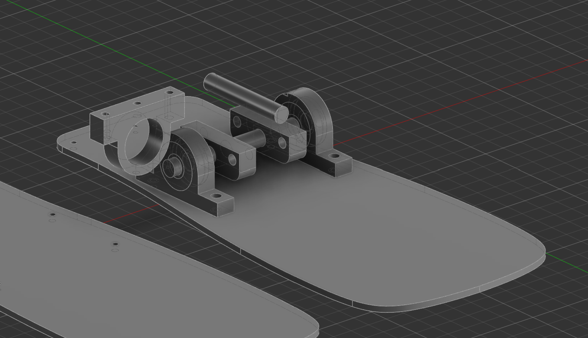

**Total time spent: 3.3h**

# 2026-06-16: Finishing ankle joint, starting QDD gearbox

Date: 2026-06-16 (Jun 16, 2026, 11:14 PM)

I finished my ankle design with the 2 joint bearing system here and will print it overnight:

After heavy contemplating, I decided on prototyping with the C6374 motor as it was the same price and more torque, though it was a little bit bigger.

I did not have a CNC machine and did not have enough budget to get one. I had to make do with my core-XY printer and I had to tune it for tolerances, and carbon fiber reinforced nylon to try and make a high torque gearbox. I was thinking of doing both a planetary and cyclodial gearbox. Capstan gearboxes, linear actuators, worm, spur, harmonic, and belt gears did come into my mine but belt and spur would be too big and spur would be too weak, same goes for belt, linear actuators would be too slow, harmonic is too expesive to fabricate, worm would have no backdrive which was needed, and it would be hard to angle it. I learned about minimizing backlash and having the highest backdrivability, which is what new robots like unitree and boston dynamics are chasing after current. I was curious on the performance of planetary and cyclodial 3d printed gearboxes and did a lot of research into their specs. I found out that for plastic, a cyclodial mixed with metal bearings and bushings would be the cheapest and strongest,

these are some research papers I read to decide on the gearboxes to use:

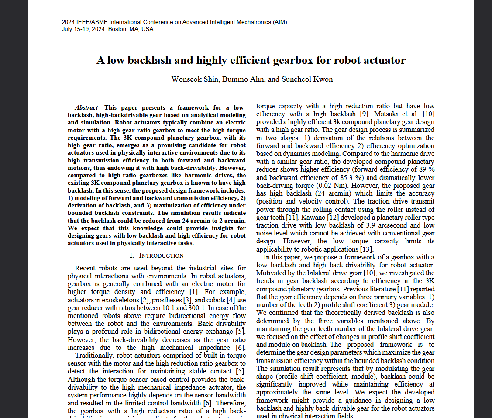

For finding the use of 3d printed cyclodials

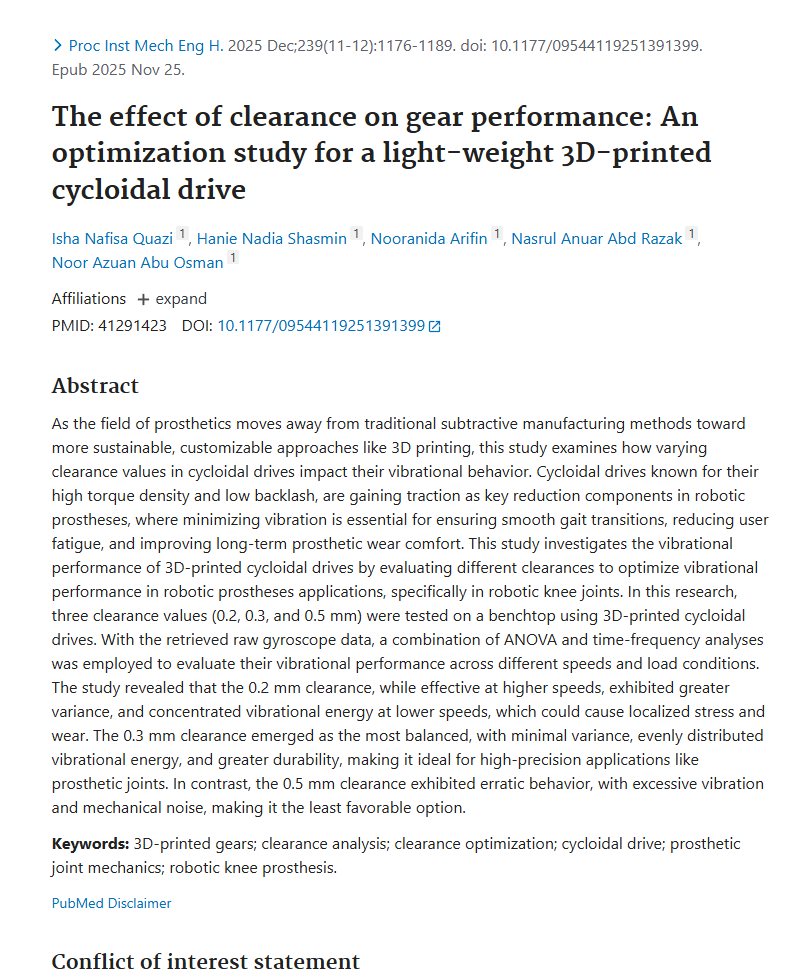

This is also how my cad looks like now, the ball joints are for the differential moving system

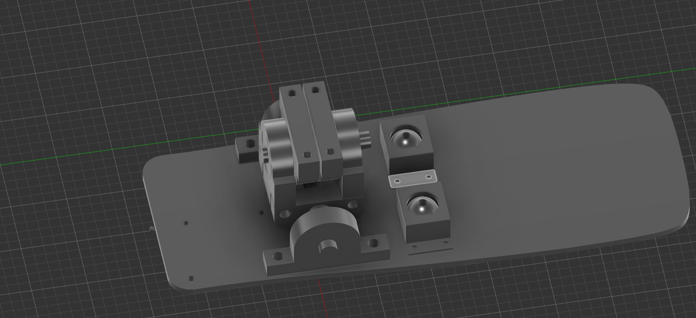

**Total time spent: 3.3h**

# 2026-06-17: Making the planetary actuator gearbox

Date: 2026-06-17 (Jun 17, 2026, 11:55 PM)

This was my first time making a gearbox. I was going to utilize the built in fusion spur gear generator. It was literally better than add on spur gear generators with backlash and fillet radius settings which were crucial for strong gears. I was playing around with the gear sizes and since my design would be plastic I had to maximize module and strength. I chose a 48 tooth ring gear size and a 14mm height which would be optimal.

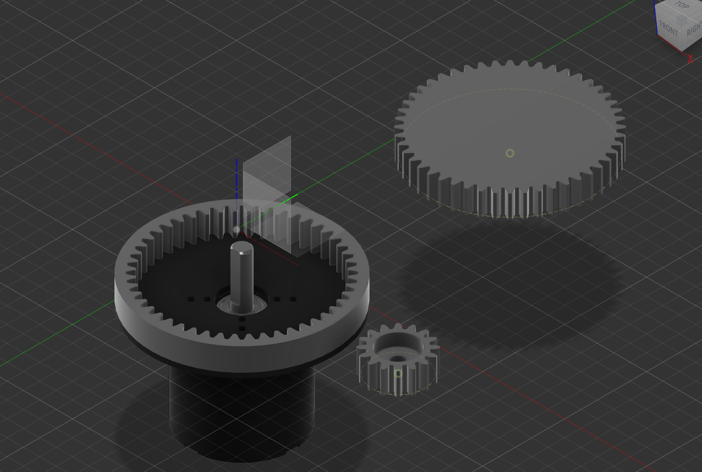

I made the ring gear by cutting from a spur gear that size

This is how it currently looks like with cheap 608 bearings

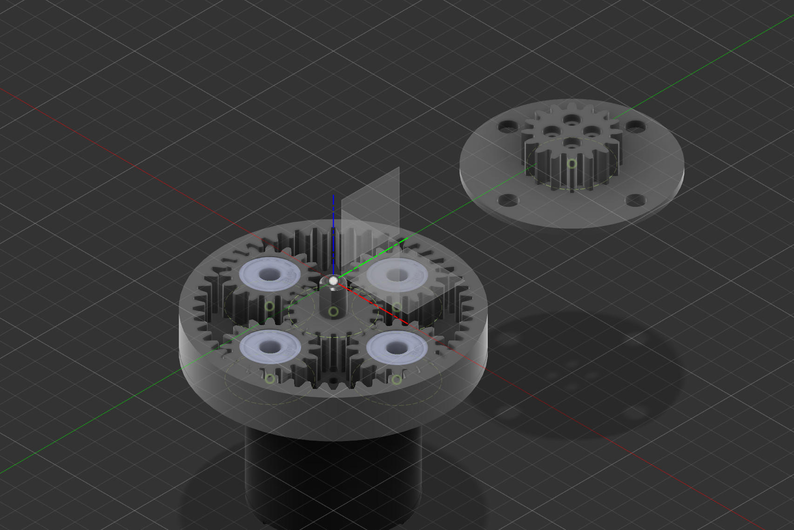

I wanted my design to be as slim as possible, and looking at plastic planetary gearboxes online, they utilized thick bottom plates to keep the planet output rigid. I couldn't do that as it would make my gearbox though long (max 5 inches for calve placement). I had the great idea of using the balls from my 608 bearings and putting them in a hole I have for the spur gear and that will reduce friction and help me a lot.

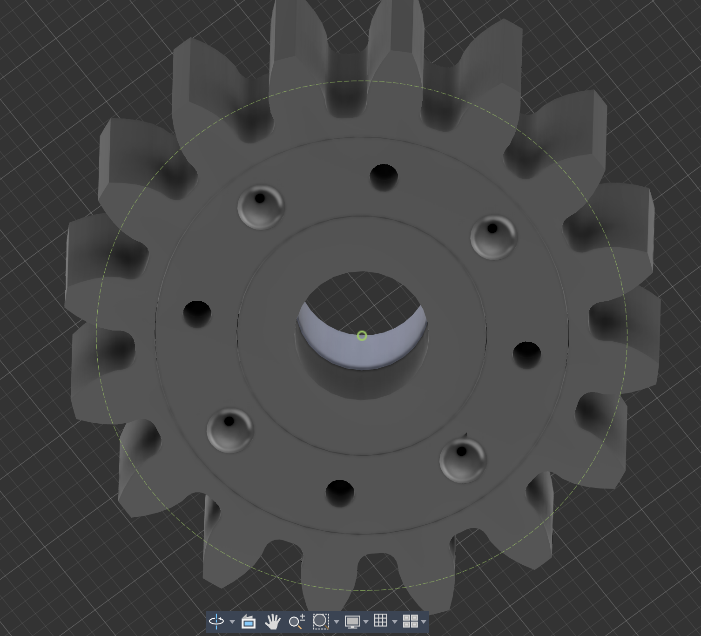

I also spent some time building the current ankle prototype 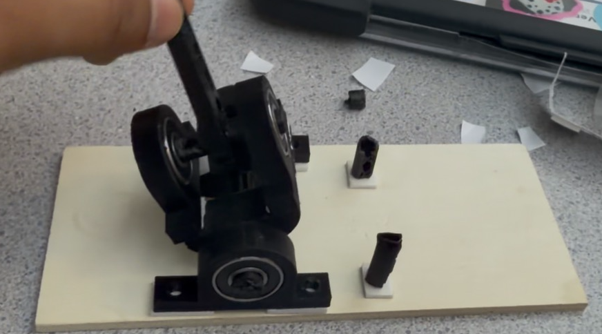

**Total time spent: 3.7h**

# 2026-06-29: Finishing up planetary gearbox

Date: 2026-06-29 (Jun 29, 2026, 5:38 PM)

After cadding for a while this is what I had came up with for my planetary actuator:

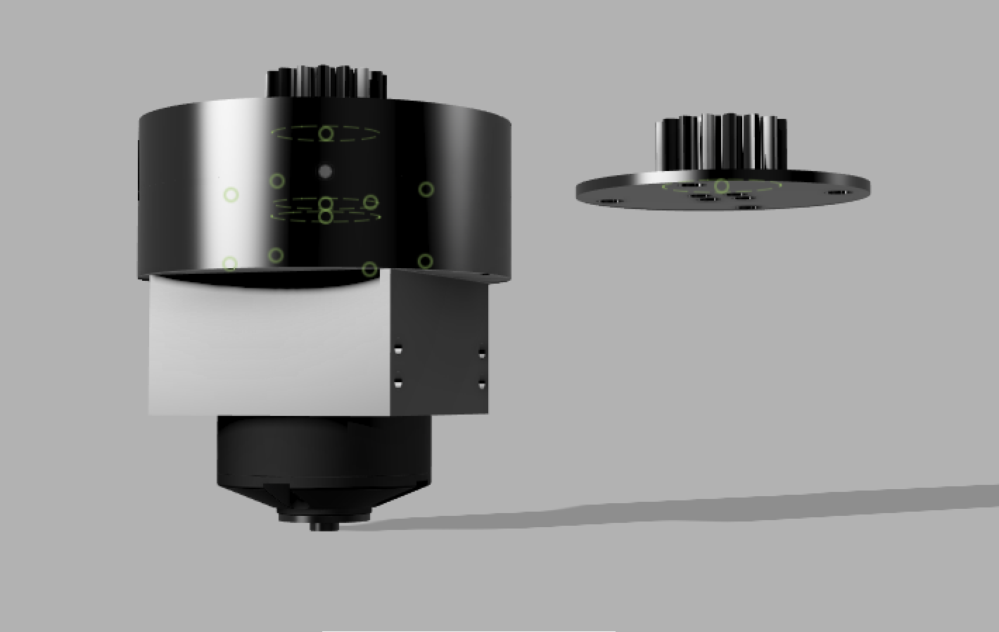

I had tried to make it as slim as possible, but it was really long (136mm). That's way to long to fit on a human calve, and this was without the encoders. It was a dual stage planetary gear. I was going to be using plastic so I used 4 planet gears. I tried to maximize planet strength. This was the smallest I could go according to what I had read on plastic strength and watched on youtube if I wanted my gears not to break if I printed them out of engineering grade plastic such as nylon-CF. When I print it and test it I can try making it smaller with smaller gear heights but I felt like a cyclodial gear would be much more compact for a 10 or 16 reduction. I wanted a 10 reduction to satisfy the requirments of a quasi direct drive, but I had to go for 16 as this motors commercial torque rating was around 4-5nm and according to the physics based torque calculations I did, I wanted to get 100nm for the calves. Factoring in 2 motors, I needed that 16 gear ratio to get that torque and cover any efficiency loses.

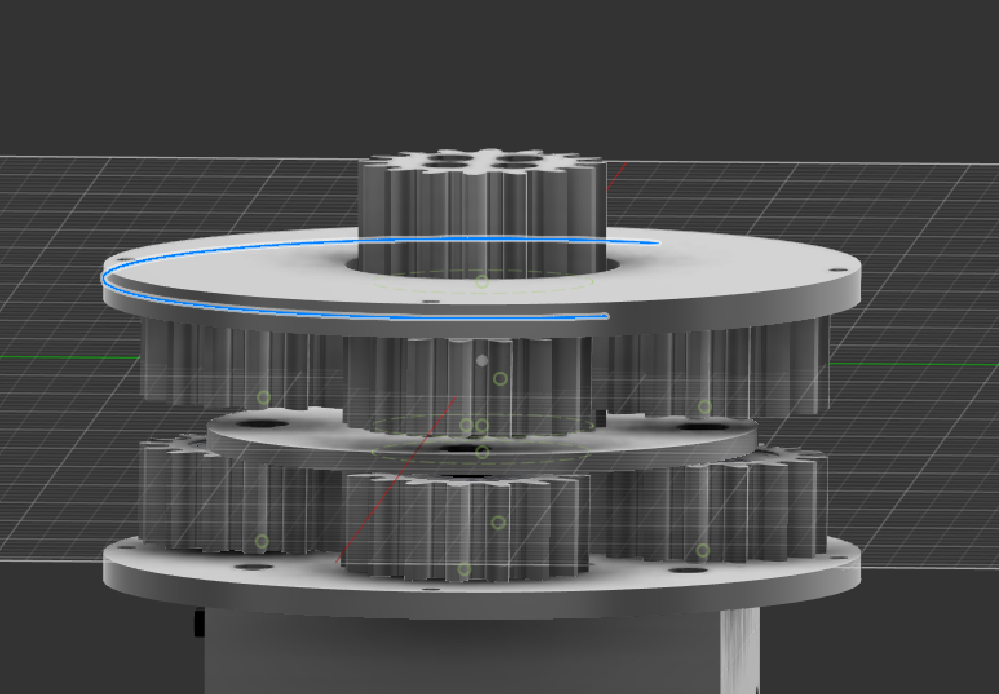

This is what the two stage planetary system looked like. Let me explain more on my design process. I chose a gear tooth radius module around half of my gear module, which is optimal for gear tooth strength. I didn't go with helical gears as they were harder to print, and I wanted a simple design for now.

A picture of the 2nd output sun gear:

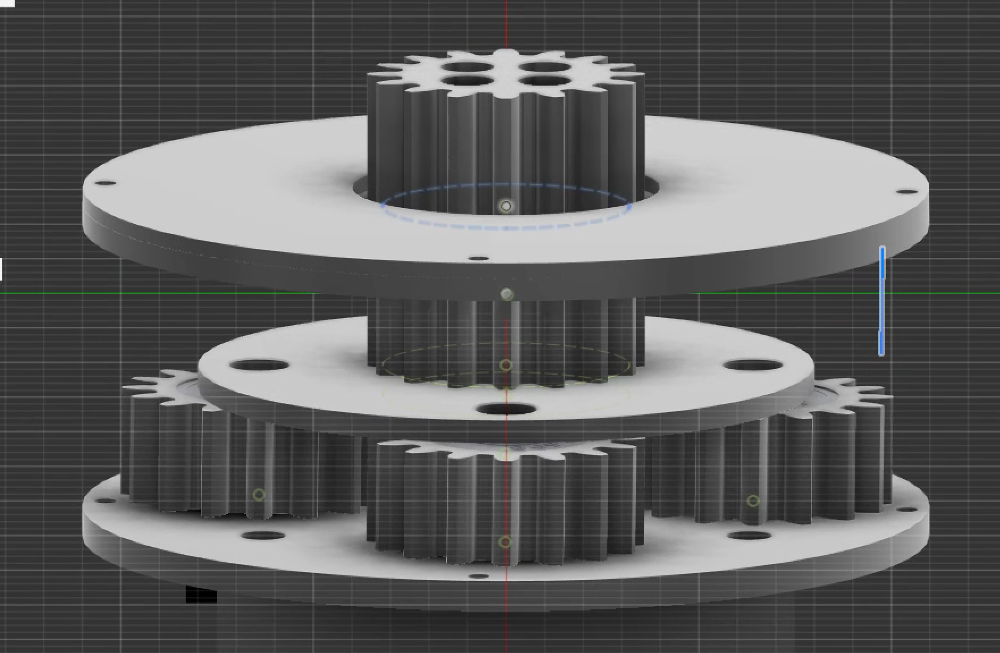

I now want to prototype with a cycloidal drive and see how that goes. My current planetary system used 16 teeth sun and planet gears with 48 tooth ring gears. I found out that 12 teeth is fine for planetary gears, so in the future, to make it stronger, I will definitely switch to 12 tooth and a higher module for bigger and stronger teeth.

Here is proof of my version history to prove the amount of time i've worked on the actuator:

**Total time spent: 2.9h**

# 2026-06-29: Making cyclodial drive CAD

Date: 2026-06-29 (Jun 29, 2026, 10:34 PM)

For building my cyclodial drive, I imported the base of my planetary gearbox and got this:

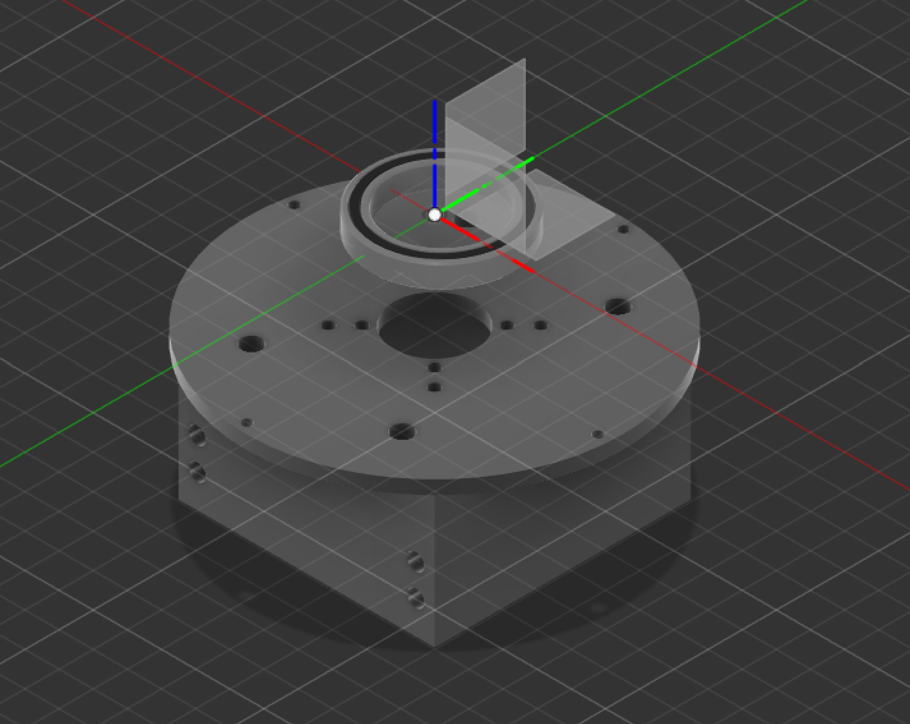

I researched cyclodial drives for a while and there was even research on plastic cyclodial drives, specially NA-CF filament which i'll be using.

For my cyclodial drive, I chose a 30mm id, 42mm od bearing for my eccentric shaft, as it was very cheap online and a big size for 3d printing an eccentric shaft to maximize strength.

To make my cyclodial disks themselves, I could sketch them out but a mathematical approach would be much better. Luckily, for fusion360, cyclodial drive generators already existed.

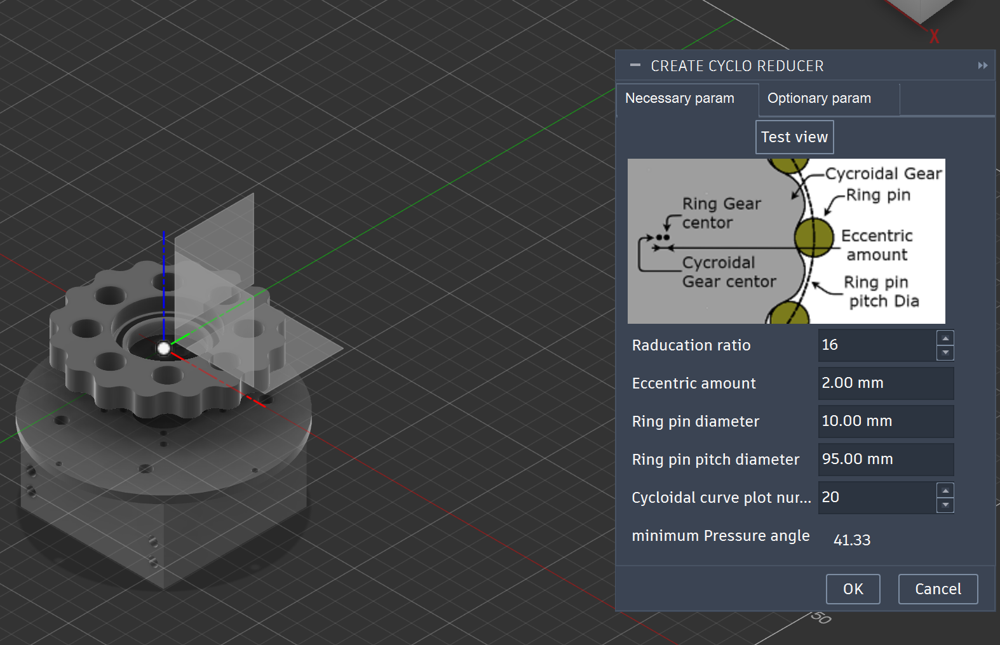

This guide was very helpful on helping me design my cyclodial disks:

[https://www.youtube.com/watch?v=HDVCgaDknyM](https://www.youtube.com/watch?v=HDVCgaDknyM)

Also, here I have used this script generator from woodenCaliper: [https://github.com/woodenCaliper/CycloidalDrive](https://github.com/woodenCaliper/CycloidalDrive)

As you can see in the picture of my cyclodial drive generator I have decided on an optimal 8 lobes. I made sure to use the most lobes possible to maximize the plastic strength and though about putting metal bushings on them for more strength.

I was going for a double cyclodial system where 2 disks cancelled out to reduce vibration.

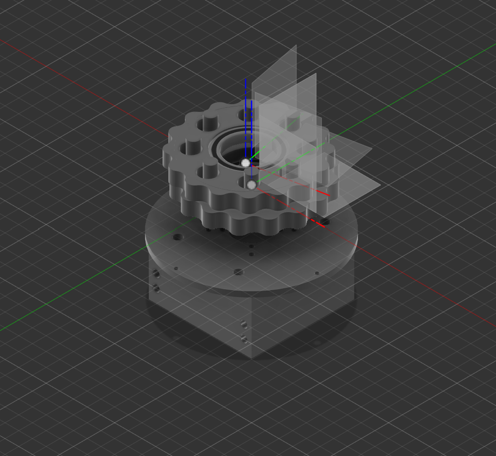

This was my current setup with 2 disks cancelling out.

Also, I has used 17 output pins/lobes to get a reduction of 16, which would give me around 50nm torque (assuming 100 percent efficiency) based on the torque calculations I got from my C6374 motor, and 100nm of combined power when the differential ankle system was compounded. This was only the torque at the rated current. If I did what motors such as the Kraken X60 from FRC did, I can push the current 2-3x higher than rated for a short burst to get 7NM, which would give me 112 NM from one motor, giving me a whopping 224 NM in total. I probably won't need this much and can push down to a 10 reduction but I want to cover as much friction losses I can.

I am currently in the process of designing a system for my roller pins to roll on, I was thinking of using aluminum bushings:

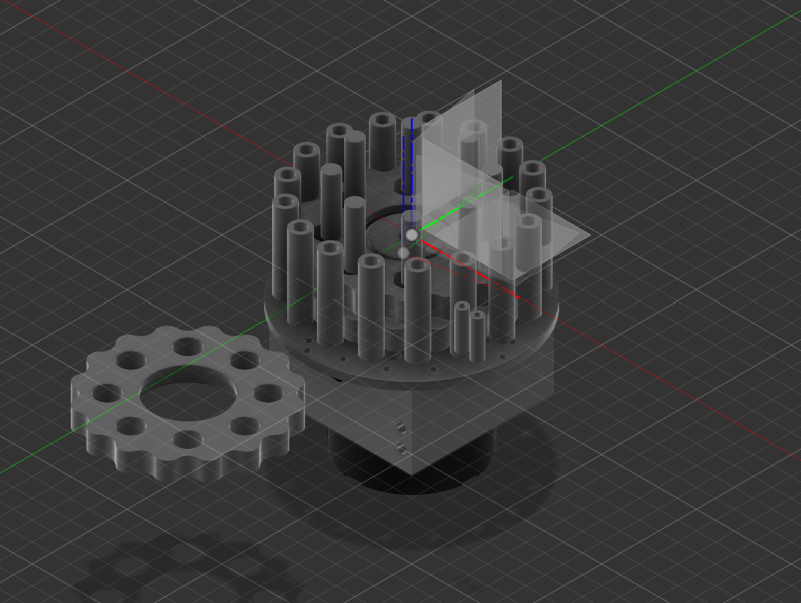

**Total time spent: 3.4h**

# 2026-06-30: Finishing cyclodial drive cad

Date: 2026-06-30 (Jun 30, 2026, 10:13 AM)

Over here I have finished cadding my cyclodial drive. On the bottom right you can see an attachment I made for the input shaft where I can turn it with my fingers to see the drive rotate.

Also, the image shows the eccentric shaft I made, and I made it pretty big, so the plastc which will be experiencing a peak of 7-8nm of input will be able to withstand the stress (I think I can probably get away with smaller for future designs).

The bottom left shows my bottom output disk/pin holder, it is to hold my output pins from the other side to make them more stable, less wobbly, and stronger, reducing backlash and increasing gearbox strength but also at the same time increasing the total gearbox length. To minimize the increase in gearbox length I used the same ball-bearing balls inside them, so I can put the balls in them to reduce friction (like a custom sliding radial bearing).

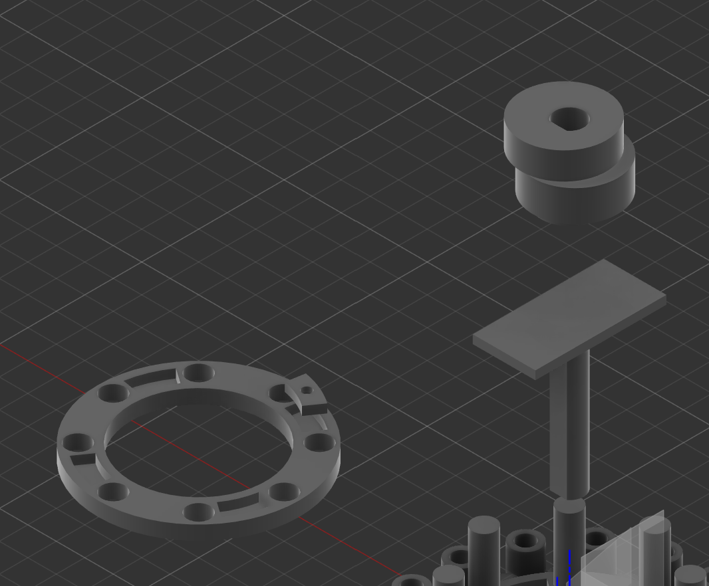

Here are the 4 slots, each slot has a hole for 1 ball bearing, there are 4 on each side, so total 8.

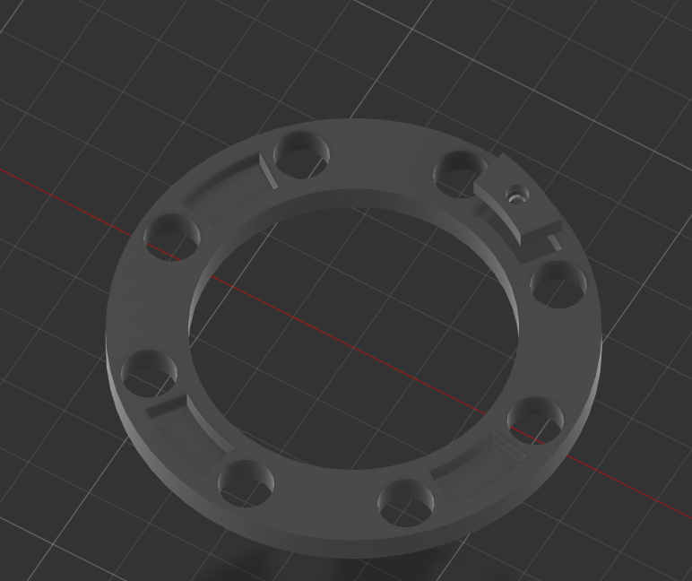

Over here you can see the output plate I designed. I made it as thin as possible but also made it strong. I used a cheap 50mm ID, 62MM OD bearing, and that bearing was the right size for futureproofing as I can make the gearbox smaller and have the bearing fit. I had multiple holes for inserts and attachments on the output of the gearbox.

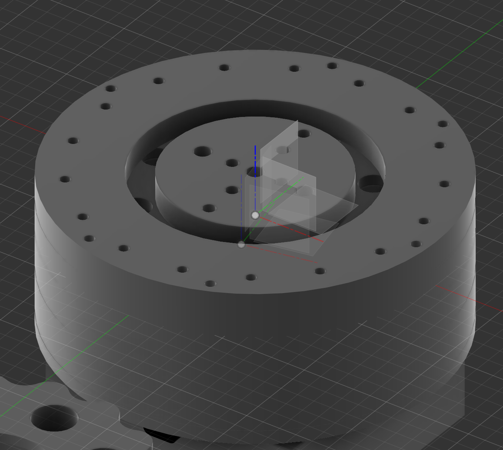

As you can see in that picture is the completed gearbox. The circular empty gap is for the bearing.

This one took me longer to make than the planetary as it was more complex and I had to iterate a few times on my cyclodial shape and dimensions, proven by my longer timeline here:

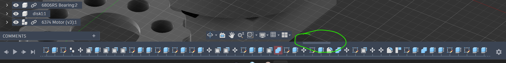

This gearbox was around the same length as my planetary but I have more flexibility on making it thinner, so I plan to print this and prototype with it first. Not only that, it is much stronger and easier to get dimensions right than planetary so I plan on printing this.

Here is what my gearbox looked without the shell, there were 2 disks:

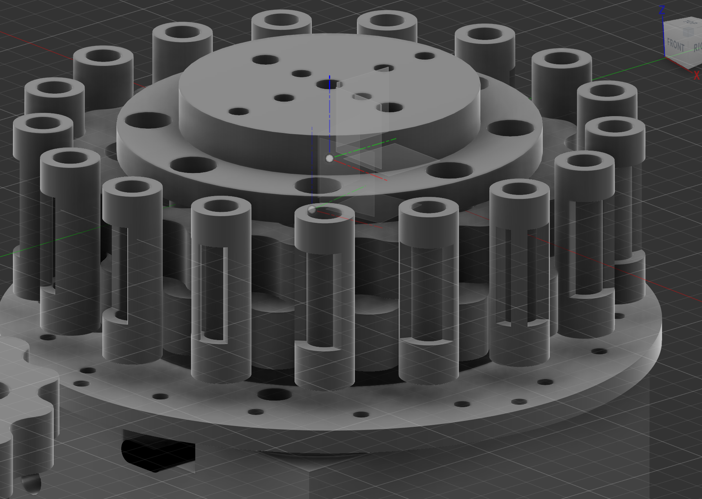

**Total time spent: 3.8h**

# 2026-06-30: Torque experimenting with C6374 motor

Date: 2026-06-30 (Jun 30, 2026, 1:59 PM)

This is going to be a controlled experiment for measuring the amount of torque my cheap 40 dollar motor that I had can produce. The makerbase Xdrive i'm using for driving this motor was based on the odrive 3.6 (discontinued), but this only came with one axis, and it wasn't exactly the same wiring config. It had different pinouts so the odrive software was a little different, but the good thing is that the makerbase xdrive github repo listed every change and even had examples for testing the xdrive, and the firmware:

[https://github.com/makerbase-mks/ODrive-MKS](https://github.com/makerbase-mks/ODrive-MKS)

Thanks to this, I had direct control over all the odrive firmware, and the sad thing is, that a web GUI for visualizing motor torque and commanding motor is not supported by odrive in their deprecated odrive 3.6 versions, but I can build my own now that I have full control over my Xdrive, which is just an stm32 with a DRV gate driver and a few mosfets (I won't mess with that part of the software as its very fragile and complex). I made a few changes to the original software, and I created my own web server with direct control over my motor. No need to type into a terminal using odrivetool to command my motor. Anyways, here was my setup:

Here is the GUI I used for controlling my odrive. It was mounted to the C6374 motor which I was going to be using in my gearbox.

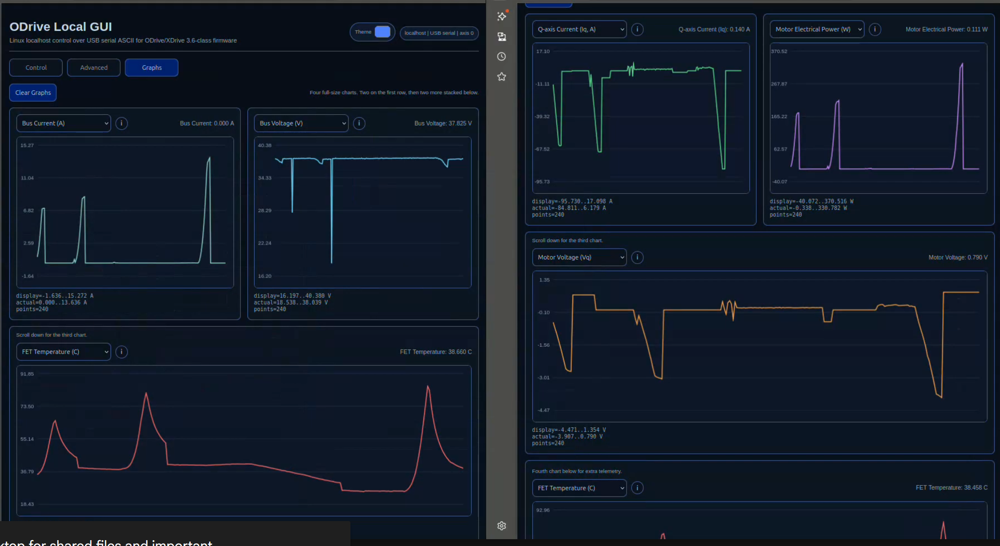

In this gui in split screen you can see multiple data points that i'm visualizing directly and logging as I run my motor tests (total current, voltage, bus voltage, power, q-axis current, and the important FET temp which was how hot my Xdrive was getting while pushing current surges).

I spent a while building this setup:

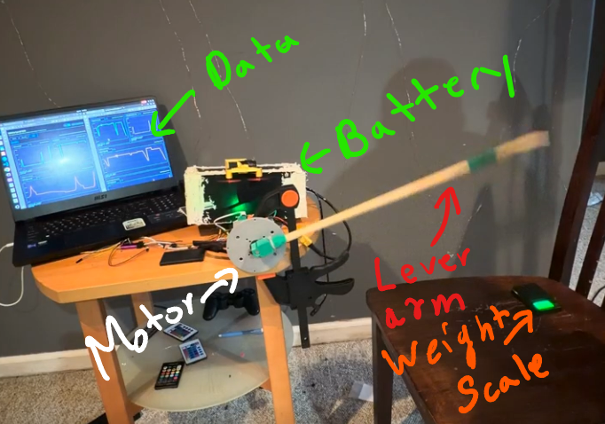

As you can see, I used a nearby table and used a clamp to put my motor on the table. I used the mount I had made for my planetary/cyclodial gearboxes which I printed which gave me a good source to clamp my motor to my table. I rapidly prototyped an attachment so that I can connect a wooden shaft to my motor. The wooden shaft was 22.5 inches in length. Originally, it was 17.5, but why did I extend it using the green 3d printed attachment you can see in my lever arm? This was because my aliexpress weight scale could only measure weights up to 1000 grams and if I wanted to measure more than 5nm from that motor, according to my lever arm torque calaculations, i'd need atleast 1.13 KG of measurement capacity, this is where my knowledge in AP physics c mechanics actually gets useful!

Here is a video of the torque tests running:

Here i've linked a video of my statistics- how much FET temperatures rised as I ramped up to 105A on my motor phase current, and the primary reason the xdrve shut down was due to the FETs going above 100C temp

[https://www.youtube.com/watch?v=2mQLq0kSfGY](https://www.youtube.com/watch?v=2mQLq0kSfGY)

Here's also a picture of all my stats when my motor was producing its peak torque

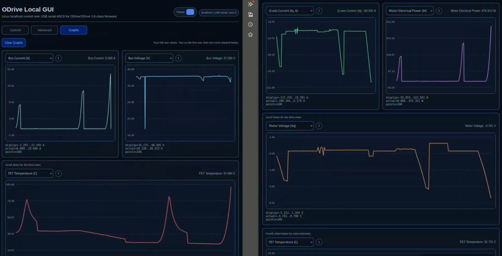

As you can see in the picture I was pushing 100A and burning though 500W of heat!

Here i've linked a video of my lever arm testing, where you can see the lever arm of 22.5 inches push 900+ grams onto the scale, specifically I get 956 grams at 22.5 inches, which is around 5.38 NM of torque. This is at 100A, and it is a little less than the calculated from the motor KV and size, but it is actually expected due to motor coil current saturation which is where the torque you get from the motor reduces exponentially as you increase the current and also note that the heat being generate increases exponentially to. In the statistics video above you can see how the motor was burning over 500 watts of heat just idling there doing nothing. The cables were very hot after testing. I wanted to push to 150A of current for a much smaller time interval but it seemed like my xdrive burned out already (yeah it stopped working). I don't know why, maybe it was faulty, or maybe because I didn't add the brake resistor.

[https://www.youtube.com/shorts/URe1jQX0fmo](https://www.youtube.com/shorts/URe1jQX0fmo)

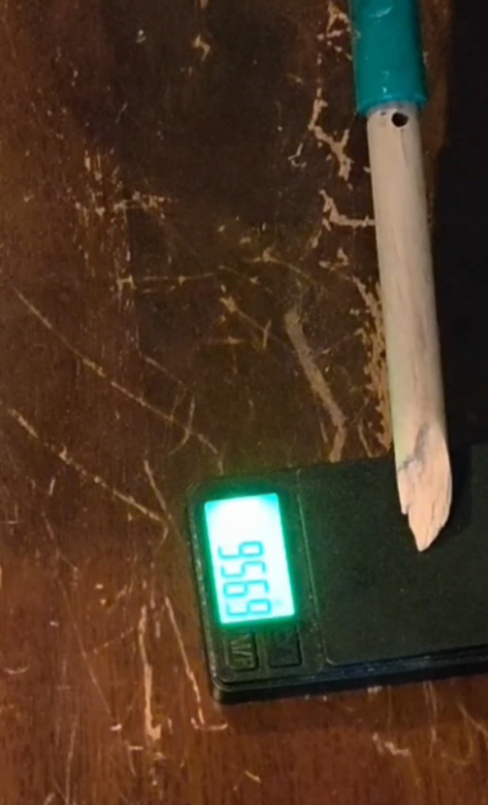

You can see here the scale is reading 956 grams which was the peak value I got at 22.5 inches length and 100A current limit before my xdrive overloaded and broke. Although it broke, the mosfets are rated for over 300A, i'm sure the reason it broke was probably because of no brake resistor and the motor giving back-emf.

This is the video of my full lever arm setup, you can see it run here:

[https://youtube.com/shorts/W6E\_mle94bk?si=-Q9WvaRHzBB44zzH](https://youtube.com/shorts/W6E_mle94bk?si=-Q9WvaRHzBB44zzH)

Or heres a picture for a quick look:

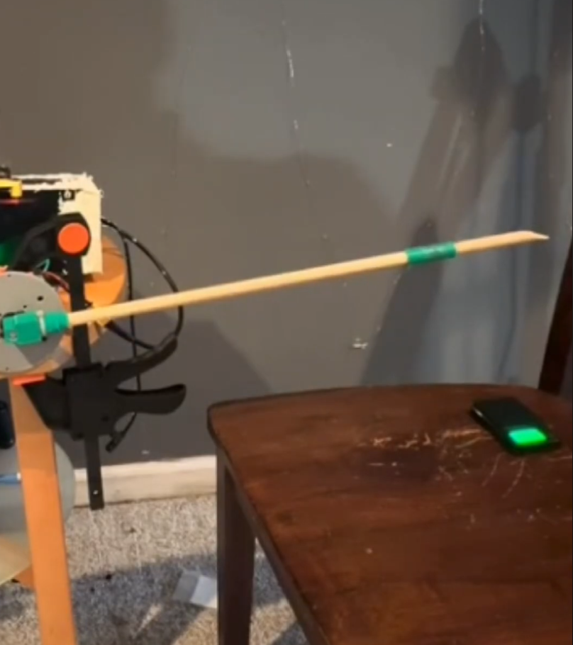

I hadn't just collected the data at 100A, I had collected the data at multiple different current intervals and found out how this motor performed at each interval, and how much torque/A of current it lost:

**Now what was I going to do with all this data?**

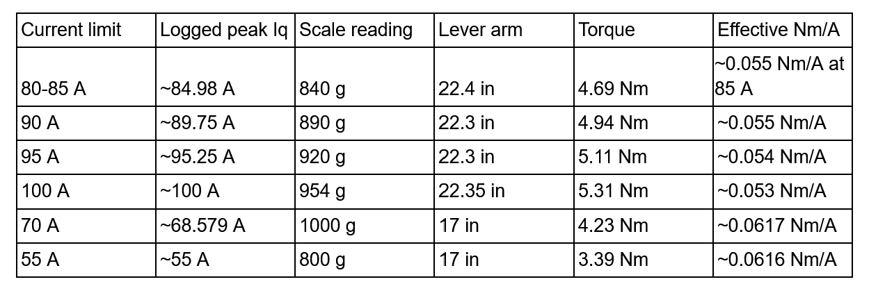

That picture has the data, if you look at the torque/A closely you can see the values drop as i increase the current. My goal is to get 100NM+ in the ankles system of my robotic joint. Since 2 of the same motors will compound to get 2x torque, I need to get atleast 50Nm. Currently i'm getting 5.38nm at 100A, with a 16 ratio and 75 percent gearbox loss, thats 64.5nm estimated!, and 86.08 theoretical. This is more than enough for the 5 foot+ bipedal build I was targetting.

The problem is that this motor might be a little to long. That's why I was contemplating on whether to switch to the pancake style 8318 motor. It has thinner leaving a lot of room for a front plate gearbox. Unfortunately though, I can't do what MIT did as i searched it up and the motor's inner diameter space is only around ~35mm in diameter. Katz from MIT when building MIT's famous cheetah robot used QDD cyclodials with planetary gearboxes built into the motor. His motors were also off the shelve. His motors provided much less torque though. The motors i'm going for are going to provide 3x more torque, and have less inner diameter space. I was actually thinking of fitting my encoder there instead of a whole gearbox, having a front plate gearbox. This will still free up a lot of space. The problem was the EMI from the motor messing up my magnetic encoder readings, I will problem need to use some type of faraday cage or capacities encoder measurement.

I wanted to build a gearbox with this motor and see how well it fits within my calve frame of the bipedal I was going for first, and then maybe switch to the 8318. This wasn't a failure, but an iteration, all part of testing. In the beginning I went for the C6374 motor because it was cheaper and I already had one at home. Also it was less wide than the 8318 but after actually building the setup i'm seeing that I have room for more width, I need less length though.

Pictures of setup:

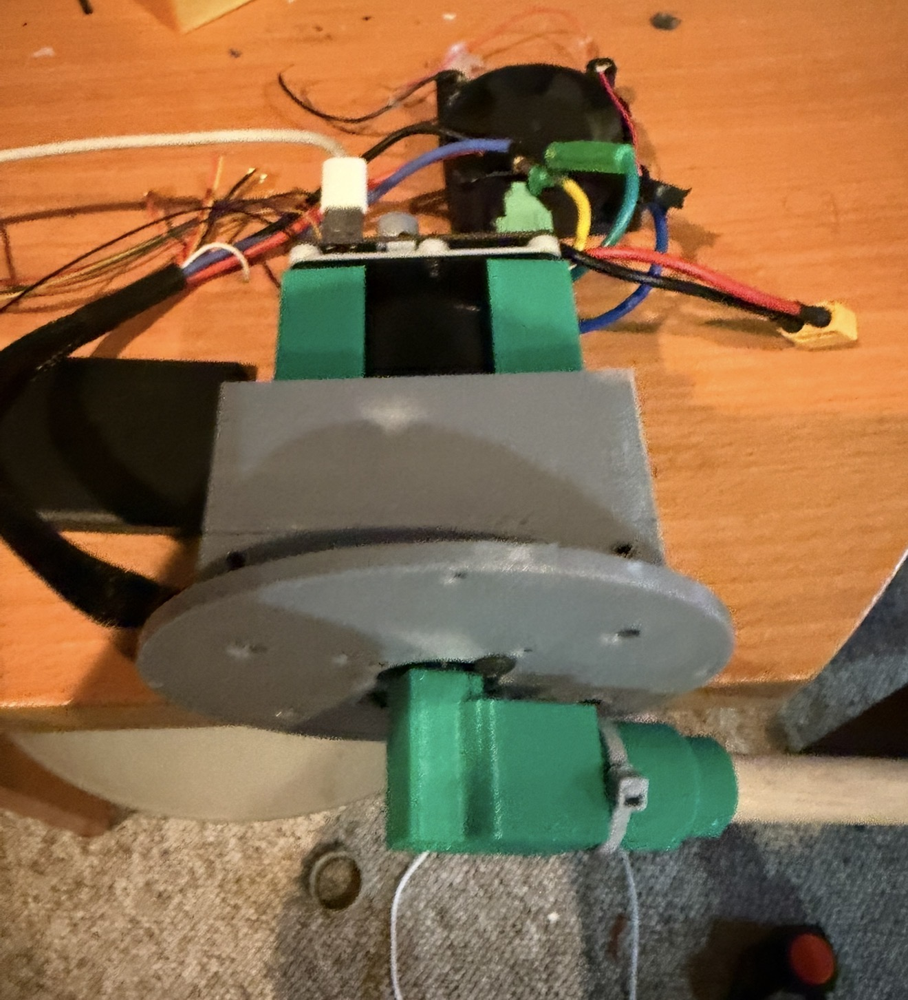

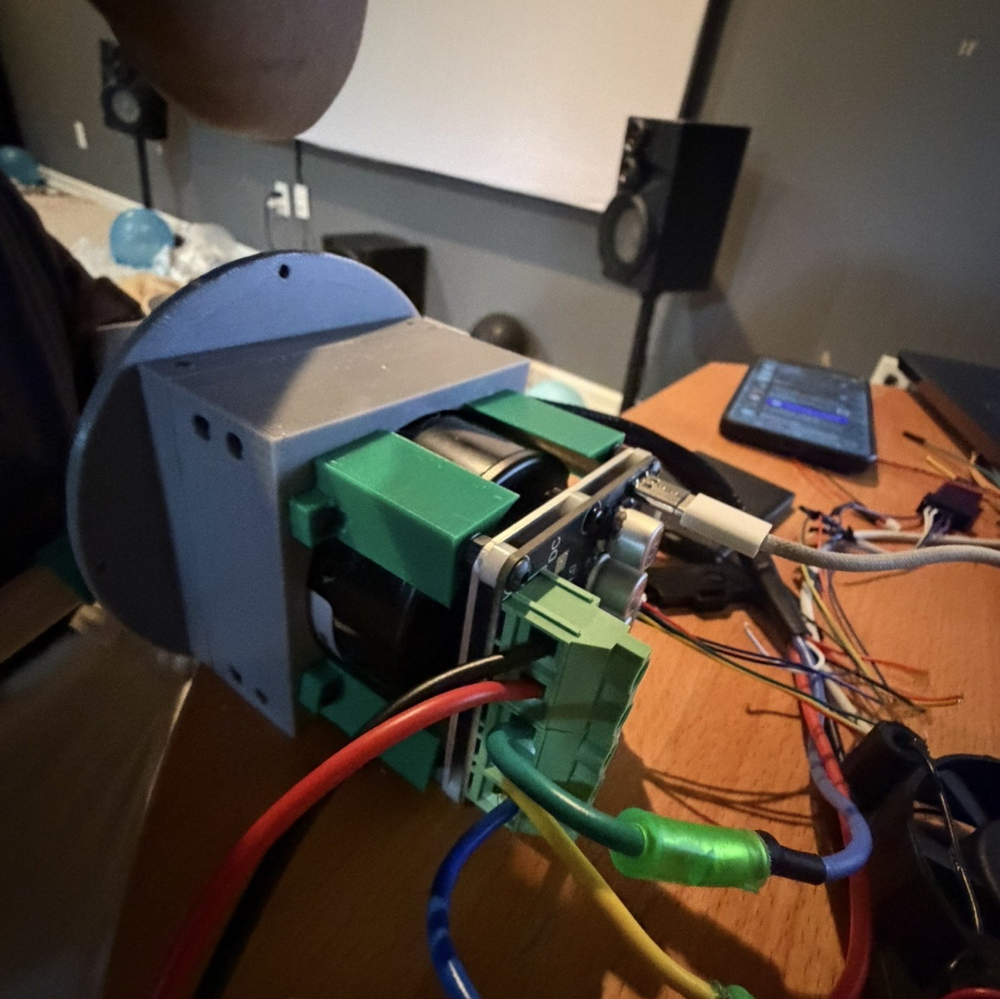

I used this fan for cooling the odrive it was pretty powerful as they were coreless high rpm drone motors 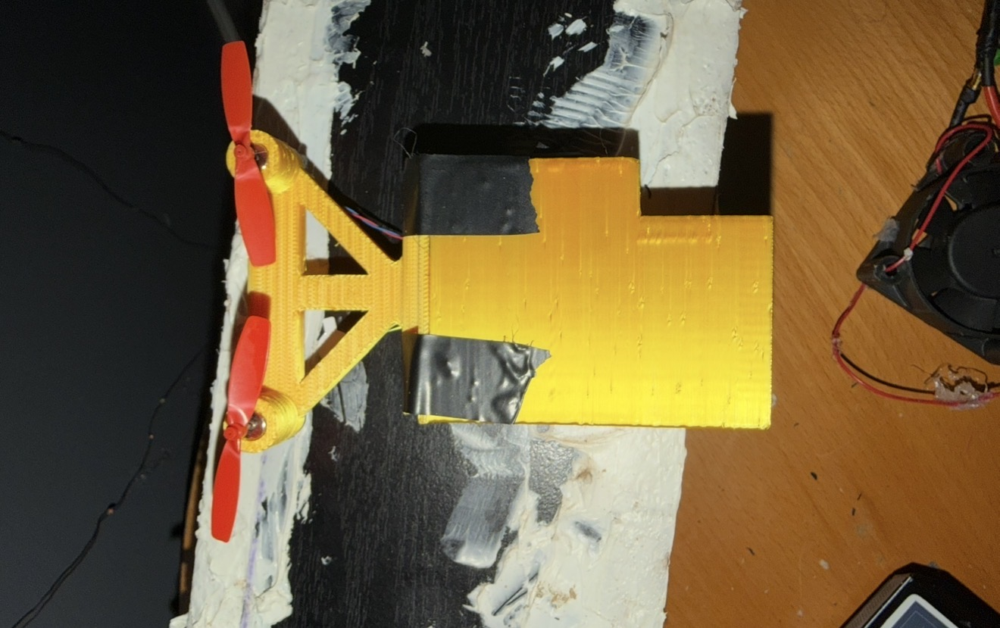

I had a XDRIVE mini which was a cheap odrive 3.6 FOC controller clone with a built in A5047P encoder on its pcb mounted behind the motor

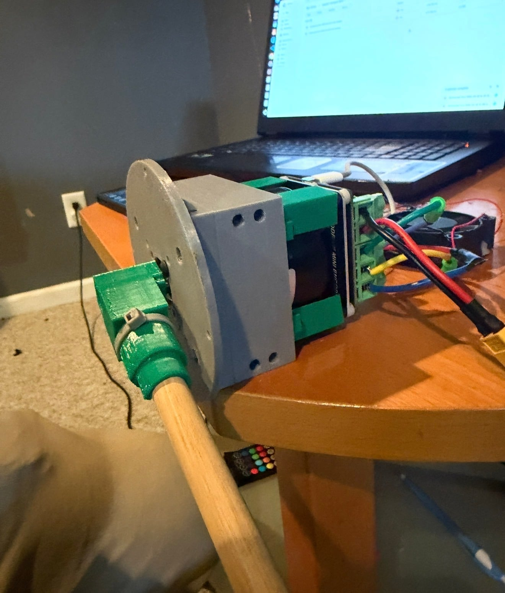

**Total time spent: 5.3h**

# 2026-07-01: Building the cyclodial

Date: 2026-07-01 (Jul 1, 2026, 10:26 AM)

I had printed every part out for actually building my cyclodial drive. By this time, I had calibrated my printer and I knew its exact tolerances. So I could print with amazing tolerances on the 1st or 2nd try.

Here is the assembled cyclodial drive. As you can see here I have assembled the eccentric bearings with the eccentric shaft and two opposite cyclodial disks. For a 16 reduction ratio I have 17 roller pins that I have made out of cheap aluminum bushings. The thing is I found steel spacers to be a better option and they are cheaper so I’m probably going to use those next.

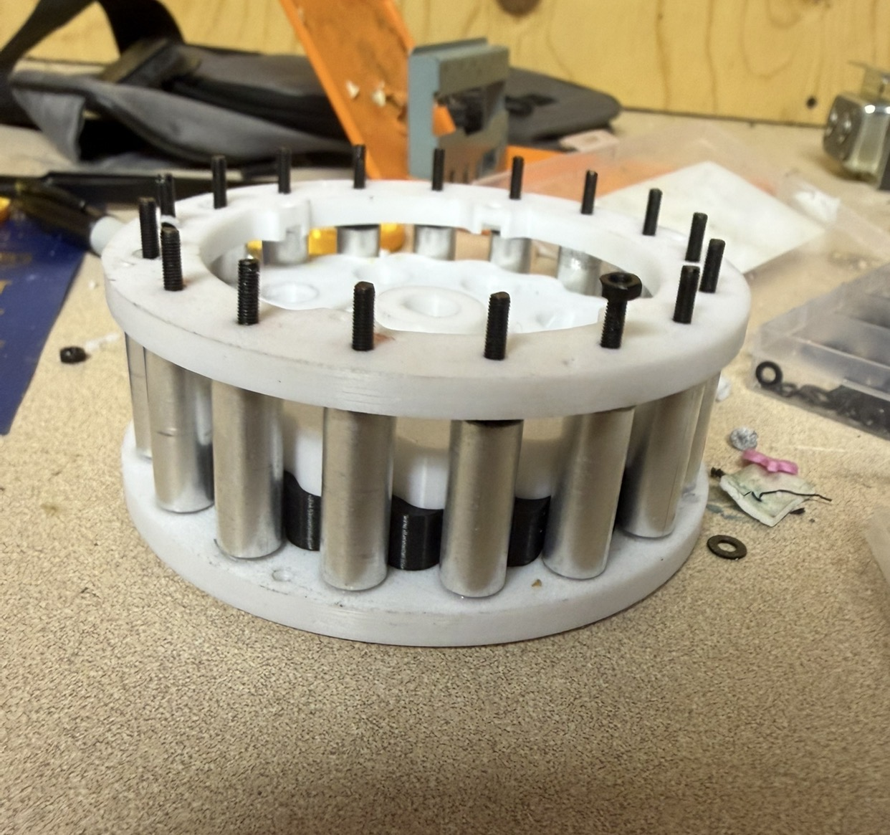

Here I have attached the hand rotary input shaft from where I can use my hand to drive the cyclodial as you saw in my recent cad for testing its smoothness.

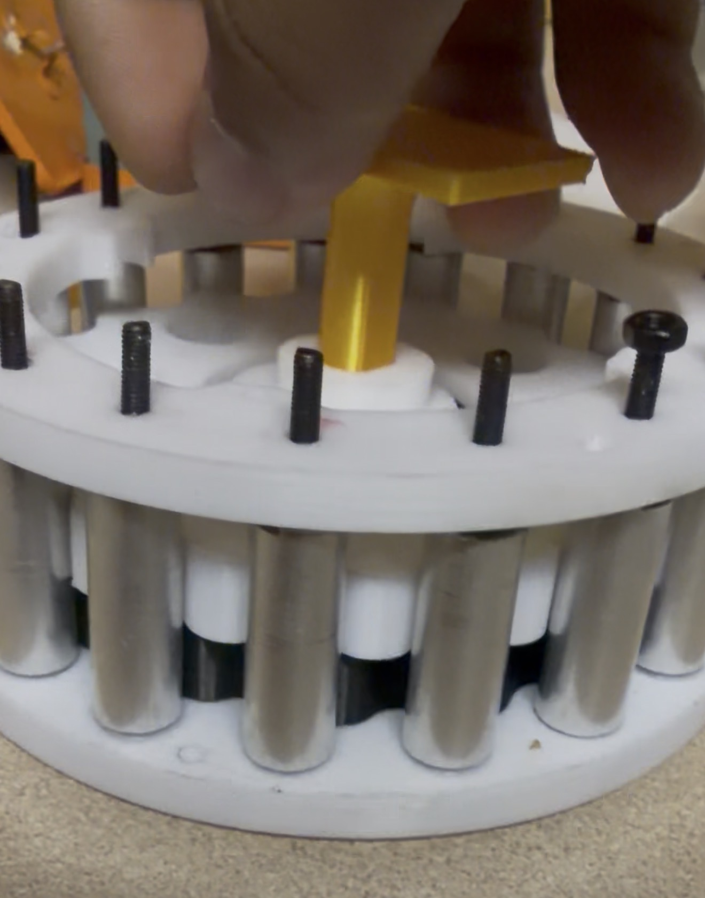

Here is the fully assembled drive with the motor mounted on. Well it isn’t fully assembled as I haven’t added the output attachment and bearing yet but I will tomorrow and I will test the motor with this tomorrow just like I did with the motor directly. 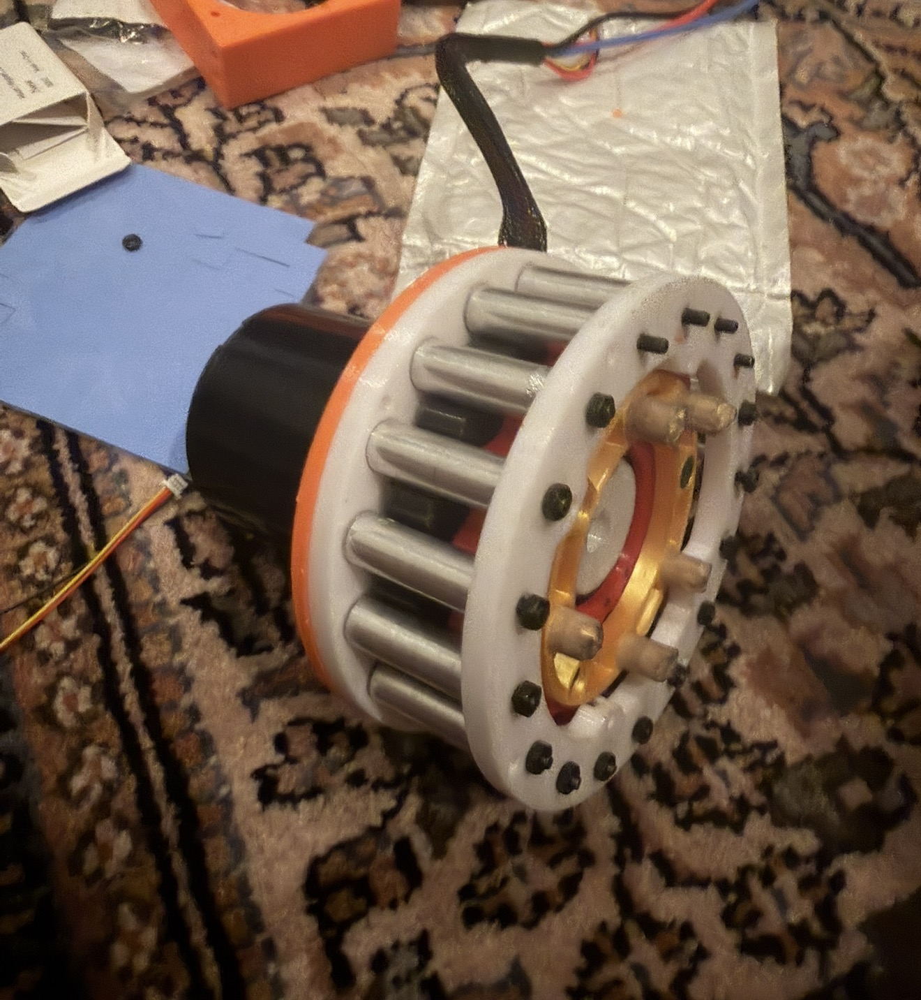

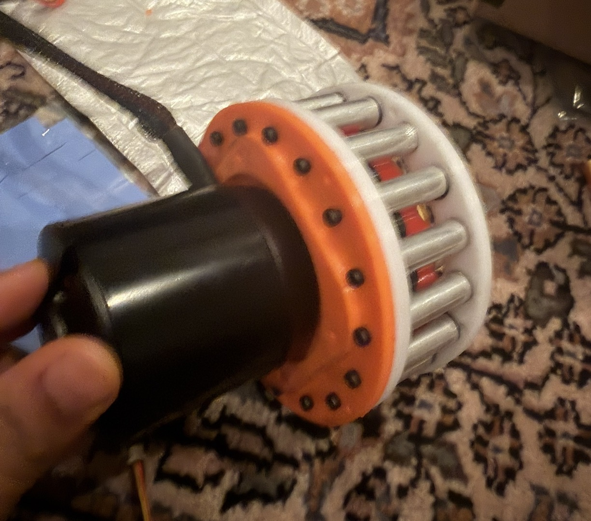

**Total time spent: 3.7h**

# 2026-07-08: Tesing 16:1 cyclodial gearbox

Date: 2026-07-08 (Jul 8, 2026, 9:07 PM)

I had printed out all my parts for the cyclodial gearbox of my C6374 motor. I was going to assemble and test them. Right now, I had fried my Xdrive that had a built in encoder from last session where I pushed over 100 amps through this motor while testing its limits so I was using another ODRIVE 3.6 clone but this didn’t have an encoder so I was using an external MT6816 encoder with an ABZ output as the current ODESC firmware didn’t support drivers for communication with it through SPI. I couldn’t even make custom code to make it do that because the manufacturers didn’t give any documentation on this clone so it was a huge risk to put random odrive firmware on there as the last time I did that with another odrive clone one of its axis outputs stopped working (this was on my autonomous rover project). I had to make an extra mount for that magnetic encoder and 3d print that, with some spacers I also made for an optimal length between the encoder and magnet.

Here is the cyclodial drive before I assemble and screw it shut:

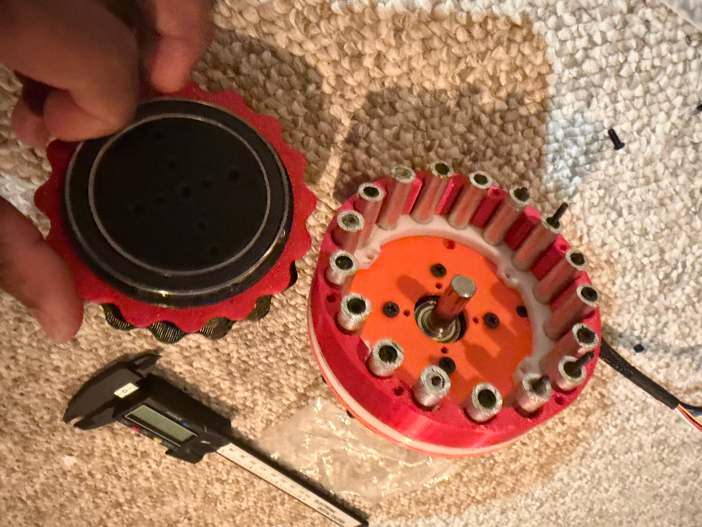

This is what it looked like completed:

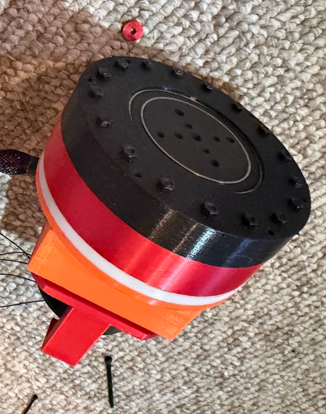

Now, I had mounted the odrive, and connected my MT6818 encoder in ABZ output mode, so now I could torque test the motor using FOC:

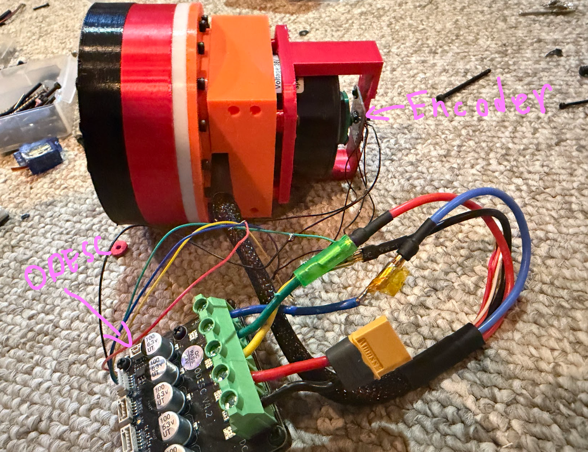

My torque testing process was going to be the same as last time. It was so I can gauge how much torque this setup produces. How did did I want? For the place where this motor was going to be, I wanted 50+NM from from the output. it was going to drive the ankles using a differential setup and I needed 100+NM minimum, and 120+NM would be great. Curretny, I had 5.38Nm from the shaft, multiply that by 16 to get 86.08 NM of torque. Combined with 2 motors, that would be a whopping 172.16 NM of torque for my robot's ankles. This is because there would be 2 motors in the calves driving the ankles. This is amazing, in allows me to explore heights of 6 feet with this robot. The higher a humanoid robot gets, the more power you need to control it. In fact, that ratio is to the 4th power. It's exponential, a 6 foot robot would require much more power than a 5 foot one. Anyways, this is probably not the torque i'd get at 100 amps. I'd probably get something like 120 NM of torque which is still great as the robot build I was targeting for would be at minimum 5 foot, my target was 5 foot 6 inches. I got my torque numbers from doing lever arm calculations based on an estimate of the robots weight and where its distributed.

To measure that torque I couldn't use my old 1000 g scale as the scale would have to be much larger, at least 16x larger to measure the full torque. Thats why I got a 20KG load cell, which has 20x the capacity for torque measurment. I made a 3d printed custom setup for the load cell, and I wasn't gonna make a video on everything this time as my current setup is very similar to the previous one I made a video of, just with the new gearbox added:

This was my test setup:

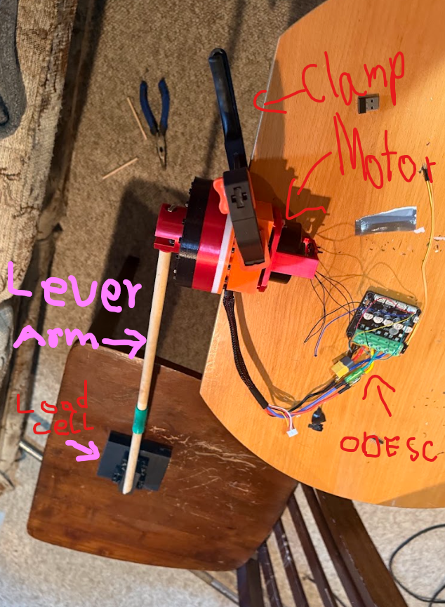

I measured the torque at these current values: 10 amps, 30 amps, and at 55 amps. At 55 amps, my lever arm broke. I totally expected this to happen. My setup was literal plastic, I expected my output shaft or my level arm to break, didn't know which would first. I was not going to need a metal level arm which I had to test, but here you can see how it broke:

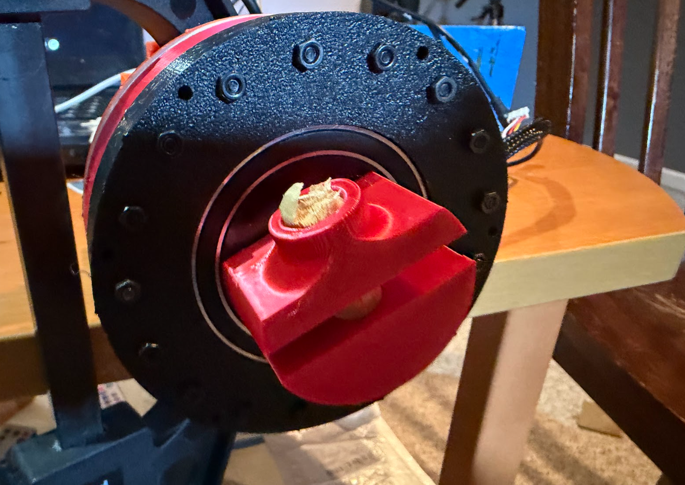

How much torque did I get out of that?

I was actually very happy with my results. I did indeed lubricate my cyclodial drive with white lithium grease.

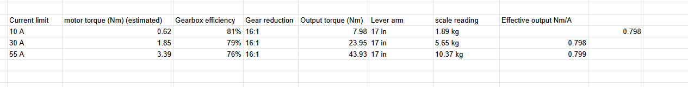

As you can see, i was able to achieve 43.39 NM of torque before it broke, you can see it bending in this pic:

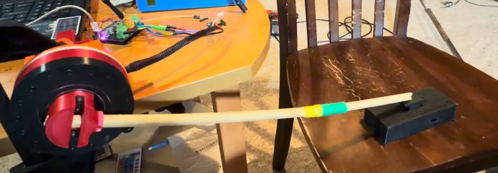.

This torque was at 55A of current, and I had and based on my direct drive torque results, that was an efficiency of 81% So lets say I pushed 100A through the motor, and chose an efficiency of 75%, I would be getting: 68.86 NM of torque based on my calculation from the estimated efficiency. And lets say I did a 150A burst which is what many actuators do to get much higher torque, I would be getting maybe 90NM! Thats literally 180 NM combined, which is amazing. This is perfect for my humanoid ankle assembly.

Backlash was OK, it wasn't as low as I had expected but I think it could be fixed by using higher diameter output pins. If I tried backdriving it directly from the output shaft it was hard on my fingers but when I attached the level arm and backdrove it from there it wasn't that hard. The problem is, this gearbox is way to big. The width of it is manageable to put in a humanoid calve, but the length definitely isn't. Tomorrow, I'll design a much smaller gearbox capable of fitting in a humanoid calve area. Currently, its length was around 135MM, which is 5.3 inches, and the diameter is 120MM. I want to shrink this to 100mm, or 3.9 inches, which is much better, and also try shrinking the diameter to 100MM. Based on my estimate of how well these plastic parts hold up, I wont switch to CNC steel until one of my plastic parts break and i'll switch that one out because CNC is a lot more expensive.

For a first prototype I was proud of the results.

**Total time spent: 5.3h**

# 2026-07-09: Building ankle cad assembly

Date: 2026-07-09 (Jul 9, 2026, 8:57 PM)

Right now I wanted to complete how my ankle will look like. Here is what I had so far:

Both these images show how I made my bearing setup. I chose 608 bearings because they were extremely cheap and were strong enough. Most 608 bearings can handle 1.37kN static to 3.3kN dynamic (while moving). This is enough, as I had 2 for each axis, and I can upgrade to 4 if needed but, 2 will be more than enough, so 2.6k newton and 6.6k newton static not moving and dynamic while moving capacity. On a normal 100 lb human ankle, 222N is loaded on the ankles when standing on one feet. Walking puts 500+ N on one ankle, and running puts over a 1000. Jumping puts up to 3k. 608 bearings will work fantastic for my ankles. Now, 8mm wide steel rods will also work (the ID size of a 608 bearing), as my load is spread evenly around a long center distance and they can withstands thousands of pounds of load at that 80MM length I have them cadded to be.

I have cadded mounts for 2 23x23 mm sized encoders, currently i'm using a AS5600 but i'll probably use much more robust 14-bit MT6818 or AS5047P encoders as they are better at handling misalignment. The encoders is the reason I chose this bearing setup instead of ball bearings as I can better measure both of my axis with this. I have a pulley to measure my pitch axis, and the other roll axis is being measured directly. The pulley system is not robust and I plan on rotating the bearing assembly 90 degrees and having a encoder mount the same way I did for the ankle roll. For my differential linkages i'm using ball bearings though. This is my first prototype, but I plan to bring the assembly back to the heel a little bit motor. To map out the motion before actually cadding it though, I used motiongen which was helpful in helping me find max angles of my roll and pitch. I targeted angles of +/- 35 degrees for my pitch and +/- 20 degrees for my roll. This is similar to a real human.

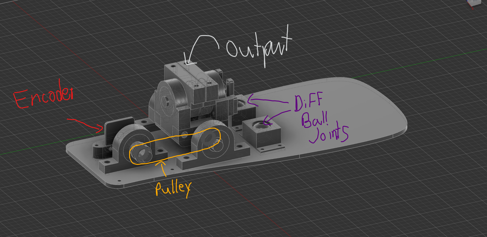

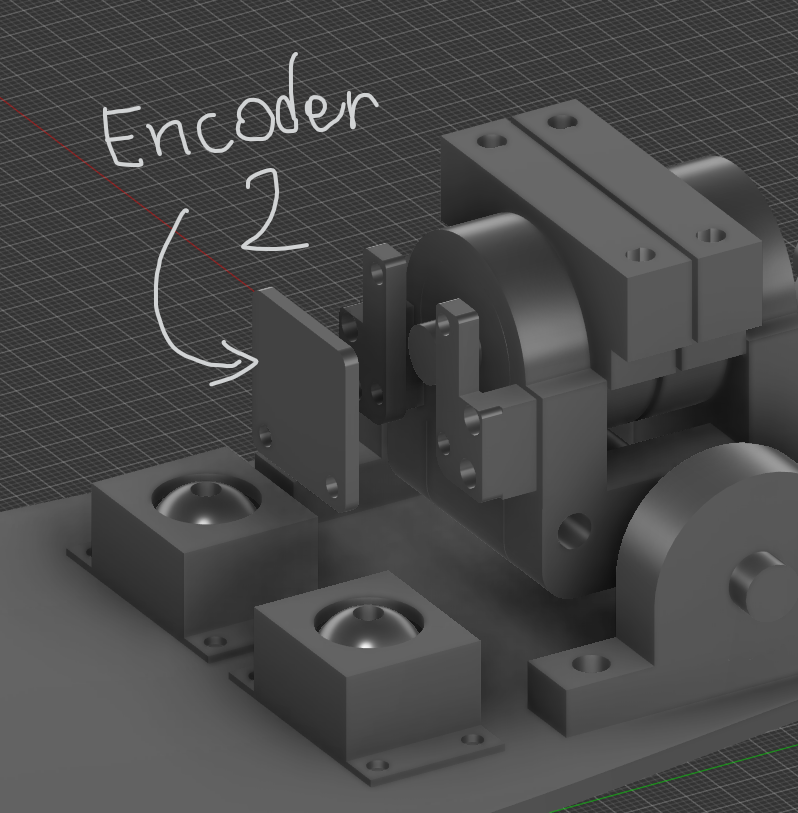

Those are pictures of my cad.

Now here is what I did in motiongen, where I had an angle from where I moved my ankle roll axis. I am new to motiongen and need to learn it better so I can try simulating my 2 actuators in the calves interacting with the differential system for the roll.

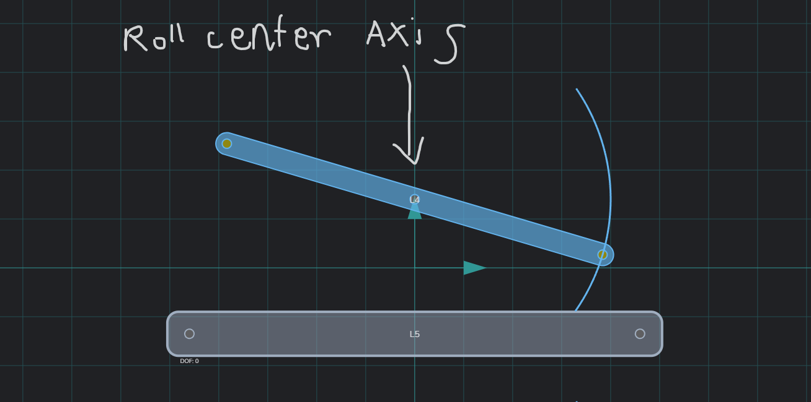

Motiongen was crucial for analyzing the movements of my robot and building accordingly.

After spending some time learning motion gen, I was able to create this masterpiece:

This demonstrates the roll mechanism motion of my setup.

The same mechanism could also kind of be interpreted to be pitch control, the only difference being that the rods should be one, not that they are actually one, but are overlapping so in the 2d image you can't really see them individually: 

I had also printed the finish build on my ankle assembly to see how it performed IRL, I spent some time building it:

**Total time spent: 7h**

# 2026-07-10: Shin design

Date: 2026-07-10 (Jul 10, 2026, 8:22 PM)

I was designing the shin part of my robot, integrating the cyclodial actuators I made into my design:

To control my motors, I was going to use these controllers compactly placed on the back of my shin area, where they could easily be water cooled, but air cooling would be enough:

**This odrive 3.6 dual axis clone was a STEAL. It was 35 dollars of off bang good and could power 2 motors at 150A.**

For the shin i designed, I looked into CNCing it and it was 300, which is kind of a lot considering the fact i could use much cheaper steel struts as a rigid frame for my shin

I was thinking of using these, which are strong and sturdy for my shin with a custom CNC attachment that connects them to my ankle

But currently, I needed to research different motors, because my current C6734 motor was too heavy to fit in a humanoid's ankles. I researched into other robots, like the asimov robot and found out it used these motors that provided 36nm of peak torque, and had a stator much weaker than the current 6374 motor I was using, although their robot was also under 4 foot (it was 3 foot 11). I was targetting mine to be 5 foot and 35kg or less.

This is the github to their open source robot:

[https://github.com/asimovinc/asimov-v0/tree/main](https://github.com/asimovinc/asimov-v0/tree/main)

Thanks to their robot, I was able to learn more about what actuators I should use and how much they should weigh.

Their differential linkage system used a RSU type linkage where the ratio was reduced 2 times in the linkage so effectively they had 2x pitch torque and 0.8x roll torque, which would be 150NM pitch torque which is kind of more than my C6734 motors which were aimed at around 140NM torque. Considering the fact that their motor's torque size is way smaller than mine, and way lighter, I needed a better setup. My current c6734 motors were too beefy. Not only that, the reason why the torque was not as high is because I was targetting what the MIT cheetah robot did, a quasi-direct-drive setup where the ratio is less then 10 (well currently it was 16 but I want to maximize backdrivability). So I needed to abandon that as I didn't have enough resources to make a QDD actuator that is small has has enough torque for the ankles. I was now going to choose a much higher gear ratio. The ASIMOV robot had very little rpm though due to the fact that they choose to reduce their ankle rpm to get that 150NM, their current ankle movement capability is less than what a human typically uses during dyanmic movements. I wanted a motor that could move fast enough (over 70+rpm at the ankles based on what i'd found from research on human ankle speed). So it was time to look for new motors.

I haven't even finished the shin part yet, but I needed a rough estimate of how long my robot will be, how much it will weigh, and where that weight will be at. So I chose to draw a quick sketch of what I think I want it to look like in the future, I'll build bottom-up, going to my knees next and then 3 DOF hip motors.

This is because I wanted to get my design in the simulator and simulator it before to test different torque levels and weights:

[https://github.com/isaac-sim/IsaacSim](https://github.com/isaac-sim/IsaacSim)

I was gonna be using Nvidia ISAAC sim to simulate my robot. To do that, I'll need to utilize a fusion360 extension that exports my robot as a UDRP file which Isaac sim accepts for physics simulations. The thing is I haven't even modeled any joints yet, and I need to learn how to simulator motion in fusion360 first. I did learn how to do it in motionGen though.

Also, overnight I had left all my ankle parts to print. here is how it came out when I assembled it:

**Total time spent: 4.4h**

# 2026-07-10: More research

Date: 2026-07-10 (Jul 10, 2026, 10:58 PM)

I had a better idea on what to do for my calves area now. Based on the placement of my differential linkages, I could add another gear ratio, based on the distance of my crank arm that converts the radial motion into linear and the distance of my ball bearing on the foot of my joint that converts that linear motion back into radial. I could manipulate these distances to get a higher ratio to increase my torque. This research paper showed me the different possibilities and orientations to make such a mechanism:

A differential mechanism like this is what most robots- asimov, unitree, boston dyanmics used to control their ankles if they had 2-dof ankles as it places the weight of the motors in the calves reducing the inertia. Currently, I was thinking of getting these 8318 motors instead of the C6374 motors. Why? Beacuse they were 100KV, meaning they provided more torque than my 170kv c6374 motor and their torque constant was much better. Not only that, they were pancake style motors, and their length was almost half that of my C6374 motors.

They were a fair price (+40 shipping) 

But the problem was that they weighed around 700 grams. This was less than what my currently used C6374 weighed, but this was more than the weight of the entire gearbox assembly that other robots used. I could achieve the QDD backdriveable design while maintaining high torque with this motor though. If I over current the motor by pushing 1.5x its limit, possible going up to 100 amps, I can maybe get 8.5NM out of it, which is 85nm with a 10 gear reduction which qualifies my motor to be highly backdriveable, this motor was going to interfere with my design assembly. I chose to look at the 8308 motor instead. This motor was a thinner sibling, it was half the length of the 8308 and was commonly used in robotics but had barely any documentation. It provided much less torque and I had to come up with an estimate on how much torque it could provide because online figures were too varying and unreliable. From a listing, I estimated the max rated current for the motor to be at around 33A for the 90kv model. With my calculations for how much torque per amp the motor could provide, I estimated I could get 3NM if I pushed it to 45A, and above 4 if I did 60A+. If I used a 20 reduction gaerbox, I could get 80+NM. I had given up on trying to make the actuator backdrivable though as the enrgy losses were too much and I couldn't find other humanoids online doing that (the asimov used a 36 gear reduction). So the 8308 motor would work, as it was thinner but more expensive thant he 8318.

Researching into different motors, though, I came across the 6007 motor. This motor was much smaller than that 8308 motor and half its weight, but provided much less torque and there was barely any documentation on its torque ratings. Based on its KV, I calculated that if I pushed 50A through the 160KV variant, I could get 2.5NM, maybe 3NM of torque for short bursts. This, if combined with a 30 reduction cyclodial gear, I could get 80+NM of torque. The problem which this was that designing the cyclodial gear for this would be much harder. Cyclodial gears aren't easy to design when they are small due to the fact that they use roller pins to reduce efficiency and those pins take up space. Currently I was using a M3 screw + aluminum bushing to act as my rollers, and they worked pretty well, but took up a lot of space. This was only with a 16 reduction. Pushing my reduction to 36 will cost me a lot more pins and I will have to make them smaller, and that would reduce their ability to roll and reduce their efficiency. Instead, to maximize on space, I was going to use was NASA used in their cyclodial gears.

This is what NASA did, they used steel dowels but instead of having 2 small bearings on each dowel they mounted them loose so they could spin. This introduced backlash though and it wasn't something that could be easily repeated by me with a bench-CNC.

Designing a cyclodial gearbox this small was going to be hard and time consuming, and I did look into planetary gearboxes, and I found a good option. MJBots sold a planetary gear 6:1 gear set, which I can stack to get a double stage 36 reduction. It was also around the size I was targetting. 

not only that, it was targetted to being used with the 8308 motors. The problem with it was that if I wanted to get the ratio I wanted, I needed to compound the gears, and compounding that sun gear would make the geabox a little thick. That sun gear was pretty long. Its inner diameter for the input shaft is also small and might break if I used the output from my first stage planetary setup to drive it. I didn't know if the 2nd stage could even handle the torque as the steel gears were only 0.5mm module.

**Total time spent: 3h**

# 2026-07-11: Research

Date: 2026-07-11 (Jul 11, 2026, 5:12 PM)

So I was heavily conflicted on what motor choice to choose, and I needed to get a better hold on my variables and know what specs I needed exactly. From my current CAD design, I know:

My foot is approximately 243 mm long, with the ankle axis about 70 mm ahead of the heel. Therefore, the maximum distance from the ankle to the toe is 0.173 M.

My original robot concept was 5 foot 6 inch, but I need to make a few sacrifices and do 5 foot instead. This scale fact is a 0.909 scale. Joint torque scales using this formul: τ∝mgL∝L4. Based on the scale values, this shorter height would be equal to: 40(0.751)≈30 kg from 40kg. This is a better, easier, and cheaper number to work with considering energy needed for bipedals scale to the fourth power (exponential) as height increases. This would make me require only about 70 percent power compared to 5 foot 6 inches. If I assume the robot weight to be 35 kg, and multiply that by gravity I get 343.33 N force. The pitch torque at the ankle from ground force is: τankle​=Fz​dCoP​ (Thanks to AP physics I can do this). So pasted on different center pressures of the ankle, (100m, 125mm, 173mm toe edge) I'd need torque from 34.3nm to 59.4nm. Scaled to 2.5x body weight, that would be at max 148.5NM.

So with fixing these variables down, the earlier 120NM pitch force for my ankles was a little low. Its only about twice the body weight. The asimov robot had theirs around 2.5 the body weight, but theirs was slow. I needed to tarket 2.5 the body weight, with peaks pushing to 150NM+ for ankle pitch. Ankle roll could suffice with much lower values.

Now from the research in the previous journal, I found out using the linear linkages I could gear down my ankles. This are the differential ankle equations that dictate the linear motion passed down to the ankles:

τp​=Kp​ηl​(τ1​+τ2​) τr​=Kr​ηl​(τ1​−τ2​)

t1/t2 are both the actuators, kP is the linkae pitch and kr is the linkage roll. The N like character is the linkage efficiency. For pitch they add, for roll they don't. So the combined ankle torque would only be available in pitch, which is perfectly fine and expected. You can't get the peak pitch and roll torque compounded at the same time, thats like defying energy rules.

Now I had to calculate how much RPM I needed the motors to spin BEFORE the linear linkage reduction. I was going to base my comparison on the walking ankle movement of a normal human this size. I found out normal human ankle pitch values to be around 30 degrees. Thats 0.524 rads, and if you want to cover that in 0.2 seconds, you need 50RPM. Thanks to my handy AP physics equations I could solve this ωpeak​≈t2Δθ​.

If I wanted to do it in 0.15 seconds that would be 67 rpm. So a motor that provided a well margin like 85+ rpm would be good. For my knees, based on this data, I had estimated I would want torque values of 175+NM. Now, a 6007 160kv motor, if overwhelmed with current, could give this paired with a gearbox good enough, but I am across a commercial motor company that offered a pre-built actuator (steady win) with a slightly stronger stator (6010 instead of 6007 meaning more torque) and torque/rpm values that were exactly what I needed. Not only that, they were around the same price I'd spend if I made my own actuator gearbox, as the individual planetary gearsets, bearings, steel pins and custom CNC casings would add up to a lot. This steadywin 6010 motor was smaller, had enough torque, and barely met the rpm requirement I was looking for. It had enough torque that I could use the linear linkages to trade the torque for speed though:

With these new motors, I had eliminated the hassle of spending months building my own gearbox and could focus on the humanoid part more. The steel struts I had integrated was a rough sketch currently, I was thinking of using stacked 20 guage steel plates instead to form a frame but these new dimensions gave me much more flexibility on making a frame.

**Total time spent: 3.1h**

# 2026-07-12: Learning simulating joints in fusion360

Date: 2026-07-12 (Jul 12, 2026, 11:42 PM)

To make the virtual physics ISAACLAB work and simulate my robot I needed to have motion worked out which I didn't know how to do yet, so I needed to learn how to do it in fusion360 using joints and components. I watched this youtube playlist and implemented practice in fusion:

[https://www.youtube.com/watch?v=gGgmA1WZESs&list=PLHEouj-sdEJEdDfqwsiKI2izfYUGHi\_Mu](https://www.youtube.com/watch?v=gGgmA1WZESs&list=PLHEouj-sdEJEdDfqwsiKI2izfYUGHi_Mu)

Created ball joint here:

**Total time spent: 1.2h**

# 2026-07-13: Re-designing foot CAD

Date: 2026-07-13 (Jul 13, 2026, 10:20 PM)

The current implementation of my foot was CAD that was good but not good enough. Encoder placements were awkward, it was kind of over engineered, and expensive to CNC. I will try using standard parts that are cheaper. Today, I spent the whole day cadding. I made big decision change. At first, I was designing for two actuators per calf, but now I made a heavy engineering decision to switch to one. I had redesigned my entire foot, thinking over it multiple times, as the current implementation was complex and required 4 axis CNC.

This is my V2 of the foot:

It may look like its less than the old version, but it actually is simpler and much more robust. The encoder goes directly on the joints. I swapped out my complex CNC favored 3/8 inch split axis holders for a single piece that I will 3d print. I calculated that decision as found that a 3d printed piece will work just as fine as long as I use engineering grade NA-CF filament with full infill. This made my build significantly cheaper. Not only that, I researched and found bearing pillows I can use for this which are much stronger and cheaper. I spent a while designing this setup, where ZERO cnc was required. Also, on my foot, I added a bed layer below it that screwed onto my bearings and encoders, giving it a rigid base. That small base then screwed onto my actual footplate which made the whole thing a lot more rigid, stronger, and made it easier to change my foot geometry.

As you can see, I have used cheap 1 inch square aluminum tubing with a full infill 3d printed attachment, and a huge 3d printed holder that incases both my motors and is strong enough to support it.

I designed everything so it could be 3d printed smoothly: 

But then I came into a limitation:

If I wanted to make it as cheap as possible, I couldn't rely on many machined parts, and this 2nd motor was adding weight, creating more break points, it was expensive, required an additional motor driver and setup, and removing it would remove an entire joint and a lot of jacobian math, and I felt like this would make my job a lot easier. Previously, many robots have walked in 3d environments without powered ankles at all, so this is something thats totally possible.

So now, I had to abandon this cad after realizing how complex it was to a cleaner 1-DOF version. If I had access to CNC tools, I would've definitely gone with the 2DOF layout.

**Total time spent: 7h**

# 2026-07-14: 3rd iteration

Date: 2026-07-14 (Jul 14, 2026, 9:40 PM)

Today i'd make the 3rd iteration of my cad. I hoped this would be the last version and be the most robust one. After research and calculation I found the exact dimensions I needed my crank arm to be.

I also found a much more robust encoder MT6835 with AMR tech that supports some magnet misaslignment, it took me a while to find its dimensions so ill put it here incase i forget:

Today was a very proud moment for me, where I learned how to add motion to my joints!

As you can see I have added motion to my pitch control for my ankle. This now expanded my horizons even more, as now I was able to calculate exactly how much fillets I should make to the base so my base can move 25 degrees forwards/backwards without interfering and colliding with the material underneath as you can see here:

As you can see the base didnt collide with the fillet and i knew exactly what values to use

Every prototype I made improved from the last one, I hoped this one was my final one and I could settle on a good design to design the rest of my robot off of.

**Total time spent: 2.7h**

# 2026-07-15: Finishing Ankle CAD, making documentation (SOURCE cad+schematic in github).

Date: 2026-07-15 (Jul 15, 2026, 1:07 PM)

After days of cadding, I think I was finished with my ankle cad. I had everything I needed and had cadded the jounts for my knee attachment, so the ankle/shin part of my robot was done and I should probably build it IRL to see if the pitch works

I used a ball screw with an m4 nut which according to my calculations can handle up to 6K newtons with carbon steel nuts and I need <3k.

The system here is basically a reciprocating system but I have maxed out the torque and added a 2nd reduction from my linear system, of about 1.2:1 meaning my torque increases by 20 percent. I achieved this be having a 50 mm long crank arm and a 40 mm long length from the hinge. Although this leg looks ugly that can easily be fixed by lightweight 3d printed covers. And to minimize CNC, I am using off the shelve aluminum tubes and a ton of high infill NA-CF plastic to make a rigid joint.

Now it was time to make a grant and wait until I can build my lower leg.

Since I had switched to 1 motor instead of 2, I was using a different odrive, although it was the same price as the 2 axis one:

These are screenshots of the items I put in my grant:

**Total time spent: 3.5h**

# 2026-08-03: Fixing documentation

Date: 2026-08-03 (Aug 3, 2026, 10:23 PM)

In needed to add my GitHub cad, and source cad for each of my assemblies and parts. I fixed the documentation by adding a readme and fixing project title/description

**Total time spent: 1h**

# 2026-08-03: Making a schematic

Date: 2026-08-03 (Aug 3, 2026, 10:30 PM)

I did not have a production level PCB that I built for this project yet, though I will be doing that later to build an FOC controller, currently I was using off the shelve PCBs so I could only build a schematic of their connection.

**Total time spent: 1h**

# 2026-08-04: CAD Proof (GIFS of fusion timeline)

Date: 2026-08-04 (Aug 4, 2026, 10:52 PM)

Before I submit I wanted to my fusion timelines as timelapse GIFs in order to validate my source cad:

**Total time spent: 0.2h**

# 2026-08-05: Important note to reviewers

Date: 2026-08-05 (Aug 5, 2026, 2:17 PM)

Ok, so I have submitted my robot for review in macondo but a whole month has passed and I honestly want to work on it and don't want to let the long review process stop me from working on it.

My project is basically a whole humanoid robot but the project would take a long time and Macondo wasn't going to last that long time, so instead I limited my project's scopes to just the legs of the bipedal robot which I would ship in Macondo, which all the journals below covered.

(In the long run my design never got approved, it got imported to forge)

Overview on the journals below:

The journals below progressed from me building the ankle, to then building a suitable actuator for my ankles, which turned out to be too big so I am not going to use it. In my final design I utilize a commercial actuator with a odrive motor controller.

What the journals above are:

It had been a month since I last worked on this project and I had new cad and design skills, I was going to shift my design approach and instead build a mock-up of a 5 foot robot and test it in ISAAC-lab first, and then design my actual robot around that mockup and its actuator specs/limits.

**Total time spent: 0.05h**

# 2026-08-25: Learning how to simulate the robot

Date: 2026-08-25 (Aug 25, 2026, 1:39 PM)

I realized the development process was flawed. I was designing from the ground up, letting my actuator size dictate my robot's shape and mass, but first, I needed to overcome a major skill gap: simulating the robot's movements digitally.

This was crucial, and I realized I needed to first learn physics simulators targeted toward training robot neural networks.

This was going to take a long time, so I first started by downloading Isaac Lab.

After a while of terminal stuff and reading guides, I had gotten the GUI to work.

Luckily, this simulator had robots like the Unitree G1 and the H1 already preloaded. They were two very good examples for getting a grasp on my own robot's motor architecture.

But the sim kept crashing when I tried to run them. Here's a picture below:

Sadly, the minimum specs for Isaac Lab were 16 GB of VRAM and 64 GB of RAM. The recommended GPU was an RTX 4080. I only had an 8 GB RTX 4060. Yeah, this was sad, but I read in a forum that light training and visualization could be done. To train my actual robot, I'll probably use cloud compute, but after a while, I got it working:

As you can see, there are many H1 robots in this picture.

**Total time spent: 1.5h**

# 2026-08-26: Learning Isaac Lab, playing with H1 and G1 robots

Date: 2026-08-26 (Aug 26, 2026, 4:34 PM)

I had spent a lot of time today training and testing these H1 and G1 robots. This was directly helping me understand how to use Isaac Lab for my own robot.

So, my development process was going to be:

Get the joint torques of the H1 and G1 robots. My robot's estimated load will be known after I train it, but it will be somewhere between the G1's and H1's load capacities, as the G1 is shorter than what I'm building and the H1 is taller.

I will test those robots in different scenarios: walking, running, pushing, shoving, going up stairs, and falling, and measure the torque values.

First, I made and used Python scripts that log the joint torque as a CSV.

In the screenshot, you can see all the data I had collected from one hour of pushing, shoving, and walking at different speeds, taking up over 100 MB.

How did I test the robot? Well, I tested it by applying 0.15-second pushes from 25 to 400 newtons in four directions. I also tested the Unitree H1 with a leftward push sweep, and that robot, though taller, actually withstood much more force, recovering from up to 600 newtons. I think its training policy was better suited for recovery, though.

This is the dashboard I used to evaluate the torque it was consuming at different physical positions and states.

I also learned about how the PD controller interacts with the motors. For the G1, the ankle pitch torque limit was 20 Nm. This is extremely low, much lower than my budget of 140 Nm. But the robot was able to walk with it. When it was pushed, though, it demanded up to 85 Nm of torque. Also, the knees and hip pitch demanded an impossible 300 Nm and roughly 279 Nm. This was much more than what they were rated for, but it was just the training policy. The Unitree G1 was literally being shoved so hard that it started shaking on the ground after falling instantly. The torque requests were tremendously high. Here are two GIFs with parallel visuals of the robots and the data statistics:

This was useful and helped me get a grasp on how much torque I'll need for my robot.

**Total time spent: 2h**

# 2026-08-29: Training my own robot in Isaac Lab

Date: 2026-08-29 (Aug 29, 2026)

Today was exciting because I made my own CAD model for a robot. I spent a lot of my time learning how to create and configure joints in Fusion 360, and then ran training simulations and tested the model in Isaac Lab.

Here is a GIF of me building my quadruped. I chose a quadruped instead of a humanoid because this was a practice learning session where I first wanted to see whether I could get a robot trained. A quadruped was easier than making all the joints for a humanoid robot, which I plan to work on tomorrow.

As shown in the recording, I learned how to create an assembly and add revolute joints. I also added mass properties to every body, which was crucial for the simulation. I estimated the masses by comparing the design with real quadrupeds. The normal robot's modeled mass was **22.8 kg**.

Adding a payload

I added a **5 kg payload** to test whether the robot could still run while carrying a load. This brought the simulated robot's total mass to **27.8 kg**.

The property panel in this Fusion screenshot shows a geometry-and-material calculation for the selected solid. The authoritative payload used in Isaac Lab was the 5 kg mass defined in the URDF model, not Fusion's temporary steel-derived value.

I watched this YouTube playlist to learn how to simulate and configure the joints: [Fusion 360 joint simulation playlist](https://www.youtube.com/watch?v=gGgmA1WZESs&list=PLHEouj-sdEJEdDfqwsiKI2izfYUGHi_Mu).

Moving the model into Isaac Lab

Next, it was time to export the model as a **URDF** for Isaac Lab. I converted the model to URDF, generated the USD asset used by Isaac Sim, and added it to my custom Isaac Lab task.

Before training, I had to specify the motors' actuator capabilities, velocity limits, friction, damping, and reflected inertia. I chose behavior similar to a BLDC actuator with a 20:1 planetary reduction instead of the low-reduction QDD actuators used on robots such as the MIT Cheetah.

Robot and actuator specifications

| Specification | Hip abduction joints | Hip flexion and knee joints |
| --- | --- | --- |
| Gear reduction | 20:1 | 20:1 |
| Continuous output torque | 12 N·m | 18 N·m |
| Command torque limit | 45 N·m | 55 N·m |
| Short saturation torque | 50 N·m | 60 N·m |
| Command velocity limit | 18 rad/s | 18 rad/s |
| Simulation velocity ceiling | 22 rad/s | 22 rad/s |
| Reflected armature | 0.035 kg·m² | 0.045 kg·m² |
| Position stiffness | 45 N·m/rad | 55 N·m/rad |
| Velocity damping | 2.5 N·m·s/rad | 3.0 N·m·s/rad |
| Static / dynamic friction | 0.70 / 0.50 N·m | 0.80 / 0.55 N·m |
| Viscous friction | 0.030 N·m·s/rad | 0.035 N·m·s/rad |

The actuator model also included a four-second thermal time constant, a zero-to-one-step command delay, torque-speed limiting, and a simple thermal budget that limited how long peak torque could be used.

How I trained it

I used curriculum learning, where each policy started from a skill learned in an earlier stage:

1.  First, I taught the robot to stand.
2.  Then, I taught it to walk after it knew how to stand.
3.  Next came running.
4.  I trained it to run with the 5 kg payload.
5.  Then came jumping.
6.  Finally, I attempted a backflip.

For standing, the reward system encouraged the base to remain around 0.47 m high, stay level, keep its horizontal and angular velocity near zero, and remain close to the nominal joint pose. It also penalized excessive joint speed, torque, large or rapidly changing actions, and contacts made by anything other than the feet.

For walking, the policy was rewarded for matching commanded forward, sideways, and turning velocities. A foot-air-time reward encouraged an actual stepping gait, while the standing stability and smoothness terms remained active. For running, the commanded forward speed range increased to 0.60–1.60 m/s, velocity tracking and foot air time became more important, and some motion penalties were relaxed so that the robot could use a faster gait.

Running with the 5 kg payload used the same type of reward system, but the extra body and its inertia were attached throughout training. The forward command range was 0.50–1.40 m/s.

For jumping, a three-second phase clock defined when the robot should crouch, rise, become airborne, and land. The policy received rewards for following a target body-height curve and vertical-velocity curve, getting all four feet off the ground during the airborne phase, staying approximately upright and in place, and landing on its feet. Torque and rapidly changing actions were still penalized.

For the backflip attempt, I retained the jump and landing objectives and added a time-varying pitch-orientation target plus a target backward pitch rate of about -9.5 rad/s during the rotation phase. These were rewards rather than strict requirements, which became important when I reviewed the result.

Training scale

My testing session lasted about **4 hours**. I ran **2,048 robots in parallel**. The final column below shows the number of parallel environment-iterations, not individual physics timesteps.

| Training session | Parallel environment-iterations |
| --- | --- |
| Standing | 819,200 |
| Walking | 2,662,400 |
| Running | 3,276,800 |
| Running with 5 kg payload | 1,638,400 |
| Jumping | 4,300,800 |
| Backflip attempt | 5,734,400 |
| Total | 18,432,000 |

I have an RTX 4060 with 8 GB of VRAM, while the setup guidance I was following recommended 16 GB. I was worried that my GPU would not be strong enough, but at 2,048 parallel robots the training used only about 4 GB of VRAM. From that test, I estimated that 8,192 robots might fit with roughly 1 GB left. I would still increase the count gradually and verify VRAM and training throughput, because memory use does not always scale perfectly linearly.

Results

Standing

Walking

Running

Jumping

The jump was not very clean. The robot moved its legs unnaturally, and near the end some of the legs clipped slightly before the episode reset. The movement was a result of the reward system allowing any motion that achieved enough height, air time, and landing score. I could make future jumps more natural by rewarding symmetry and coordinated joint trajectories, penalizing self-collision and unnecessary foot motion, or adding mechanical-energy and peak-power costs. An energy reward alone would not guarantee a natural jump, but it could reduce some inefficient erratic motion when combined with posture and landing terms.

For the backflip, the result was essentially the same as the jump. At first I was confused about why the robot did not rotate. I realized that it had found a loophole in my reward system: completing a full rotation was difficult, but it could still collect many points from jumping high, following the vertical phase, becoming airborne, and landing. The orientation and pitch-rate rewards were not strong gates that required a completed 360-degree rotation.

This was a great lesson for when I train my humanoid in the future. A better backflip task should track unwrapped accumulated pitch rotation, gate the height and landing rewards behind rotation milestones, require approximately one full rotation before touchdown, and penalize incomplete or repeated hops.

**Total time spent: 6h**

# 2026-08-29: Making a rough humanoid robot mock-up

Date: 2026-08-29 (Aug 29, 2026, 8:30 PM)

Today, I spent the whole day making a rough mock-up sketch of a humanoid robot that is 5 feet tall, using a 1:15 differential joint for the knees.

This wasn't easy. Although I was replicating a human who is 5 feet tall, I needed their dimensions and needed to know how their joints move. The trickiest part was making the Jacobian-style differential system.

I used resources such as [this NASA report](https://ntrs.nasa.gov/archive/nasa/casi.ntrs.nasa.gov/19790005540.pdf) and [this CDC report](https://stacks.cdc.gov/view/cdc/206117/cdc_206117_DS1.pdf) because they were reliable places to find human joint specifications.

From there, I decided to worry about the motor mass and full-body mass after building the entire robot.

Here is a GIF of me working on the robot's CAD:

Here is a table of the proportions:

| Landmark | Previous | Updated |
| --- | --- | --- |
| Ankle axis | 80 mm | 80 mm |
| Knee axis | 400 mm | 450 mm |
| Hip-pitch axis | 680 mm | 805 mm |
| Shoulder axis | 1,185 mm | 1,245 mm |
| Head top | 1,524 mm | 1,524 mm |
| Thigh length | 280 mm | 355 mm |
| Shank length | 320 mm | 370 mm |
| Neck link | 160 mm | 85 mm |
| Head height | 164 mm | 184 mm |

As you can see, I had made the joints on that. Now, I had to convert it to URDF, and then USD for Isaac Lab, and actually test if the joints work in Isaac Lab. I made a script that makes each joint move, and indeed they work:

I was going to leave the robot training overnight. I was going to train it to stand, walk, run, and run at high speeds of 4 m/s. I was also going to train it to get up from a lying position.

In the CAD, I hadn't copied the exact masses of a 5-foot human. I chose 39 kg, which is a good estimate for the whole body, a little bit heavier than the Unitree G1 but lighter than the H1, and its height fits perfectly. I made each joint around 80% of an actual human joint's weight, though I was going to change it after picking my motors. For my motors, I found the cheapest motor brand, Steadywin, and started looking at its motor datasheets. I had already decided what motors I was going to use for the ankles previously, so that stayed.

So here is a table of what motors I was thinking of using. I added a boost factor, as I would probably be using my own custom motor driver to push higher current through the motors:

| Joint | Motor/transmission | Continuous torque | Stock peak | 25%-boosted peak / Isaac limit |
| --- | --- | --- | --- | --- |
| Hip yaw | GIM8115-9 | 15.27 Nm | 54.55 Nm | 68.19 Nm |
| Hip roll | GIM8108-36 | 25.00 Nm | 130.20 Nm | 162.75 Nm |
| Hip pitch | 2× GIM8108-8 high-speed, 2:1 chain | 26.84 Nm | 92.36 Nm | 115.45 Nm |
| Knee pitch | 2× GIM8108-8 high-speed, 2:1 chain | 26.84 Nm | 92.36 Nm | 115.45 Nm |
| Ankle pitch | 2× GIM6010-36 differential, 1.15 linkage | 40.48 Nm | 120.70 Nm | 150.88 Nm |
| Ankle roll | Same coupled differential | 40.48 Nm | 120.70 Nm | 150.88 Nm |
| Waist yaw | GIM8115-9 | 15.27 Nm | 54.55 Nm | 68.19 Nm |
| Waist pitch | GIM8115-9 | 15.27 Nm | 54.55 Nm | 68.19 Nm |
| Shoulder pitch | GIM8108-9 | 8.19 Nm | 27.38 Nm | 34.23 Nm |
| Shoulder roll | GIM8108-9 | 8.19 Nm | 27.38 Nm | 34.23 Nm |
| Elbow pitch | GIM8108-8 high-speed | 6.71 Nm | 23.09 Nm | 28.86 Nm |
| Head yaw | GIM4310-10 | 1.63 Nm | 7.98 Nm | 9.98 Nm |
| Head pitch | GIM4310-10 | 1.63 Nm | 7.98 Nm | 9.98 Nm |

I felt like the torque from the motors for the hip pitch and knee was too low. So I updated them to custom actuators:

| Custom actuator | Continuous | Peak |
| --- | --- | --- |
| Hip pitch | 60 Nm | 226.8 Nm |
| Knee pitch | 65 Nm | 243 Nm |
| Hip roll | 35 Nm | 132.25 Nm |

This was to account for the acceleration forces when moving and getting up.

After looking at and adding up the masses of these motors, my estimated mass of 39 kg still held up, so I didn't change it. I also factored the inertia of these gearboxes into the sim.

Now, to train it, I'm going to utilize my full RTX 4060 and its tiny 8 GB of VRAM and run 8,192 parallel robots. This is actually a lot; I didn't know my GPU could do this much. I'm impressed. Actually, it can do even more, as it only uses around 6.5 GB of VRAM at this scale, possibly 12,000 robots.

For training, my reward system utilized these rewards for standing:

| Term | Weight | Purpose |
| --- | --- | --- |
| Alive | +0.5 | Reward every surviving step |
| Upright | +3.5 | Keep gravity aligned with the torso’s vertical axis |
| Height | +2.5 | Track a base height of 0.84 m |
| Both feet supporting | +1.5 | Prefer stable two-foot support |
| Planar stillness | +1.0 | Keep horizontal velocity near zero |
| Failure termination | −200.0 | Strong penalty for falling |
| Vertical velocity | −1.0 | Prevent bouncing |
| Roll/pitch angular velocity | −0.10 | Reduce torso rocking |
| Upper-body posture | −0.10 | Keep waist, arms, and head near neutral |
| Lateral leg posture | −0.10 | Avoid excessive hip/ankle roll |
| Left/right asymmetry | −0.12 | Encourage a symmetric stance |
| Torque squared | −1e-6 | Reduce excessive actuator torque |
| Joint acceleration | −2e-7 | Reduce vibration |
| Action-rate change | −0.01 | Prevent rapidly changing commands |
| Joint-limit use | −1.0 | Avoid extreme joint positions |
| Foot sliding | −0.30 | Prevent feet sliding on the ground |
| Non-foot contact | −1.0 | Penalize other body parts touching |
| Ankle differential violation | −2.0 | Keep ankle motor sums/differences feasible |

These rewards for walking:

| Walking-specific term | Weight |
| --- | --- |
| Gated velocity tracking | +4.0 |
| Yaw-rate tracking | +1.5 |
| Swing-foot air time | +0.5 |
| Vertical velocity | −0.50 |
| Lateral velocity | −0.75 |
| Foot sliding | −0.25 |
| Joint power | −1e-5 |

These rewards for running:

| Running term | Weight |
| --- | --- |
| Gated velocity tracking | +5.0 |
| Yaw-rate tracking | +1.5 |
| Swing-foot air time | +0.8 |
| Upright | +3.5 |
| Height, target 0.81 m | +1.0 |
| Vertical velocity | −0.15 |
| Lateral velocity | −0.75 |
| Roll/pitch angular velocity | −0.10 |
| Torque squared | −7.5e-7 |
| Action-rate change | −0.006 |
| Joint acceleration | −2e-7 |
| Joint power | −1e-5 |
| Foot sliding | −0.25 |
| Non-foot contact | −1.0 |
| Ankle differential violation | −2.0 |

And these rewards for getting up:

| Term | Discovery | Refinement |
| --- | --- | --- |
| Height toward 0.84 m | +1.5 | +1.5 |
| Upright orientation | +1.5 | +1.5 |
| Joint limits | −0.5 | −0.5 |
| Torque squared | −2e-7 | −1e-6 |
| Action-rate change | −0.001 | −0.01 |
| Joint acceleration | −5e-8 | −2e-7 |
| Joint power | −2e-6 | −7.5e-6 |
| Head contact | −2.0 | −2.0 |
| Ankle differential violation | −1.0 | −1.0 |

I was gonna leave this chain training overnight on my GPU. Time to check in tomorrow.

**Total time spent: 7h**

# 2026-08-30: Analyzing the training

Date: 2026-08-30 (Aug 30, 2026, 10:19 PM)

Ok, so overnight, I trained my robot.

The results weren't what I expected, because there was definitely an error in the way I made the joints. As you can see in the video results below, the final outcome actually sort of matched the results but the robot's knees were literally moving backwards, and the robot seemed to be moving backward. This is due to the way that the robot was converted and its joints made, as the leg pitch joints were exported around each link's local `-Y` axis while the controller assumed the opposite positive pitch direction, leading to the joints not being correct.

Training while standing dashboard video

Here is a video of it walking, where as you can see it is very unnatural.

Walking dashboard video

Here is a video of it running at 4 m/s. According to the physics data, it was actually running at **3.984 meters per second**. That's definitely due to the way it's moving, and the joint errors.

4 m/s running dashboard video

Now here is a video of it getting up.

Getting up dashboard video

Now, as you can see, the robot was messed up. This is a combination of the joint problem and a reward failure policy loophole. The robot kept moving after getting up due to the continuous height and upright rewards being collectable without completing the hard stationary standing check. Also, the reversed pitch-axis convention resulted in the knees bending in the wrong direction. For the running, the forward-speed reward being stronger than the gait-quality penalties caused the robot to use an unnatural movement to reach the target speed.

I will train overnight again, with these fixes made, so the robot moves more naturally.

**Total time spent: 1.5h**

# 2026-08-31: Improving the walking training

Date: 2026-08-31 (Aug 31, 2026, 7:35 PM)

So for this new training session, I had significantly improved my robot's reward and gait movement training. I learned a lot from the failure of the last attempt. This time, I was going to train just walking and see how it does, perfect it, and then train running from there.

Here are the changes I made to the training:

I made the joints much better by fixing the reversed hip, knee, and ankle pitch directions and improving the one-joint-at-a-time validation.

I utilized the Isaac Lab locomotion rewards used for the Unitree G1 and H1 to strengthen my reward system

Here is a table of my rewards for walking:

| Reward | What it's for |
| --- | --- |
| Alive | Stay active |
| Terminating | Penalize falls |
| Upright | Keep torso upright |
| Height | Maintain pelvis height |
| Vertical velocity | Reduce bouncing |
| Roll/pitch velocity | Reduce rocking |
| Upper-body posture | Stabilize upper body |
| Lateral posture | Limit sideways joints |
| Torque | Reduce torque |
| Acceleration | Smooth joint motion |
| Action rate | Smooth commands |
| Joint limits | Avoid joint limits |
| Foot slide | Prevent slipping |
| Undesired contacts | Feet-only support |
| Ankle differential | Stay within motor limits |
| Velocity tracking | Match walking speed |
| Yaw tracking | Hold heading |
| Feet air time | Encourage steps |
| Lateral velocity | Reduce sideways drift |
| Joint power | Reduce power |
| Arm posture | Keep arms controlled |
| Foot width | Maintain stance width |
| Foot crossing | Prevent crossed feet |
| Knee crossing | Prevent crossed knees |
| Arm/torso clearance | Prevent arm overlap |
| Foot alignment | Keep feet straight |
| Single support | Alternate steps |

Here is a video of how that went at 2x speed:

As you can see, it is so much better than my previous run. Though I stopped at walking and wanted to see how it was walking. It walked correctly this time but was really sloppy.

Also it slowed down at the end as it dynamiaclly adjusts from 0.2 to 1 m/s walking speed and gets randomized pushes from each direction.

I will be making chanegs to my training now, and re training the walking using a retargeted natural walking reference and a reward system for stride length, cadence, swing-foot clearance, alternating support, torso smoothness, and arm swing.

**Total time spent: 2h**

# 2026-09-01: Finding cheaper actuators

Date: 2026-09-01 (Sep 1, 2026, 6:42 PM)

3 Hours.

I went around searching for the cheapest actuators. I looked at the 6010-36 reduction and it was literally 150+30 for shipping which was way too expensive. I found a much better deal:

These frameless motors. I was evaluating my decisions heavily and decided that these motors are actually a blessing.

This frameless motor here produces 40+ nm of stall torque:

If used a linkage reduction on my ankles with that, I can get 80+nm which was a much cheaper and better deal but the problem was that it was out of stock. My goal was 120Nm on ankles pitch. This would give literally 160. Wow. Sadly it was out of stock.

But there here is another blessing:

For that low price I get an actuator with like 420RPM at 17nm torque, I estimate I’ll get like 25 NM. If I use a 2 reduction RSU linkage, I get 50nm, and 100 total though this is a little low.

This is a much better deal, I get a 30 NM stall torque, which I can push to 40NM, and then with a RSU linkage reduction of 1.5, I can get like 120-150 NM ankles.

And the benefit is, that I was previously thinking of CNCing a 2nd planetary stage, but I realized that if I spend a little more and used the output torque, I won’t need to do that if I pair it with the RSU linkage.

I was looking at this table to get the list of actuators and their torque and rpms:

I spent time searching through MULTIPLE steadywin distributors to determine the lowest price.

One website had free shipping but the motor prices were inflated and the ship Time was literally 4-6 weeks. Yeah no. The best I could find was on ALIEXPRESS which I already trusted and the ship times were better and motors a little cheaper and I also have coupons I can use

I was thinking of using the QDD GM6013-9 with around 30nm stall torque. More like 40nm with my extra current that I’ll put in as I’ll use a custom FOC board. I know I can put in extra current as the motor itself can handle it according to my KV, stator saturation and other calculations.

So I have 40nm per motor, but we will have to bump the linkage reduction to between 1.5 and 2. Don’t bump it up right now. Just evaluate.

How much freedom do I need in my ankles? Pitch? Roll? How many degrees is good. This is because joints like RSU joints can only go so much reduction before limiting freedom too much. The ASIMOV robot uses 2 reduction rsu. I need to

calculate how much I should use with the 40nm peak.

  

In the end I decided to go main with the 7010-8 motor because it had the highest torque in nm per amp at 0.65 nm/a which was pretty good and higher than the others and its peak current rating was higher.

**Total time spent: 3h**

# 2026-09-02: Improving the training

Date: 2026-09-02 (Sep 2, 2026, 11:17 AM)

I had paused the robot at some way into the training, this is what it looked like:

As you can see, it is limping. I needed to get diagnostics and see how it was limping, so I ran my debugger and checked it. The reinforcement learning model was actually doing good but I wanted it smooth running.

It's good but the step rate isn’t smooth, it's like the robots limping or putting more load on one leg.

I want to try the 4m/s speed to see if it improves efficiency.

So there was this diagnostic code isaac lab came with, that gave me FULL access to the joint angles. I used that to evaluate the symmetry of the motors:

I constantly saw that the left leg had LESS load than the right by about 30-50 percent.

The reward tracking system I was using was a little flawed. The orientation of the robot was measured using the pelvis. I need to change that to the torso as the torso was leaning forwards because of that. Its joint ordering mixes the two legs instead of pairing pitch/roll within each ankle.

I wasn’t going to start the whole training again, too much time. I was instead going to fine tune it and real some reward penalties for this walking style.

Time to leave it training for 8 hours, I’ll check in after 2.

After 8 hours, it didn't work. I decided to give up on this because I had enough data

**Total time spent: 3h**

# 2026-09-10: Time to start redesign, overview of current design

Date: 2026-09-10 (Sep 10, 2026, 11:42 AM)

So it has been a while and I need to reflect on my design and decide what to do. I great thing I did was I pulled up another open source robot, the asimov robot, and used it as an example for my design.

  

I started researching linkage joints to use on my robot.  

these are very cheap from ALIEXPRESS and from this I can have a threaded 6mm or 5mm rod going down to the ball and screw into the threaded ball. The end bearing would have to be female for that. This is a very cheap alternative. For connecting the motor output to the distance away to the end bearing. I can have aluminum plate, which goes like 20mm far, and connect an 8mm rod through the sphere hole, through a hole in the aluminum plate that connects to the more output.

My goal is from all this information, is to currently finish the shin, leaving opening for the knee attachment for me to connect the knee. I feel like the oval salvaged steel tubes I have are the best resources not the square steel tubes.

  

From my foldable canopy I've salvaged a lot of strong steel. You can find the canopies themselves on amazon for like 50.

I got:

1 inch square steel tube

0.8 inch square steel tube

18x10 mm steel oval tube.

 length: 18.0 mm

width: 10.0 m

End radius: approximately R5.0 mm

Straight section between the curved ends: 8.0 mm

wall thickness: about 0.45–0.6 mm

yeah I'll have to print and guess dimensions for it so it fits tight. 

  

Reflection on current cad:

  

This cad is my original ankle cad for my 2-dof ankle.

It has properly labelled directories, though the bodies aren’t labelled, I put them in folders with correct names. When making my final draft I should utilize good cad naming skills.

I use a pulley system for my pitch encoder, where the encoder is behind the ankle.

For my roll encoder, it is mounted on the custom cnc pillow block I have on the top.

Use m5 screws to connect the bearing holder there to the roll section from the pitch.

Selected parts are the pitch

Selected part is one of the outputs

Problems with it:

The bearing holders, I had to CNC, which I can totally do, as I made most of the parts in their commercial sheet aluminum thickness, but it is probably more expensive than commercial pillow blocks.

To connect my ankle rods, I use a commercial steel ball with a thread in it. It is supported by a plastic 3d printed

The output didn’t have the biggest area to screw/mount the shin on to.

Good things about it:

Mostly CNC aluminum 7075, or maybe 6061, it's strong.

Things to consider:

To connect the linkage rods, I have two steel m5 threaded balls, with printed covers to lock the commercial spheres into place. I can actually print a layer of aluminum with a hole for the ball, and then 4 screws at corners, and then put that on top, which makes it contact the sphere instead of plastic, and print something below to support it from below, which could be helpful as the plastic might not be strong enough to keep the sphere ball in place.

The asimov uses a different approach but I think my approach is very good and might be cheaper. The asimov uses gobilda parts (atleast from what I could tel for their pillow blocksl) which are expensive. Also they don’t use the sphere solution, instead use rods that come with sphere balls in them, I think they call it a RSU linkage.)

foot v2

This is my v2:

It improves by:

Having the entire ankle supported on an aluminum sheet, and below that is the printed, made out of wood, or yeah just printed foot structure (I don’t really care about that part, as I can always change it up, increase the thickness, use two metal small tubes I have, as the thick metal sheet that supports my ankle is the support and below the foot sole is like the changeable attachment).

I use commercial amazon pillow ball bearings, 10 pack for 10 dollars, its steel and cheaper than cncing it myself and wasting some aluminum.

To support it though, I have a thick 100 percent infill nylon-cf piece, that thats the roll axis at the bottom, and the pitch axis at the top, and joins them. It can be made thicker, but I think it will work. The encoder holders are carried on from the previous design, the pulley is removed making it simpler and in turn more robust. The output is much wider, larger, and better for mounting the shin.

shin

I used steadywin 6010-48 reduction motors but those are not the motors you will be using, this is a previous iteration. I will be using the 7010-8.  The shin attachment is printed and connects to the metal tube and the pillow bearing blocks below.

So as you can see, the shin is long to support a 5 foot 3-6 inch body.

I haven’t designed the coupler for the knee part, which is how the knee connects yet.

But this design is very bad, and it might look good, but the plastic shin motor holder is in pieces, not strongly connected. The square tube is a 1 inch metal tube that is very cheap to get. It’s from my available list of resources I listed. I plan on mounting my odrive v3 dual axis which has a length of 140mm behind it, beneath the motor. I think I’ll have space for that based on my shin height.

A lot of the stuff isn’t labeled correctly I have to fix that.

ASIMOV Robot example

This is the Asimov robot example. I have hidden the f3z that is unrelated to the legs. 

I can see they use my same 3d printed thing to combine the roll and the pitch which is a conformation that my system works. But they haven’t use the same sphere method as me for the ankle linkage. They also have a complete knee attachment in pretty sure that one thin part is CNCed. Their entire shin holder is printed.

**Total time spent: 3h**

# 2026-10-20: Cadding the shin

Date: 2026-10-20 (Oct 20, 2026, 8:40 PM)

I spent a while thinking about how this should be.

  

So for the pitch to roll adapter its gonna be plastic. For cnc I would need a 4 axis cnc. I was thinking of using engineering grade PA-6 CF for this part so it can actually hold the forces of the entire robot and. So basically to make it stronger I was using m3 screws, and at the same time they locked in my 8mm shaft so they don't move.

  

  

The yellow part is the cap for the sphere rod linkage. Its supposed to be milled aluminum. The bottom part is supposed to be filmant which would make the thing a lot cheaper. The bottom baseplate is also supposed to be cnced while the one below that should be the printed plastic piece (Later I was going to reinforce it with metal, and not make it printed). 

  

For my motors, they are the same 7010-8s I discussed earlier. The roll and pitch ratio reduction in the linkage is around 2. I will reduce the roll reduction because I currently don't need the amount I have and it looks like a triangle and the rods aren't parallel which doesn't look great. 

  

**Total time spent: 4.5h**

# 2026-10-20: CADDing the shin

Date: 2026-10-20 (Oct 20, 2026, 8:40 PM)

**Total time spent: not recorded**

# 2026-10-20: More cadding the shin

Date: 2026-10-20 (Oct 20, 2026, 8:49 PM)

I decided it would be a great idea to switch the shin around.

  

I rotated it 180 degrees. It looked much more natural now. 

  

(Info about the RSU linkages: They use m6 rod end bearings with m6 threaded rods. The yellow motor output attachment is supposed to be cnced but i'll first be using plastic to prototype). 

If you look at it this way it looks so much more natural and like a calf. 

  

New design of the plastic ankle joint to shin adapter is much stronger

  

  

I joined the threaded ball joints together. I did this because it would be much stronger this way, as a lot more area is covered by the plastic and the screws

  

Also the aluminum in yellow cap actually covers the sphere with good tolerance

  

  

Currently I'm designing a mount for my odrive motor controller to go behind it and sit compactly. It should be resistant to the shocks created by the robot jumping around and thus should be in tpu.

  

  

Also I was thinking of having 4 different rods at first but realized it would be much stronger if I had 2 straight beam rods. 

  

Now I wanted to improve the strength between the motor mount and the shin casing because if the motor was going to do up to 40-50nm of torque, it should be strong and in pa-cf filament.

  

  

So I was thinking of making the lids 1 pieces in the beginning but now i'm thinking 2 pieces so they are modular and easy to print.

  

New mount with m3 screws (not threaded)

  

Also I built the odrive holder:

To keep it not rigid to the shock heavy case I only screwed it at the top using 2 screws from a tpu mount and the bottom held by a lip

  
  

After adding motion limits to the jacobian differntial linkage (adding joints/motion to it) I realized that the ankle roll to pitch adapter meshed/interfered with the ankle joint to shin interfere so I had to cut some space at the top which seemed to fix it.

  

**Total time spent: 4h**

# 2026-10-20: Cadding the shin again and then making the knee system

Date: 2026-10-20 (Oct 20, 2026, 9:03 PM)

Ok so the problem was that the 6mm rods are way too thin to handle the torque and the pressure of the foot slamming on the ground

  

  

So my sigma brain devised an amazing idea that would cost NO MONEY!!

  

Use the existing oval tubes, and put them around the 6mm, to reinforce them from buckling/bending

  

I added threads to the rods, and then added around them a 3d printed adapter to adapter the geometry of the rod to the bigger tubes, and now they look like they can actually handle the robot

  

So I think I'm good with the lower leg part here. I'll come back to it later to redesign to foot to use LESS cnc parts and more of what I have making it even cheaper.

  

So here is what I had devised for the knee system:

  

I have an adapter that adapts to the two oval rods:

  

  

So basically, I will use the exact same pillow blocks which I used for my ankles, making it even more cheaper, and the same 8mm rod (I was kind of worried on whether these 8mm rods and pillow block bearings can handle the load and after deflection calculations of the stainless steel rod, using normal physics 1, and the yield strength of steel, the bending stress was near the limits for both the ankle and the knees. Good thing I had a way to mitigate this which I'll explain later after I add my adapters for the knee and re calculate, because the adapters are basically the savior that stop the rods from bending too much).

  

So basically, I was going to have a huge cnc block that will connect to the oval rod, and it will then also connect to the 8mm rod that connects to the pillow block bearings. And I also thought out about how I will cnc that big aluminum blob! I will cnc it in 4 thin pieces because getting a cnc block that thick and big is going to be too expensive, also I would need a 4 axis cnc for but splitting it into pieces cuts my requirments to only 3.

  

This is what it looks pre cut and also with the adapters for the pillow block to knee, the while line represents the oval steel rods which will be the structural frame of the hip on both sides.

  

  

  

So here is what I meant by bug aluminum blob:  
  

  

  

This adapter, split into pieces so its easier to machine, makes not only the attachment strong but also makes the 8mm steel rod deflection less as it reduces the distance from end to end for the rod bending. And how will I drive the knee? Not a motor in the knee. The motor will be above the knee, driven by a chain sprocket. The sprocket was a problem because I wanted like a 2 reduction ratio after my qdd 8 reduction from my 10018 motor and yeah thats a low of troque for the sprocket and chain and I'll have to do some extensive calculations to determine the max load of this thing while at the same time keeping the view look good because currently it looks ugly the sprocket is too big.

  

Also for the shin I made the motors go forward a little bit and based on the 10mm gap in the first motor I think it's enough for an encoder magnet.

  

  

I can actually make it shorter this might be too far away.

  

Remember when I said the 8mm rod was too thin?

  

  

  

This was my fix, to use this bushings to over them to make them event stronger.

  

I also started to make my bom in github, and tried finding cheap parts on aliexpress that matched what I was using

  

  

  

**Total time spent: 4h**

# 2026-10-21: Continue working on upper leg

Date: 2026-10-21 (Oct 21, 2026, 6:27 PM)

So I had to decide what motor I was going to use on my upper leg. A choice I was contemplating for a while was the 10018 dji motor. In fact it is literally the cheapest available.

  

  

What a steal! According to my calculations, this motor can give up to 16NM of torque at 150A! Even more at 200. Reduce that by 16 and I would be getting like 360NM of torque at my knees. Yeah that's a lot. But the problem is:

  

If you look at the picture of the motor, you would find that it needs HEAVY post processing. Also there are literally NO dimensions of it! I would have to email DJI and kindly ask them, and make guesses for my design. 

And if I want a QDD gear reduction I will need to heavily mod the motor by milling out the center of the stator, and do a lot of tricks with it while at the same time being careful as to not scratch and short circuit the windings   
  

(P.S: After a lot of contemplation, I eventually bought the 4 10018s, because they are literally cheaper even if I add a CNC machine to my cart than buying motors of the spec I need). I bought them during design review even when they weren't confirmed because they were honestly my only option. I only needed the stator and rotor to work. I could design everything else from scratch and scrap the other parts of the motor. Even so I have been given a lot more and I feel like I will learn more by taking measurments IRL.

  

So here is some info on the other motors I compared:

  

This robostride module is cheap but its torque and RPM also is way too low

  

  

This one costs 1k bruh

  

This one is too low power but might work for my hip roll joint:

  

  

This one is better but has less stator space for a QDD reduction in there

  

Yeah so the 10018 is my cheapest and best option though it will require heavy mods.

  

I used chatgpt to help me evaluate which motor would have enough specs for my needs. The only problem with the other motors was that their inner stator space would be too low for me to put an integrated gearbox it.

  

The setup I was going for was a lot similar to how boston dynamics did it with their robot:

  

So after picking my knee motor, I got to replicating it, because although I don't have its exact dimensions I can atleast use visual cues to replicate it. Also I have some dimensions like the height and OD.

  

So I replicated the motor and replaced it with what was placeholder there

  

  

As you can see the orange circles are actually sprockets (not modelled yet) that I will be using to drive my ankles. 

  

At first, I was thinking of having a 2x sprocket reduction, where I have that sprocket drive a sprocket, which creates a reduction, which then drives the knee sprocket, creating a knee reduction, but I realized that would not only be much more complex, it would be much harder to put an encoder and a place for my motor driver as the big space aboe the knee would be taken up by sprockets and chains. And I would have to try and limit myself to this 1x sprocket reduction.

  

  

I tried to replicate the back mounting holes and their locations as best as I could as they are crucual to determining the motors mount position

  

  

So for now I put a rough sketch of the hip roll and pitch and yaw motors. I have decided what yaw motor to use. Its pretty clear from my isaac lab sims!

  

  

So based on my simulation runs for my robot, the hip yaw took at max 50NM of torque! Averaging like 18. The 7010-8 motors I am already using in my ankles can provide just that! So I will be re-using them for my leg's yaw, which is very beneficial as then I can buy the motors literally in bulk and make it cheaper.

  

The system isn't fully done yet, but basically it uses a cross roller bearing or a cheaper bearing option to connect to the hip roll motor up there and it connects to its casing for now I might change that later.

  

  

  

And here is a label of what each motor is if its confusing.

  

**Total time spent: 3h**

# 2026-10-21: More Upper Leg: Defining the hip motors

Date: 2026-10-21 (Oct 21, 2026, 6:59 PM)

So heres a more refined version. I mirrored the entire thing and made it an actual bipedal. 

  

  

  

  

  

I made the oval rod attachments stronger and be more to the edges for more space for the motors. In fact due to limited space for the sprocket which I will calculate in this journal, might want me to move it even farther apart (the oval rods).

  

So thats how my yaw was going to be joined

  

  

Thats roll and pitch, its currently just a rough sketch but I chose the same 1008 motors for these.

  

Why?

  

Because more of the same motor = cheaper whole robot as I buy parts in bulk and I was starting to trust this 10018 motor I bought and if I failed to work with it than my entire robot project will be cooked so I am putting my trust in it. 

  

  

The 7010 was being used for my yaw. So currently I'm only using two different types of motors for my bipedal system which is good simplicity.

  

So here is what I chose:

  

So basically, I had a long conversation with chatgpt, where I researched how much torque each type of chain could handle and I settled on #40H chains which were cheap but were in fact lower than the max tension in newtons this motor will output. The operating range of the ANSI 40H chain is in fact less than the max torque this motor can produce. That doesn't mean it will break as it breaks are 3x the max torque the motor can provide. I would be #50chains but they are in fact too big for my aesthetics.

  

Chatgpt was very useful in helping me decide the chain and sprocket values to use

  

So here are my constraints: I needed atleast 17mm of space for my chain, its 17mm wide.

**Total time spent: 4h**

# 2026-10-21: more work on upper leg

Date: 2026-10-21 (Oct 21, 2026, 7:18 PM)

So my knee motors were going to be outputting up to 120NM of torque. To make sure my "3D PRINTED PLASTIC CASE BECAUSE IM TOO BROKE FOR ALUMINUM" handle it, I had it support the motor from both sides of the ovals. This had another effect: It made the frame stronger as the ovals were connected side to side. 

The grey things, although I was thinking of 3d printing the covers, I might using long diameter aluminum tubing because I found it for pretty cheap on aliexpress

  

  

So I had 17mm space for my chain but not really as it would interfere with the top side. I needed to actually build the chain and edit it later. I'll leave that up to the final design review and continue working on the rest of the robot.

  

  

As you can see in the pic the chain might clash with the aluminum.

  

  

So now I was thinking about my waist.

  

  

  

See how I used another one of my 7010 motors!

  

So currently, my ENTIRE leg portion of my robot only uses 2 types of motors!

  

6 10018s, and 6 7010-8s, with another 7010-8 for the waist which is part of the waist.

  

I feel like a genius with these design Ideas. Also according to my simulation report the waist yaw can INDEED handle that 7010 motors torque.

  

Currently I am still thinking of a design for the waist.

  

I cannot use the same 8mm pillow block bearings as the one in my knees and ankles. The joints you see below are supposed to be 3d printed and possible have screws length wise with a nut to make them stronger. 

  

After a while of thinking, I was first thinking of having 3 motors, and each motor controls its own joint, but then I look at robots like the unitree H2

  

  

I was wondering how they did it.

  

I realized they did it by using a differential system similar to my ankles. I also realized why it was much better: It added the torques, doubled them in fact, and added another reduction.

  

I couldn't imagine how they did the differential waist system at first but I imagined it after a while.

  

So this time, I was thinking of using cheaper 6010-8 motors. I had initially thought about using these for my ankles, but they were too weak, and I could try using tehmth

I kept running deep researches with chatgpt to find better alternatives, but this repeatingly turned out to be a better option. No other motors were comparable in specs and price.

**Total time spent: 3h**

# 2026-10-21: Working more on waist and upper legs

Date: 2026-10-21 (Oct 21, 2026, 9:32 PM)

So here I have done some things to reduce the distance between the left and right leg and added the 10018 motors inside their casings.

  

  

What I did allows for the motors to be closer, and at the same time have more space for encoders and motor drivers, there is a lot of space in the center triangle area.

  

Added an attachment adapter from hip pitch to roll which again I was deciding on milling in pieces and screwing them together

  

  

  

This is my spine. I spent a while thinking about this idea.

  

  

I wanted to make it a V shape, but then I was thinking about how I would design the shoulders and realized it would interfere with the shoulders when I designed that but the current spine was kind of thin. But it was steel, and using chat again to research, I calculated that the steel oval tube would be strong enough to support the robot's sideways weight.

  

The black part was the 12s 3p battery pack that I would be using. I decided on using that much after calculating the amount of current/power required, which also came from my sim, and using that to calculate what size battery pack I would need. I would need max burst current of 200A. These 21700 cells that I'm using could handle 70A continous per cell so I was thinking it would be enough for things like running.

  

Here on my differential roll/pitch waist system:

  

This is a differential system, so the pitch torque and roll torque get multiplied. Without this, my 6010-8 motors would not have had the torque required for such the waist of this robot. Why did I have them point outwards instead of inwards? Well honestly I might have them point inwards but the limitations are the encoder space and the fact that my max angles/degrees  is pretty limited because of how short my rods are. So moving them farther apart by making the motors face outwards by moving them inwards would make the range of motion even more limited. 

  

For my head I head a temporary egg, I was using a FEETECH serial bus servo motor for it which has uart and force control which is good

  

**Total time spent: 3h**

# 2026-10-21: Making shoulders

Date: 2026-10-21 (Oct 21, 2026, 9:46 PM)

So heres what I was thinking for the shoulders

  

  

I thought of first having a chain drive system. The shoulders I decided on using the same 6010-8 motors.

  

I had done a lot of research with other motors, such as 5650, 6007, 5010, and other stator types, but there were the problems with them: Need to make custom gearboxes, gear ratio systems, adds complexity, and might be more expensive than just the 6010. Though I do admit in my design above I actually have a planetary system i'm planning to put there to multiply the torque as its currently not enough but after that multiplication my robot will literally be able to do pull ups.

Also I'm planning to put the same motor in the shoulders too! this would be even more efficient bulk use of my motors.

  

This time without a gearbox though as my shoulder roll doesn't need as much torque as my shoulder pitch unless its going to be working out at the gym with 20lb dumbbells. 

  

I planned to mount/put the electronics here

  

I actually did a lot of research for the shoulders. I thought of using tendon drive, then capstan drive, then chain drive. All of those options would require me to mount the motor in another place, which would require more complex routing and jeopordize the structural frame of the robot and increase the 3d printing load.

**Total time spent: 3h**

# 2026-10-21: Working more on upper body

Date: 2026-10-21 (Oct 21, 2026, 9:55 PM)

For the arms, I hadn't decided yet on what motors to put. In fact I was literally thinking of using the same 6010-8 motors! Maybe it would help my robot do pull ups.

  

I actually had an idea in mind:

  

A DC brushed servo but it was DC and made so much noise. 160kg servo hobby motor would work fine, one like this

  

But the brushless option would definetely be better.

  

So I made the head

  

  

  

So this is how I picked what sensors to use in the head:

  

I went searching for different stereo vision cams, and used help of chatgpt to search prices and compare and contrast different ones.

These are the ones i compared

  

| Camera considered | Edits |
| --- | --- |
| **Yahboom AI VIEW** | **Selected** at $199 with onboard MX6000 depth processing. |
| **Luxonis OAK-D Lite** | Main alternative |
| **Orbbec Gemini 2 / 2L** |  no final selection. |
| **Intel RealSense D435** |  no final selection. |
| **Stereolabs ZED Mini** | no final selection. |
| **Arducam and Sipeed options** |  but no specific model was documented |

So I was stuck between this: Whether or not I wanted on board stereo vision processing. I eventually went it yes for on board processing. This is because it might make my hardware signifcantly cheaper. I have an esp32 p4 and those are very powerful. I can essentially run the entire nueral network on that and the camera processing is done on the camera so no need for expensive hardware like a raspberry pi.

Also there was another motor in there for head pitch.

  

Actually, I was thinking that there is enough space to put the main computer systems in the head. 

  

  

Currently I had made a box to put my electronics since I had extra space, but I might not need it, it all depends on the electronics layout which I only have a rough idea of and have not chosen yet.

**Total time spent: 4h**

# 2026-10-22: Improving hip area

Date: 2026-10-22 (Oct 22, 2026, 9:53 PM)

I created much better hip pitch and roll joints. The current aluminum adapters were just drafts and were cantilevered very bad. This new design utilize more surface area and was able to handle the ~2600 newton loads of the robot which I estimated would be at the hip.

  

I though a lot about how I would connect the hip joints.

  

At first, I was thinking of having the leg connect to the casing of the hip roll motor, but then after thinking in my head HOW I was going to design the motor output to move the entire casing, I gave up on that as it would be much more complex and fragile with the parts I am using.

  

Also Instead of being canti levered, its connected from both ends for more strength

  

  

I also improved the yaw adapter to use less metal. The two plates would be screwed together and have space for a bearing

  

  

I was working on the elbows now, and decided to use the 160kg cheap brushed dc motors I talked about earlier for them.

  

Now, I needed to make the forearm and the hands.

  

For the hands, I thought of using an already established hand as there are many open source ones I can use.

  

I used chatgpt to research what hands to use. After some comparison with different prices and types of arm architectures, I chose the **Pollen Robotics AmazingHand. This hand is not cadded by me and is imported.** 

**  
**

Its pretty cheap at around 100 dollars per hand to make. It has 4 fingers.

  

For the wrist I have 2 joints but not actually added motors to them yet.

I'll do that later. I wanna make the casings so the robot looks good now.

**Total time spent: 4h**

# 2026-10-22: Making casings for the robot

Date: 2026-10-22 (Oct 22, 2026, 10:02 PM)

Made the casings for my torso, pelvis, and arms. The hands already came with them so I didn't make anything for that.

  

The casings restricted some, not all of the freedom of movement of the arm, but I actually wanted that, because of a key design detail:

I wasn't planning to have output encoders on my motors. 

Thats crucial because then I can use the limits that I KNOW to home the arm myself and figure out its position relative to its encoder as the only encoders will be the motor's FOC encoder. Adding a 360 degree single rotation encoder is a lot more complex especially since I haven't had an easy time testing out magneting encoders so I'm trying to limit them as much as possible. The casings give me a known limit to my freedom or rotation.

  

  

  

And also because my 3d printer couldn't print the whole thing it was in pieces and supposed to be attached together.

Same goes for the waist which was in two pieces.

  

I am still working on casings for the legs.

**Total time spent: 4h**
