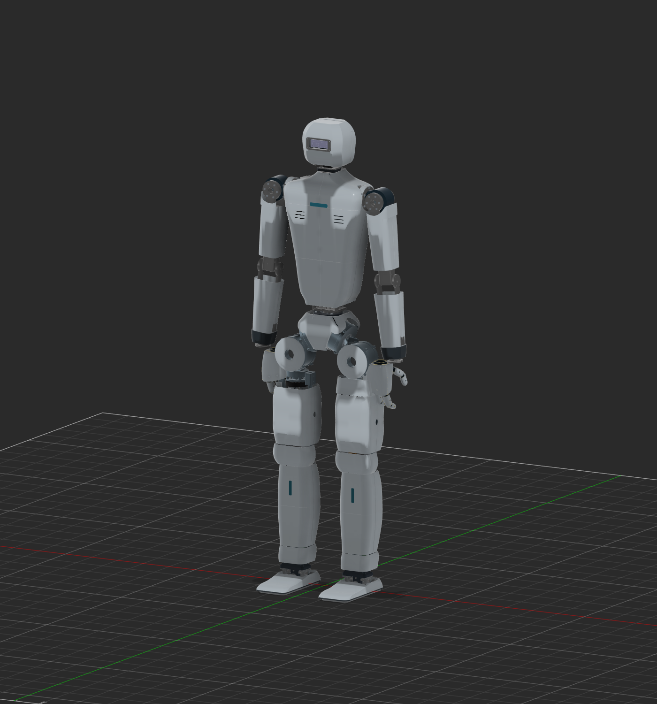

# Humanoid Robot

I am building a human-sized humanoid robot, including its mechanical design, motor control and simulation.

## Current physical prototype — v29

The physical CAD is **1.6002 m tall**, with 23 body axes, a three-axis waist, rearward metal spine, battery/electronics packaging, supported arms, microservo hand references and a stereo-camera head. V29 lengthens thighs 30 mm, shortens the torso 20 mm, uses 275/250 mm arms and replaces generic elbows with double-shaft servos. The complete native archive independently reopens, and all 23 body joints passed an Isaac Lab movement test. Hardware limits, actual masses/inertias, contact dynamics and manufacture remain pending.

| Start here | Contents |
|---|---|
| [Current build report](docs/robot/BUILD_REPORT.md) | Dimensions, mechanisms, torque assumptions, evidence and open decisions |
| [Casing design](docs/robot/CASING_DESIGN.md) | Current 53 skins/holders/marks, ownership, dimensions, colors and qualification |
| [Whole-robot BOM](docs/robot/BOM.md) / [CSV](docs/robot/BOM.csv) | Quantities, selection status and verified/unknown prices |
| [Hand reference](docs/robot/HAND_OPTIONS.md) | AmazingHand attribution and MG90/current-sensing evaluation |
| [CAD locations](CAD/README.md) / [export files](docs/robot/EXPORTS.md) | Saved native source and separately qualified local artifacts |
| [Physical robot simulation](docs/robot/SIMULATION.md) | New 23-axis URDF/USD, measured joint test and pending hardware limits |
| [Earlier physical revisions](docs/lower_leg/README.md) | Dated design history and calculations |

[Learning/HumanoidTraining](Learning/HumanoidTraining/FILE_LOCATIONS.md) indexes the separate Isaac pipeline. Firmware and host utilities remain in [Code](Code/), with [Schematics](Schematics/README.md) and [custom gearboxes](CAD/Actuators/README.md).

The [original grant record](docs/archive/LOWER_LEG_GRANT.md) and root [bom.csv](bom.csv) retain the earlier lower-leg $761.45 scope; they are not a whole-humanoid budget. [v26 mechanical report](docs/robot/history/v26/BUILD_REPORT.md) remains the detailed preserved mechanism checkpoint.

Documentation updated 2026-09-30. Local only; no Git commit, GitHub push or publication.
