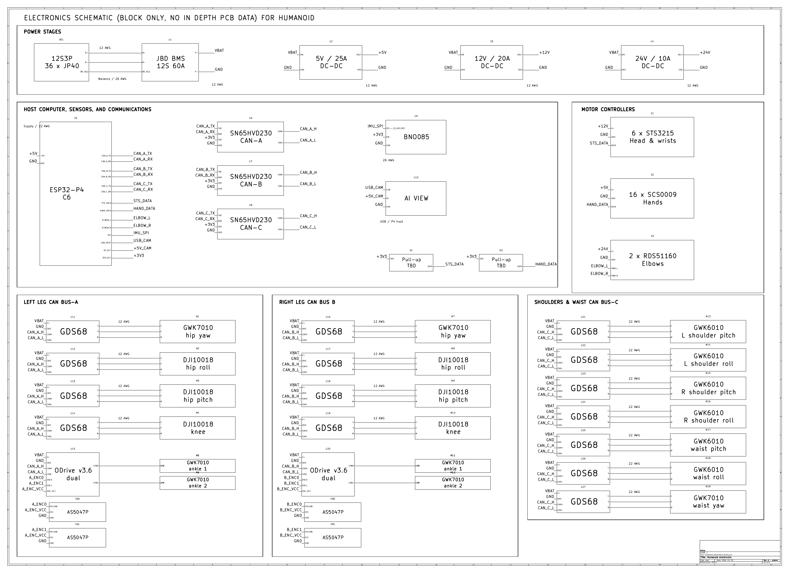

# Humanoid Robot

This is my project to build a human-sized bipedal robot. In this repo I have all my current designs for my robot's shin and lower leg, and the iterations of gearboxes I have made for my actuators.

Right now, I am using pre-made actuators and am waiting on a grant to further complete my robot.

This grant is for building and testing the robot's two lower-leg and ankle assemblies. It is the first stage of the humanoid and is not funding the complete robot.

This is the current prototype, showing both lower-leg assemblies side by side.


## Electronics

Each ankle motor is controlled by a single-axis ODrive 3.6 clone. Both ODrives share one CAN bus with an STM32F103. The ODrives run the motor-control loops; the STM32 relays position commands from a Raspberry Pi 5 over SPI. UART is available for setup and debugging.

This is a wiring diagram of how i'll utilize CAN buses for each motor [`Schematics/`](Schematics/).



## Design

At first, I was thinking of a 2-DOF ankle design but now I am thinking of 1-DOF as its much cheaper and is really what I need. This came from a lot of thinking, as I am utilizing a lot of plastic for this build (though I will utilize aluminum in places where necessary). A lot of my body will be plastic and needs to be designed appropriately to support a bipedal's weight that is 5 foot tall. Currently I have a 1-dof ankle structure with a linkage system for only ankle pitch motion.

A bipedal can easily walk on level ground with ankle pitch. I have also attached a 50mm bearing hole for attaching the knee.

I also kept my earlier 2-DOF single-leg assembly as a backup in case I return to a 2-DOF ankle in the future.


## Gearbox designs

The [`CAD/Actuators/`](CAD/Actuators/) folder has my custom planetary and cycloidal C6374 designs.

These gearboxes were built by me as a part of prototyping and learning on how to make my robot. They are there as they helped me decide how to make my robot and what actuators to use. I chose the cyclodial gearbox over the plantery in my design as it was easier to print with lower backlash, had high reductions, and was stronger, giving me 50+nm torque around 100mm size. Though, I chose to use a pre-built one as it was much less complex. 

## Bill of materials

[Humanoid BOM](bom.csv)

## Assembly instructions


1. Print the parts in [`CAD/Assembly/Individual STLs/`](CAD/Assembly/Individual%20STLs/) using PA6-CF. The STL names match their source STEP names.
2. Fit the two `Foot Mounting Plate` parts and `Rounded Bearing Support` to the `Foot Base`, then install the purchased pillow-block bearings on the pitch axis.
3. Attach the `Shin Support Attachment` and cut the aluminum shin tube to 200 mm. Drill the tube from the CAD hole locations, then fasten it with M3 hardware.
4. Use the `Electronics Mounting Tray` and `Encoder Holder` parts for the controller and encoder mounting points. The `Lower Leg Support Assembly` STEP files can be used as reference assemblies.
5. Mount one motor and one ODrive to each lower leg. Confirm that both ankles move freely by hand before applying power.
6. Wire and test one motor at a time with the ankle unloaded. 

### Power and signal wiring

- Use a current-limited 50 V bench supply rated for at least 10 A per motor, or 20 A when both motors  run together.
- The 50 V rail connects only to the ODrive power inputs. Power the STM32, CAN transceiver, and Raspberry Pi from their voltage regulations with GND connections.
- Connect STM32 CAN to Odrive CAN, merging them as you connect them, and UART to host computer.

## STM32 controller firmware

This protocol is used for Odrive comms: [ODrive v3.x CANSimple protocol](https://github.com/odriverobotics/ODrive/tree/master/Firmware/communication/can). UART can also be used for testing.

The first ODrive uses CAN ID `0` and the second ID `1` at 500 kbit/s. The Raspberry Pi helper in controls them as the host [`firmware/rpi_host/ankle_controller.py`](firmware/rpi_host/ankle_controller.py) has position, enable, idle, and stop commands. This was used to test my custom gearboxes.

### Build and flash with ST-Link

Connect the ST-LINK to the STM32. 

```text
cd firmware/stm32_controller
pio run
pio run -t upload
pio device monitor -b 115200
```

## Notes

This is a long project, and I don't think macondo runs long enough for me to complete it, which is why i'm completing the lower leg first, and then will add on in different hack club events.
