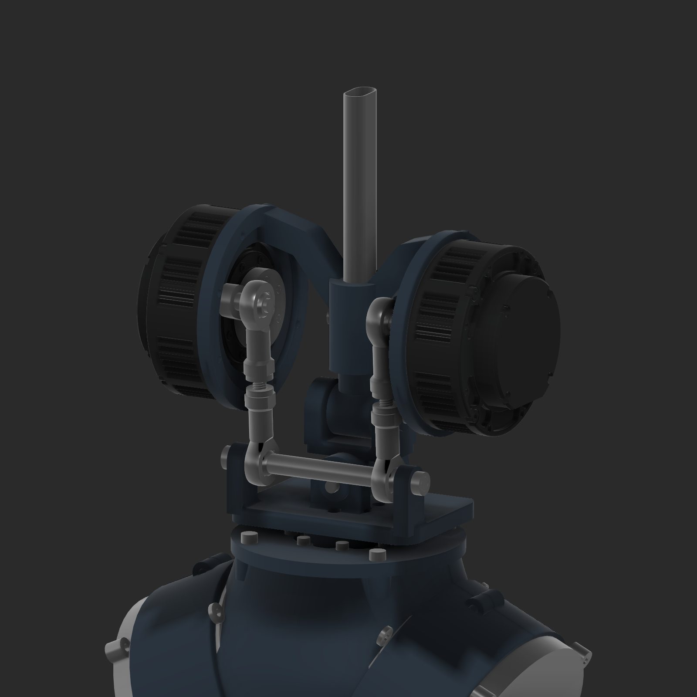
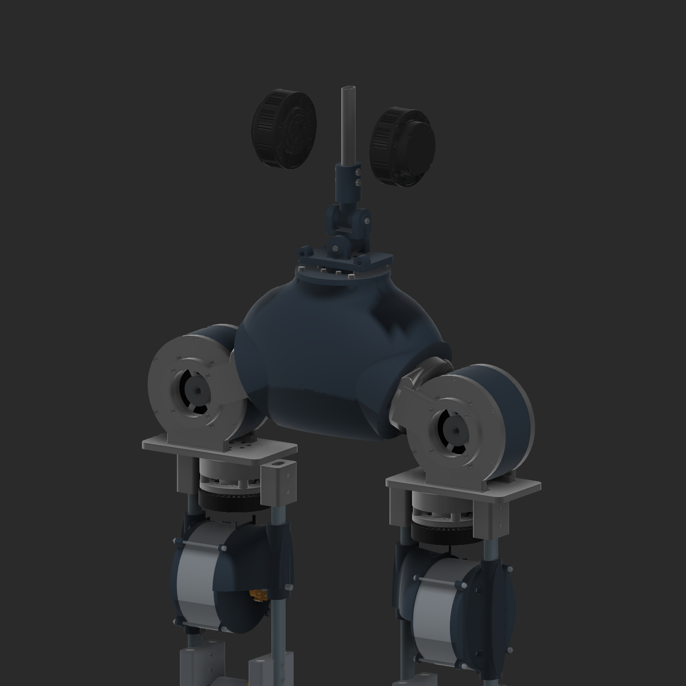
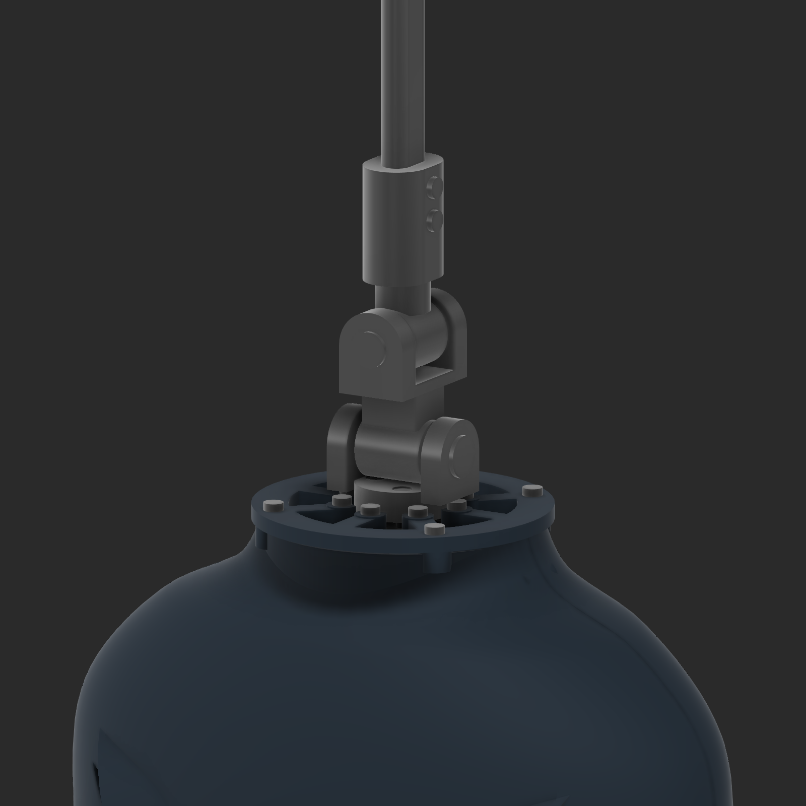
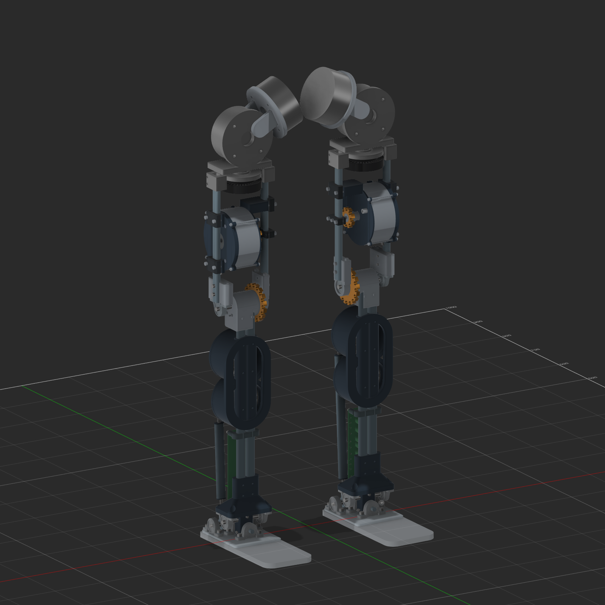
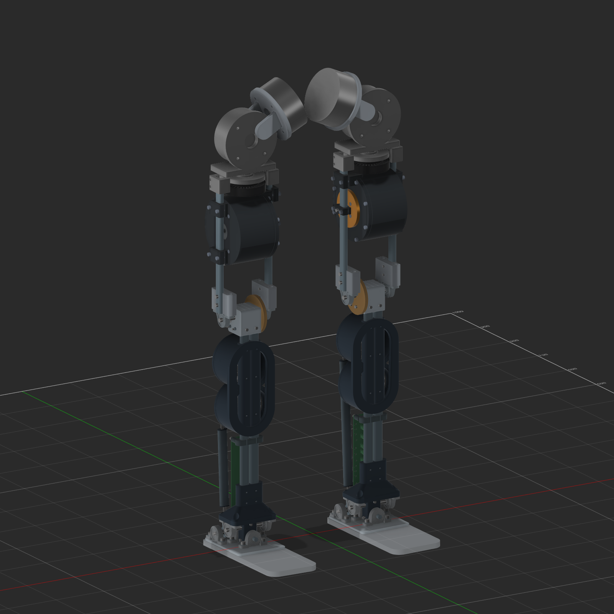
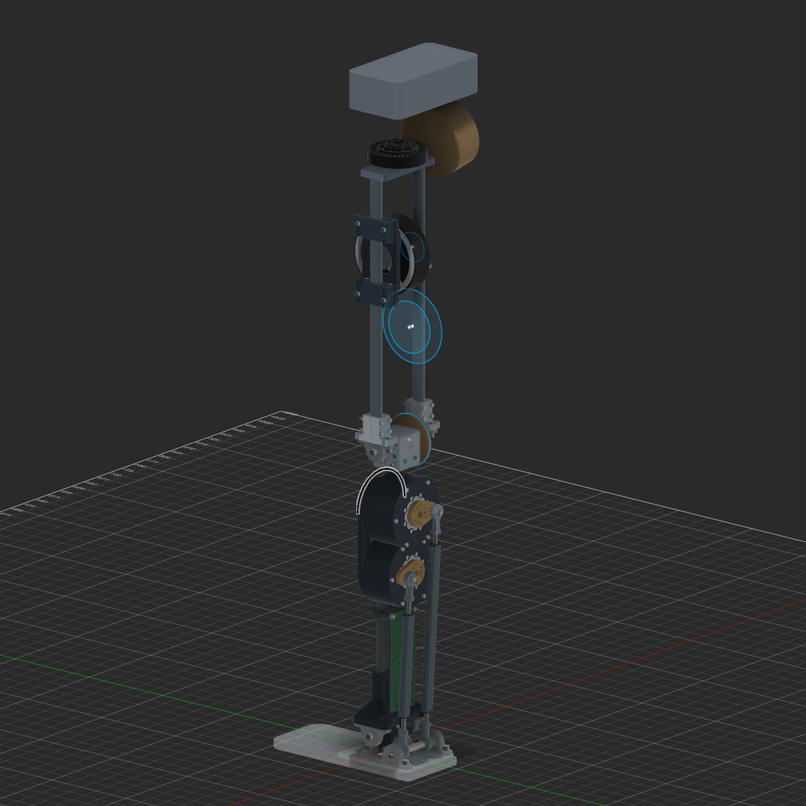
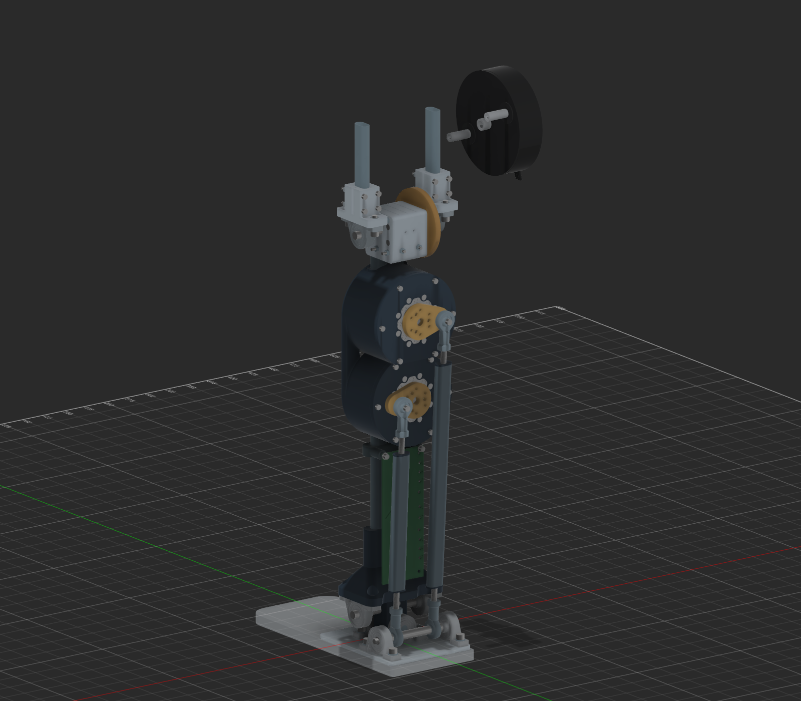
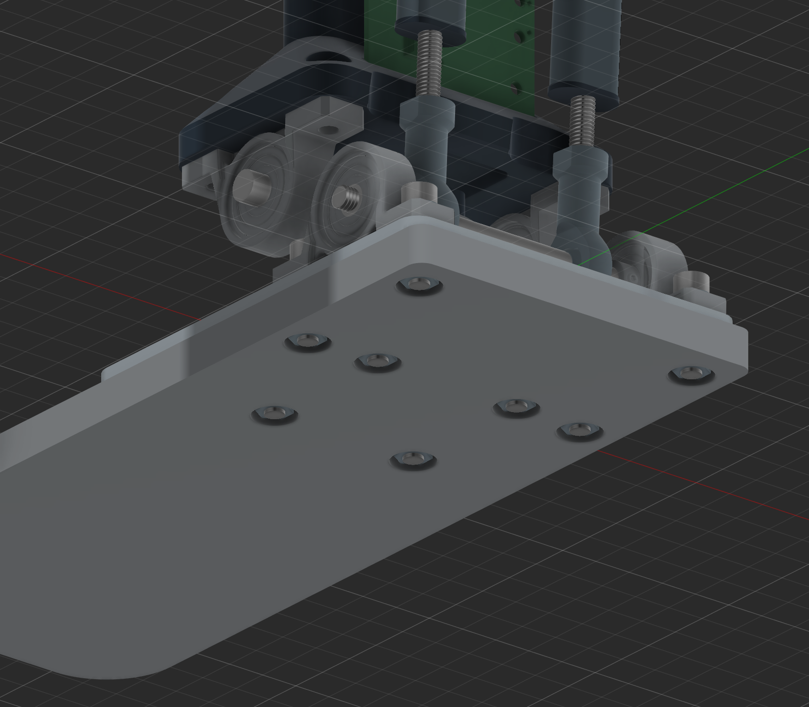
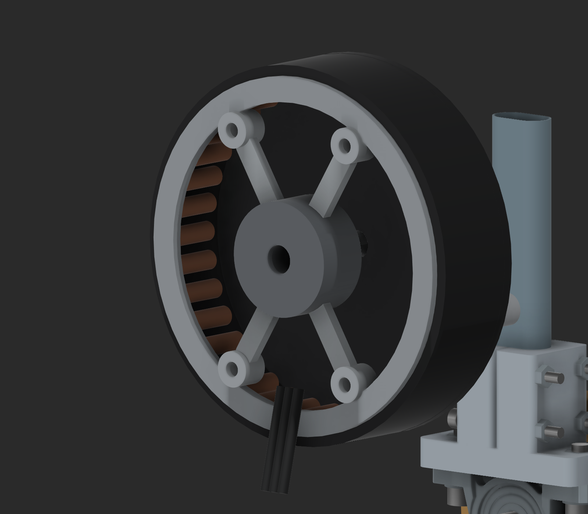

# Earlier physical CAD landing page

Historical text preserved on 2026-09-30. [Current whole-robot report](../robot/BUILD_REPORT.md) supersedes its current-state statements.

# Current physical legs and waist — v19

[V19 compact hips and linked waist](../lower_leg/HIP_WAIST_V19.md). [Component BOM](../lower_leg/BOM_V19.csv). Touching pitch rear rims,110/106 aluminum sleeves, centered bilateral hip adapters, and a low6010 waist differential with M6 links. Initial waist limits are±20° pitch and±5° roll with the existing rod ends. Prototype geometry; see the record for validation scope and unfinished gearbox work.

# Historical physical legs and waist — v18

[V18 estimated hip housings and blended forks](../lower_leg/HIP_WAIST_V18.md) keeps the DJI10018 motor references inside separate estimated shells, applies larger flat roll openings and broad lofted fork junctions on both legs, turns the two GIM6010 outputs inward, and verifies the vertical neutral spine. [Current price-free component BOM](../lower_leg/BOM_V18.csv). Gearboxes and the enlarged roll output/bearing interface remain provisional.

## Historical v17 checkpoint

[V17 corrected 7010 interfaces](../lower_leg/HIP_WAIST_V17.md) introduced the correct 48 mm fixed mounting circle and 25 mm output circle, matched knee bearings and hip yaw bearing reservations. V18 supersedes its hip shell presentation, narrow roll journals and 6010 orientation.

## Historical v16 waist prototype

[V16 motor mount and articulated waist](../lower_leg/WAIST_GIMBAL_V16.md) adds a fixed eight-hole 7010-to-casing mount, CNC output/pitch/roll gimbal, plain bushings, and a fully enclosed oval-spine socket. The exported Fusion archive was reopened and verified. V15 below is the preserved baseline.

## Historical waist and slide-on mounts — v15

[V15 slide-on mounts and waist](../lower_leg/UPPER_LEG_V15.md). [Current price-free modeled BOM](../lower_leg/BOM_V15.csv). Includes central vertical-axis waist yaw and110×50mm hip-pitch envelopes. V14 below is historical.

# Historical physical leg — v14 enclosed adapter

[V14 revision](../lower_leg/UPPER_LEG_V14.md) restores full oval enclosure and lowers the knee5 mm. [Current price-free BOM](../lower_leg/BOM_V14.csv). V13 remains historical.

# Historical physical leg — v13 chain packaging

See [v13 construction record](../lower_leg/UPPER_LEG_V13.md), [price-free BOM](../lower_leg/BOM_V13.csv), [readable BOM](../lower_leg/BOM_V13.md) and [future work](../lower_leg/FUTURE_WORK.md).

## Historical physical leg — v12 paired legs and gearbox housing

V12 preserves the user's live v11 changes and adds fitted knee rail seats, a circular motor/gearbox case with 33 mm reserved depth, opposite-rail support, output/sprocket references and CNC hip-attachment concepts. The left and right leg groups use a provisional 260 mm centre spacing. The rejected cosmetic fairings are excluded from the active assembly.

See [revision and construction record](../lower_leg/UPPER_LEG_V12.md), [price-free active BOM](../lower_leg/BOM_V12.csv), [readable BOM](../lower_leg/BOM_V12.md), and [future work](../lower_leg/FUTURE_WORK.md). Native CAD, STEP and separate custom-part exports are in `E:\Aditya\robot_sim\outputs\shin_cad_20260912\v12\deliverables`.

## Historical v11 compact, shelled upper leg

V11 shortens the thigh reference to **320 mm**, lowers the knee motor **85 mm**, sets hip pitch to **25°**, and adds a separate roll reference above the yaw neck. Curved front/rear fairings taper around the motor, with a removable circular service cover. See [UPPER_LEG_V11.md](../lower_leg/UPPER_LEG_V11.md), [upper-leg BOM](../lower_leg/UPPER_LEG_BOM.csv), and [future work](../lower_leg/FUTURE_WORK.md).

Current native file: `E:\Aditya\robot_sim\outputs\shin_cad_20260912\v11\deliverables\Leg_compact_shelled_v11.f3d`. The STEP and separate printed-part STEP files are alongside it. Geometry remains provisional; the full hip mechanism and drivetrain are not complete.

September 20 strength update: [8 mm ankle pitch/roll and knee shaft calculations](../lower_leg/SHAFT_STRENGTH_8MM.md). Bodyweight-only standing passes the assumed-steel screen; pitch/knee fail the 3x and 5x cases, and roll is contact-dependent at 5x. Actual actuator reactions still need to be resolved.

## Historical v10 upper-leg layout

The historical v10 layout added a 400 mm thigh, the estimated DJI motor with a printed rail mount, a 5 mm encoder space, a GWK7010 yaw reference, hip/pelvis envelopes and transmission circles. See [UPPER_LEG_V10.md](../lower_leg/UPPER_LEG_V10.md). V11 supersedes its dimensions; the gearbox and chains are still not modeled.

Historical native file: `E:\Aditya\robot_sim\outputs\shin_cad_20260912\v10\deliverables\Leg_layout_1600mm_v10.f3d`. The STEP and separate printed-shell/cap STEP files are alongside it. Existing live v9 edits were preserved in the input archive.

## Lower-leg baseline v9

September19,2026. This folder documents the narrowed-rail lower-leg revision; the repository root `bom.csv` describes an earlier design and contains prices. The new per-leg BOM below has no price fields.

- [BOM.csv](../lower_leg/BOM.csv):73 engineering line items; installed quantities, references and incomplete hardware distinguished.
- [Readable BOM](../lower_leg/BOM.md)
- [Construction/revision record](../lower_leg/V9_CHANGES.md)
- [Knee strength calculation](../lower_leg/KNEE_STRENGTH_V9.md)
- [Reproducible calculations and geometry/check evidence](../lower_leg/evidence)

The CAD working directory is outside this Git checkout: `E:\Aditya\robot_sim\outputs\shin_cad_20260912\v9\deliverables`. It contains `Compact_shin_392mm_v9.f3d`, `.step`, and13 changed-part STEP files. The paths beginning `outputs/shin_cad_20260912` in the records refer to that workspace, not to this repository. Native CAD was reopened with66 components and63 valid joints; no feature warnings. It has not been committed or uploaded to Fusion cloud by this task.

Run `python evidence/knee_strength.py` to reproduce the shaft calculation and report. `evidence/make_bom.py` regenerates the historical v9 BOM and would overwrite the two v10 updates to LL-042/043; preserve or reapply those rows when using it. Both scripts use only the Python standard library. The source geometry inventory is included for reproducibility.

The8 mm knee shaft is **not qualified for jumps**. At90 lb/5x bodyweight on one leg, the favourable beam screen is441 MPa. The DJI motor dimensions and four mounting holes are estimates pending the actual motor. V10 now adds a provisional motor bracket; the QDD remains undesigned.

September 22: [V15 waist PA12-CF mass and strength prediction](../lower_leg/WAIST_PA12CF_STRENGTH_V15.md), including leg mass budget and preferred print orientation.
