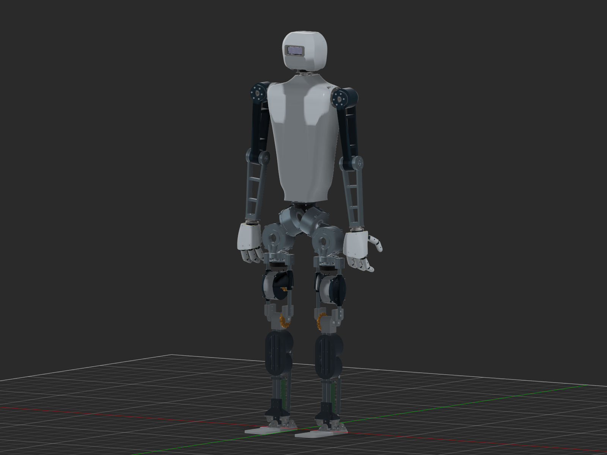

# Humanoid Robot

I am building a human-sized humanoid robot, including its mechanical design, motor control and simulation.

## Current physical prototype — v26

The current CAD is approximately **1.59 m tall**. It has paired legs, a three-axis waist, a rearward metal spine, battery/electronics packaging, supported shoulders and elbow/forearm forks, and a stereo-camera head. The current revision adds a lower split-shell head, microservo hand references and a whole-robot articulation review. It remains a design prototype; transmissions, electronics and manufacturing checks are identified in the report.

| Start here | Contents |
|---|---|
| [Current build report](../robot/BUILD_REPORT.md) | Dimensions, mechanisms, torque assumptions, validation and unresolved decisions |
| [Whole-robot BOM](../robot/BOM.md) / [CSV](../robot/BOM.csv) | Quantities, selection status and known/unknown prices |
| [Selected hand](../robot/HAND_OPTIONS.md) | AmazingHand source, attribution and MG90/current-sensing evaluation |
| [CAD locations](../../CAD/README.md) | Current working Fusion design and local release evidence |
| [Local export files](../robot/EXPORTS.md) | Full F3Z backup and concept-part STEP/STL fit trials |
| [Earlier physical revisions](../lower_leg/README.md) | Dated design history and calculations |

[Learning/HumanoidTraining](../../Learning/HumanoidTraining/FILE_LOCATIONS.md) indexes the separate Isaac training pipeline. Firmware and host utilities remain in [Code](../../Code), with wiring references under [Schematics](../../Schematics/README.md). Custom gearbox development remains in [CAD/Actuators](../../CAD/Actuators/README.md).

The [original lower-leg grant record](LOWER_LEG_GRANT.md) preserves the prior prototype and $761.45 replication estimate. Root [bom.csv](../../bom.csv) belongs to that historical scope and is not a whole-humanoid budget.

Documentation updated 2026-09-30. This cleanup remains local; it was not committed or pushed to GitHub.
