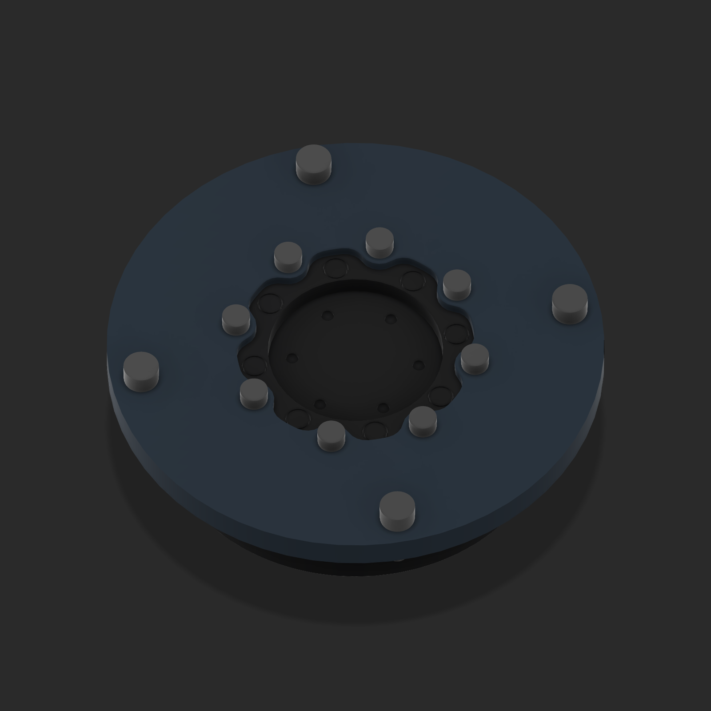
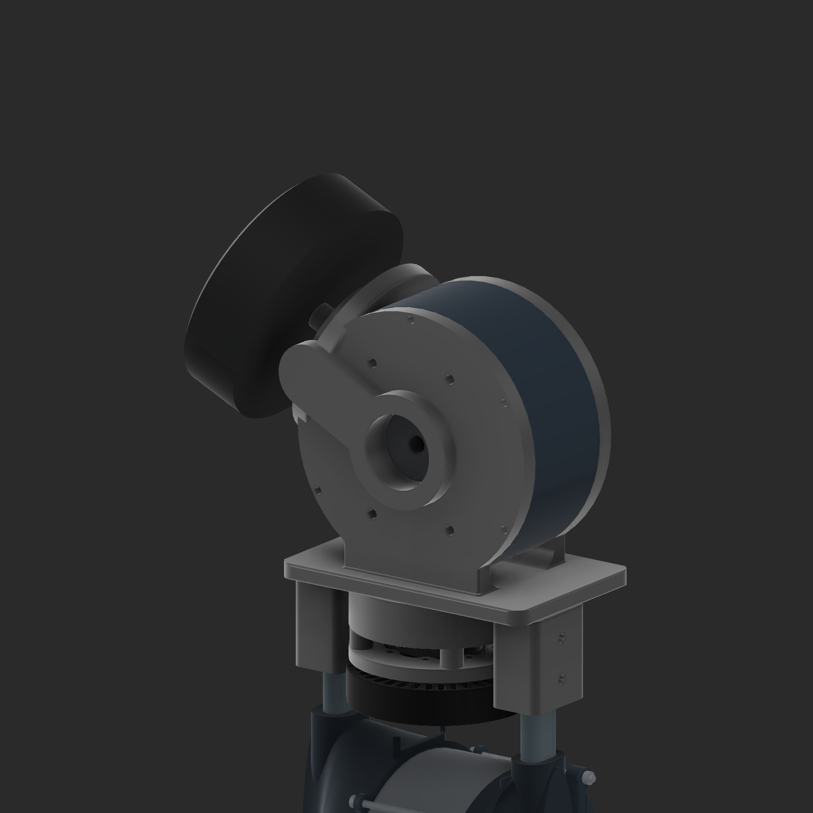
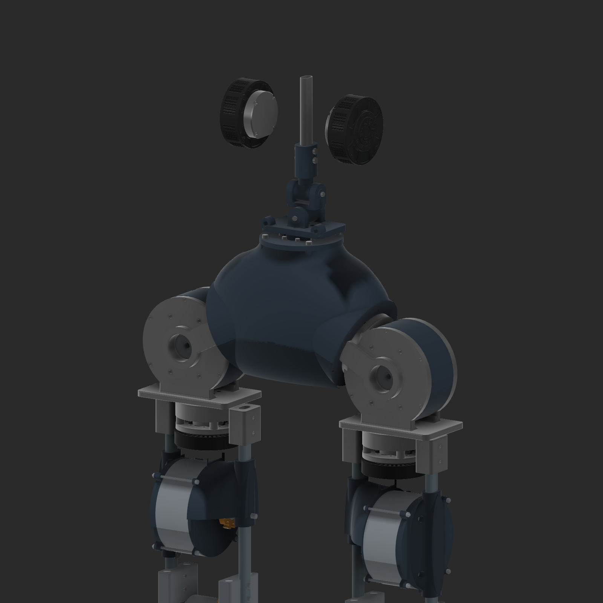

> Historical checkpoint. [V18](HIP_WAIST_V18.md) supersedes its exposed hip references, roll opening/journal arrangement and 6010 orientation.

# V17 corrected hip and waist interfaces

September 26, 2026. Built from the user's live edited v16, preserved as `Input_live_v16_user_edits_preserved.f3d`. The original document remains available. Native output is `deliverables/Legs_hip_waist_v17.f3d`.

## Motor interface corrections

The 7010 stationary mount now follows the actual curved, scalloped gearbox interface. Its **eight small mounting holes are on a 48 mm pitch circle**. The eight 40.5 mm pitch-circle gearbox assembly screws are left alone. The exact inner contour was projected from the vendor model's stationary mounting face, then extended out into the waist flange or hip crosshead.

The rotating output adapter uses the **six small holes on a 25 mm pitch circle** and seats at the output face. The three larger locating features are relieved in the adapter; they are not used as the mounting screw pattern. These corrections supersede the incorrect v16 mount and three-hole output attachment.

## Hips and knees

The user clarified that **both hip pitch and roll use the DJI 10018 77 KV**, duplicated from the existing knee reference, with 105 mm modeled OD. No GIM10015 is used. The new housings have a 106 mm bore and 117 mm OD. The original four-hole rear stator pattern remains the knee model's estimated 40 by 66 mm pattern, pending physical measurement.

The pitch axes retain 25 degrees of tilt and their previous nominal Z798.6 height. Their centers move outward from X±52 to X±62 mm. Roll centers move from X±130/Z753.6 to X±140/Z759.6 mm to package the larger motor and supports. Thigh center spacing remains 260 mm.

Both roll fork cheeks now reach the motor center and carry coaxial journals. The cradle has complete annular endplates, central output openings, and broad R8 curved floor transitions with smaller edge rounds. The pitch housings in the hollow waist shell have front and rear annular mounting/bearing seats, with the plastic terminated before the output region. Both sides reserve 40 by 52 by 7 mm bearing space, corresponding to the 61808/6808 size. The rear pitch output journal and its final connection remain to detail; the model establishes its seat and access space.

Each hip 7010 moves down 15 mm. A separate **6007-size 35 by 62 by 14 mm bearing reference**, machined seat, output journal and removable top retainer occupy the space above it. Bearing dimensions come from the [SKF catalog](https://cdn.skfmediahub.skf.com/api/public/0901d196807026e8/pdf_preview_medium/0901d196807026e8_pdf_preview_medium.pdf); the [618-series table](https://cdn.skfmediahub.skf.com/api/public/0901d19680237e2b/pdf_preview_medium/0901d19680237e2b_pdf_preview_medium.pdf) supplies the 61808 envelope. No price or load rating was selected.

The knee sprocket-side pillow block, aluminum oval adapter and associated side hardware are restored as mirrors of their opposite-side originals on both legs. The custom narrow pedestal is replaced. The sprockets are retained, and chain clearance is intentionally outside this revision's check scope.

The hip motor duplicates retain the raw prop posts/pads and phase-wire visuals as hidden reference bodies. Current packaging assumes removal of the prop features and leaves the compact gearbox internals unmodeled. This assumption must be checked on the real motor. The custom hip gearbox-output journals and bolt pattern are provisional designs, not claimed DJI output specifications.

## Waist and differential references

The waist now has **vertical yaw, lower roll along Y, and upper pitch along X**. The lower/upper axis spacing is shortened from 37 to 27 mm; the gimbal center sits 10 mm rearward of the yaw center. Nominal lower and upper pin diameters remain 10 and 8 mm. The couplers and pin references are PA12-CF with M3 through-bolt reinforcement provisions. A metal base remains a possible later alternative; this revision does not qualify the base for the proposed 20 N·m rod torque.

Two M6 rod attachment ears are part of the yaw output base. Two actual **GIM6010-8 standard-version** motor models were imported from the user's supplied directory and placed as floating references near X±62/Y23.343134/Z1040 mm. The motors follow the spine for CAD pose inspection. Cranks, differential rods, motor brackets and linkage travel are not modeled.

Roll below pitch works for the proposed spine packaging. It changes the coupled motion at nonzero angles relative to pitch below roll; the axis order alone does not establish greater strength or better control. Final rod anchor locations, crank radius, full travel and rod-end misalignment still need a linkage calculation.

The revised output/casing surfaces and the user's rough root-level rectangular hip guide are preserved in history or the source archive; the superseded guide is hidden in v17. The central electronics cavity remains hollow.

## Validation scope

See `evidence/v17/validation.json`, `joints_and_motor_import.json`, and `archive_reopen_verification.json` in the repository copy of these records. Targeted structural pairs were checked for interference, along with neutral, separate ±25-degree yaw/roll/pitch poses and two combined 15-degree poses. These samples do not certify the whole continuous motion envelope or the omitted differential linkage. There are 105 valid native joints per leg and 16 in the waist group after adding the references.

This is a geometry and interface prototype. Final fits, bearing retention, fastener engagement, gearbox design, print settings, strength and fatigue remain open. The hip assemblies retain their existing standing-layout attachment to the thighs; they are not newly completed three-axis hip articulations. The earlier v15 waist mass/strength prediction does not automatically apply to this changed geometry.

The price-free `BOM_V17.csv` is a list of visible component occurrences, including named references, not a complete purchasing list or a count of every fastener.

