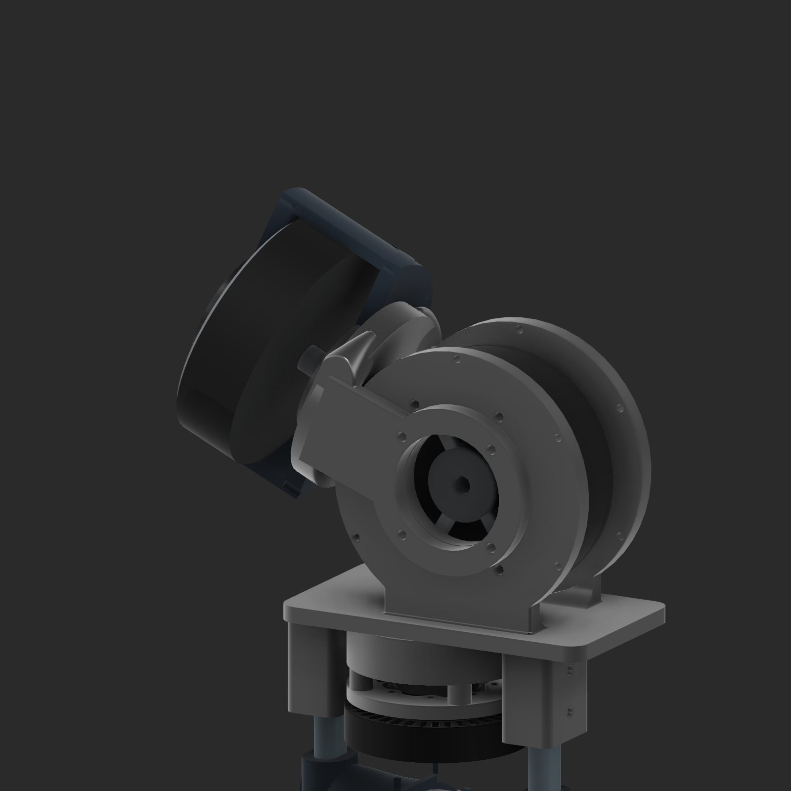
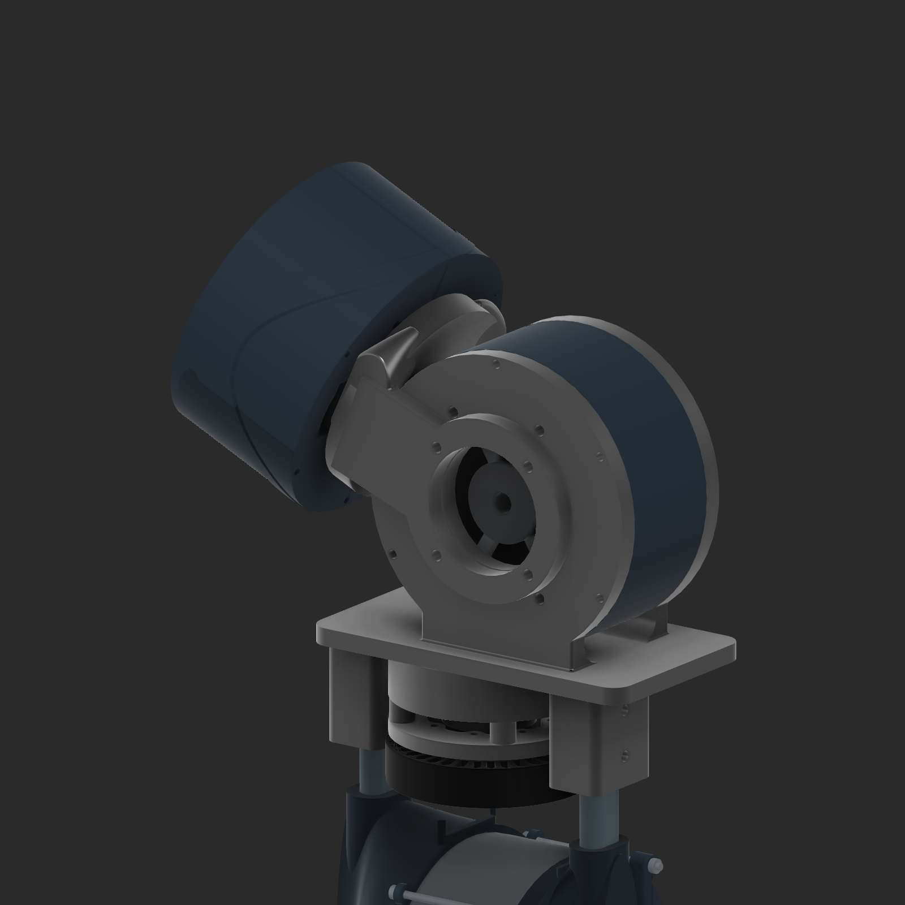

# V18 estimated hip housings and reinforced fork interfaces

September 26, 2026. Native archive: `E:\Aditya\robot_sim\outputs\shin_cad_20260912\v18\deliverables\Legs_hip_waist_v18.f3d`. V17 is preserved as a separate native checkpoint; the user's original live v16 edits are preserved in `v17/Input_live_v16_user_edits_preserved.f3d`.

Both hip pitch and roll use the existing **estimated DJI 10018 77 KV motor model, 105 mm OD**, inside a separate estimated housing. The planetary gearboxes have not been designed. Housing dimensions are packaging estimates, not measured finished actuator dimensions. The pitch housing now has its own H05 component with two shell halves; it remains visible when the central waist skin is hidden. The roll housing remains a separate H01 cover with Q02 endplates. Current nominal housing OD/ID are 117/106 mm and axial envelope is approximately 62 mm including endplates. Actual gearbox space must be revisited once the motor and reduction are measured/designed.

Both left and right hip-roll adapters have provisional **straight 50 mm center openings**. The former narrow projecting journals/collars are removed. The output fork ends are flat with the arms, with 72 mm outside diameter and a provisional four-hole pattern on a 60 mm pitch circle. The old 40 by 52 mm roll bearing references no longer fit this interface and were removed. Roll bearings, retaining geometry and torque coupling remain unselected; the larger hole reserves interface space and does not establish a torque rating.

The paired fork arms are widened from 28 to **40 mm**. The pitch flange is **12 mm** thick. Native Fusion three-section elliptical lofts create broad webs from that flange into both arms, and native 1.5 mm fillets blend their junctions. Each roll package moves **18 mm outward from the v17 position**, to nominal X±158 mm. This gives the pitch flange enough room to remain a complete circle instead of cutting thin fins around the neighboring motor. The arms terminate flat into the flange and lofted webs. Each fork remains one connected solid, and the thigh spacing stays 260 mm.

The two floating **GIM6010-8 standard-version** references now face inward. Their actual six-hole output faces were identified from the supplied STEP, rather than from the appearance of the rear cover. At neutral, output-face X coordinates are approximately -54.5 and +54.5 mm, with normals toward the spine. The 6010s remain placement references; no differential rods, cranks or brackets are modeled.

The waist retains vertical yaw, lower roll, and upper pitch; lower/upper axes are 27 mm apart and offset 10 mm toward the spine. The neutral spine is vertical, with world bounds X±5, Y24.343134..42.343134 and Z982..1091 mm. The earlier tilted screenshot was an intermediate pose. The native archive is checked again after reopening.

## Retained corrections from v17

- The 7010 fixed mount follows the exact curved star/gearbox interface and its eight small holes on **48 mm PCD**. The eight **40.5 mm PCD gearbox assembly screws** are not used as mounting screws.
- The 7010 output adapter uses six small holes on **25 mm PCD**, relieving the three larger locating features.
- The hip 7010s are 15 mm lower, with a separate 6007-sized **35 by 62 by 14 mm bearing reference**, seat and removable retainer above each motor. These are prototype bearing envelopes; [SKF dimensions](https://cdn.skfmediahub.skf.com/api/public/0901d196807026e8/pdf_preview_medium/0901d196807026e8_pdf_preview_medium.pdf) were used without selecting a load rating or price.
- Hip pitch remains tilted 25 degrees at nominal Z798.6. Nominal pitch centers are X±62; final v18 roll centers are X±158/Z759.6 after the junction-clearance adjustment. Thigh spacing remains 260 mm.
- Knee pillow blocks, oval adapters and their side hardware match their opposite-side originals on both legs. The sprockets remain; chain clearance was not redesigned or evaluated.
- The nylon waist couplers retain nominal 10/8 mm lower/upper pins with M3 through-reinforcement references and two M6 rod attachment ears. The central electronics cavity remains hollow.

## Validation and remaining design work

The evidence records targeted structural interference checks, positive connected solids, feature health, native-joint validity and nine sampled waist poses. Individual yaw, roll and pitch were sampled at ±25 degrees, with neutral and two combined 15-degree poses. This does not establish full continuous motion or linkage travel. The model has 106 native joints per leg and 16 in the waist group. The enlarged hip-roll interface remains provisional and has no selected bearing support yet.

The hip motors retain the knee model's estimated rear four-hole 40 by 66 mm pattern. Raw prop posts/pads and phase-wire visuals remain hidden references; packaging assumes removable prop features and an unmodeled compact planetary. Measure and resolve these before manufacturing. Final motor output coupling, bearing selection/retention, fastener engagement, rod-end misalignment and full hip/differential kinematics remain future work. No new strength or fatigue qualification is claimed.

`BOM_V18.csv` is a price-free visible-component list, including reference geometry, not a complete purchasing list. The saved v17 and v16 records are historical; their older interfaces and the v17 6010 orientation are superseded here.

The final native archive reopened successfully with the expected joints, vertical neutral spine and both measured 6010 output normals pointing inward.
