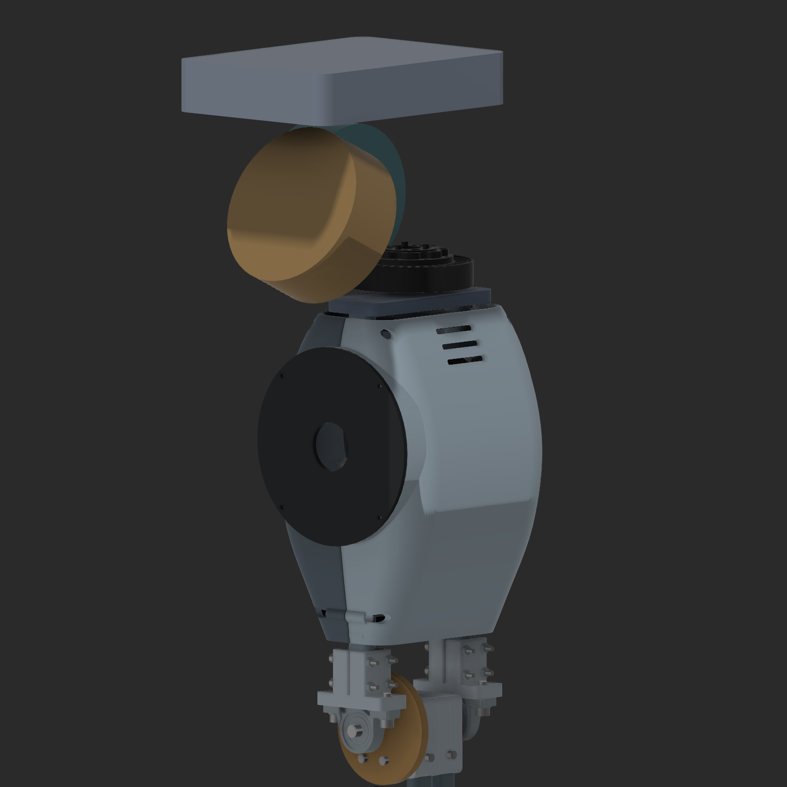
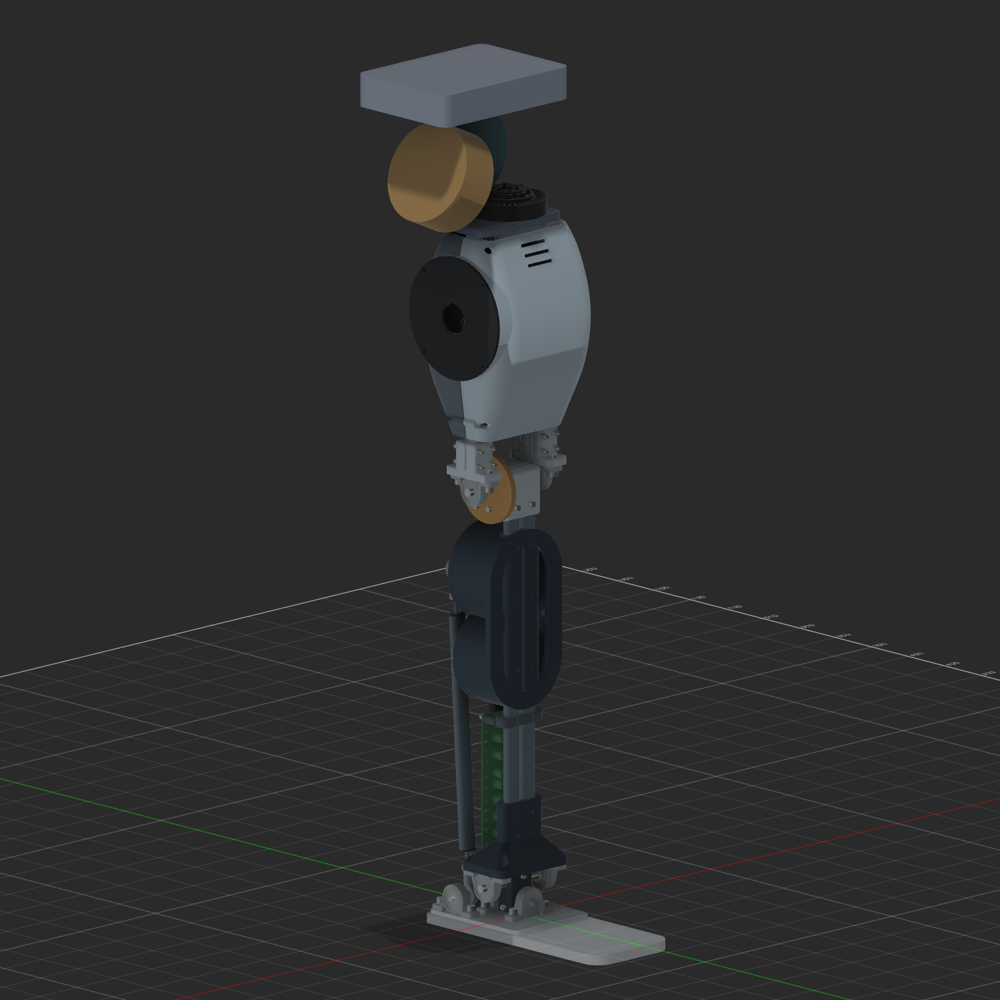

# Compact upper leg and curved shells — v11

This revision follows the user's correction that v10 looked too tall, lacked a distinct hip-roll reference, and needed a curved exterior that accommodates the knee motor diameter. The complete live v10 input was archived before editing. Lower-leg geometry is retained.

## Dimensions and hip references

| Item | V10 | V11 |
|---|---:|---:|
| Knee-to-hip pitch/roll height reference | 400 mm | **320 mm** |
| Standing hip reference above ground | 837.6 mm | **757.6 mm** |
| Knee motor center Z | 685 mm | **600 mm** |
| Knee motor center above knee | 261.4 mm | **176.4 mm** |
| Thigh rail cut length | 351.8 mm | **233.8 mm** |
| Thigh rail top Z | 798 mm | **680 mm** |
| Pitch motor tilt | 10° placeholder | **25° requested** |

Coordinates retain the existing convention: X left–right, Y fore–aft, Z up; the knee is Z423.6 mm and the ground is Z−14 mm. The thigh height reference is 20% shorter and the knee motor is 85 mm lower. The full-body target remains 1600.2 mm (5 ft 3 in), with torso/head dimensions still to design. These are robot packaging choices, not a claim about required human proportions.

Yaw is now explicitly in the **thigh neck beneath the upper hip references**, with a vertical Z axis. Its actual GWK7010 reference geometry starts at Z690.8 mm. The new `T09_Hip_roll_motor_ENVELOPE_REFERENCE` is an unselected Ø90 × 36 mm motor envelope, oriented along the fore–aft Y axis through X0/Z743.6. Its body is offset along that axis to clear the yaw body. Pitch remains an unselected Ø100 × 40 mm envelope, now tilted 25° from the lateral X direction in the X–Z plane. Pitch and roll have separate bodies and names.

The tilt magnitude is user-specified; the present tilt direction follows the previous layout convention. The serial joint order, supporting bearings, brackets and actual pitch/roll motors remain undecided. The hip references are rigidly attached to the thigh only for inspecting the layout; they are not a functioning hip articulation. The compact pelvis block is also only an envelope.

## Curved plastic exterior

The shell is original geometry fitted to the existing rails, motor and clamp. The supplied Unitree H2 and Atlas images guided its tapered outline, smooth transitions and circular motor-region detail; their dimensions or internal construction were not copied.

- **T10 front fairing:** a loft through rounded rectangular sections from Z478 to Z678. It narrows near the knee, reaches 130 mm overall width and 126 mm depth around the motor, and tapers toward the thigh neck. The nominal section offset is 3.2 mm; this is not a measured constant normal wall thickness across every curved transition.
- **T11 rear fairing:** a separately removable rear half with a 0.8 mm parting seam. Internal locating webs surround the oval rails with provisional print clearance. Reliefs leave the two transmission planes open at those webs.
- **T12 circular service cover:** a separate Ø122 × 3 mm cover over a Ø106 mm drive-side access opening. It is a printed access cover, not a larger motor or a modeled gearbox. The center opening is Ø30 mm.
- Four M3 panel-joining locations include front driver access and rear nut-envelope access. Four M3 cover clearances align to provisional pilot holes in the access flange. Fastener retention, pocket tolerances and final lengths require a print/assembly trial; no new fastener bodies were added for these fairings.
- Three upper front vents and separate covers provide access and visual separation. Ventilation effectiveness has not been thermally validated.

The existing 8 mm motor mounting web, two rail-clamp caps and their hardware move down with the motor. The shell is a protective/cosmetic component, not a replacement for the structural mount. Its rail contact, creep, attachment tolerances and impact resistance remain unqualified. The original 5 mm rear-hub encoder allowance is retained.

## Transmission and remaining questions

The intermediate reference center moves to Z500 mm. Only reference circles remain: 2.5:1 primary and 1:1 final; no gears, sprocket teeth, chains or bearings were added. These sketches are hidden in the normal assembled view so the shell shape can be reviewed. The two chain planes remain only 6 mm apart and still need a real shaft/hub/chain layout. The reduced thigh length makes this packaging question more constrained.

Existing motor-current, aluminum planetary/sprocket strength, hip-bearing and 8 mm knee-shaft questions remain in [FUTURE_WORK.md](FUTURE_WORK.md). This revision does not establish torque capacity or jump survivability.

## Files and checks

Working folder: `E:\Aditya\robot_sim\outputs\shin_cad_20260912\v11`.

- Native Fusion: `deliverables\Leg_compact_shelled_v11.f3d`.
- STEP: `deliverables\Leg_compact_shelled_v11.step`.
- Separate fairing and service-cover STEP files: `deliverables\upper_leg_parts`.
- Preserved input: `Input_live_v10_preserved.f3d` and `live_inventory.json`.
- Dimensions: `layout_parameters.json` and `shell_parameters.json`.
- Verification: `layout_validation.json`, `knee_motion_summary.json`, and `archive_reopen_verification.json`.

Verified 63 unchanged lower-leg components, preserved volumes and translated positions for the moved motor/mount package, positive solid volumes, and both 233.8 mm rails. Checked 94 potentially overlapping pairs involving the new roll reference and fairings: zero solid intersections and no boolean errors. The rear encoder gap remains 5 mm and its reserved volume is clear. Thirteen knee poses from 0° to 120° passed the geometric checks. Reopened archive: 79 components, 76 valid native joints, 1782 timeline entries, zero feature warnings. New components follow the knee joint correctly. These checks do not qualify strength, print tolerances or a complete hip mechanism.

