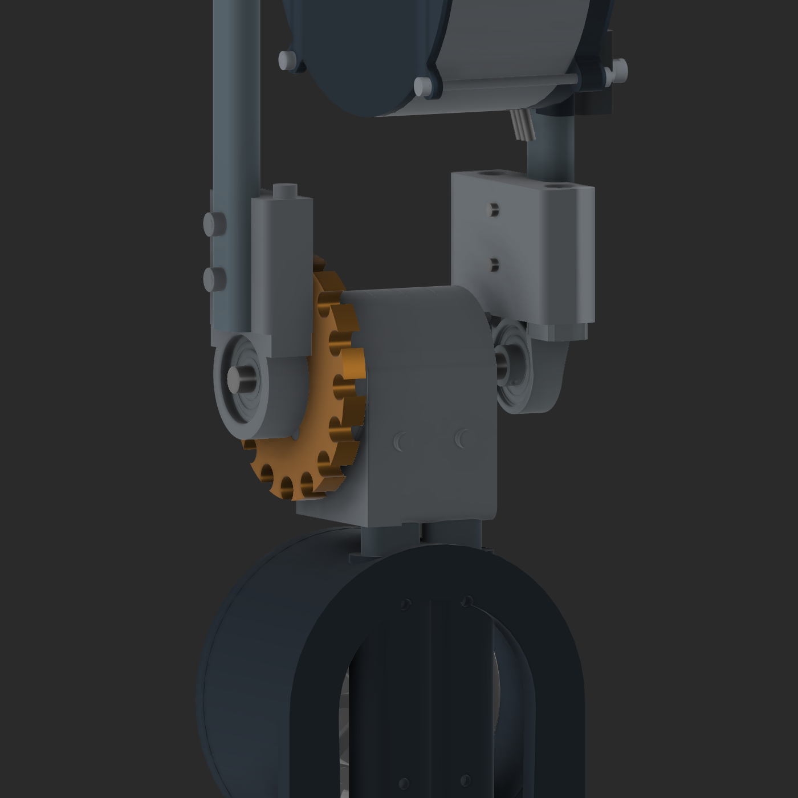

# V14 enclosed shin adapter and 5 mm knee lowering

September 21, 2026. The user's final instruction was to retain the v13 changes, fully enclose the shin oval in the aluminum knee adapter, and lower the knee by exactly5 mm. No chain dimensions were calculated or optimized in this revision.

The live `Bilateral_legs_v13` was preserved as `v14/Input_live_v13_preserved.f3d`. V14 imports that complete native archive and adds explicit join/cut/move features, retaining its existing components and joints. It does not replace the user's document or reconstruct the assembly from an older source.

## Changes

- Restored the missing drive-side outer wall in `N01_Aluminum_knee_stack_1`, from canonicalX−12 outward toX−21 in the previously relieved area. The adapter now surrounds the complete oval perimeter through the insertion region. Existing nominal0.1 mm socket clearance and screw/dowel passages remain open. The outside wall is nominal1.9 mm at its thinnest straight boundary; this is geometry, not strength qualification.
- Both shin tubes shorten5 mm at the top: length361.6 mm, Z69–430.6. Their upper cross-bolt holes move fromZ418 to413 to remain aligned with the adapter hardware.
- The knee, thigh and hip assembly moves down5 mm together. Knee pivot CADZ430.6; motor axisZ560. Thigh tube length remains234.8 mm. The upper-leg relative layout, custom bearing pedestal and sprockets are retained.
- Both mirrored legs receive the same changes. The native knee-axis sketch datum moves with the physical pivot.

**Height terminology:**430.6 mm is the pivot's CAD Z coordinate, not a newly measured ground-to-knee distance. The retained foot geometry is not based atZ0. The requested relative5 mm lowering is the controlled change; no foot or ground datum was changed.

## Checks and files

`validation.json` verifies enclosure at four cross-sections for each shin tube on both legs, no tube/adapter solid overlap, the new tube lengths, valid feature health and native knee following at0°/30°. `archive_reopen_verification.json` records reopening the saved native file. These are targeted geometry/joint checks, not chain clearance or strength approval. V13 chain-envelope clearance results must not be applied to the restored adapter wall.

Native file: `E:\Aditya\robot_sim\outputs\shin_cad_20260912\v14\deliverables\Bilateral_legs_v14.f3d`.

Price-free [BOM_V14.csv](BOM_V14.csv) contains80 modeled component/assembly groups per leg. It is not an audited ownership list. Hardware quantities and unresolved interfaces otherwise carry forward from [BOM_V13.md](BOM_V13.md). The v13 STEP file remains historical; use the v14 native model for this revision.

