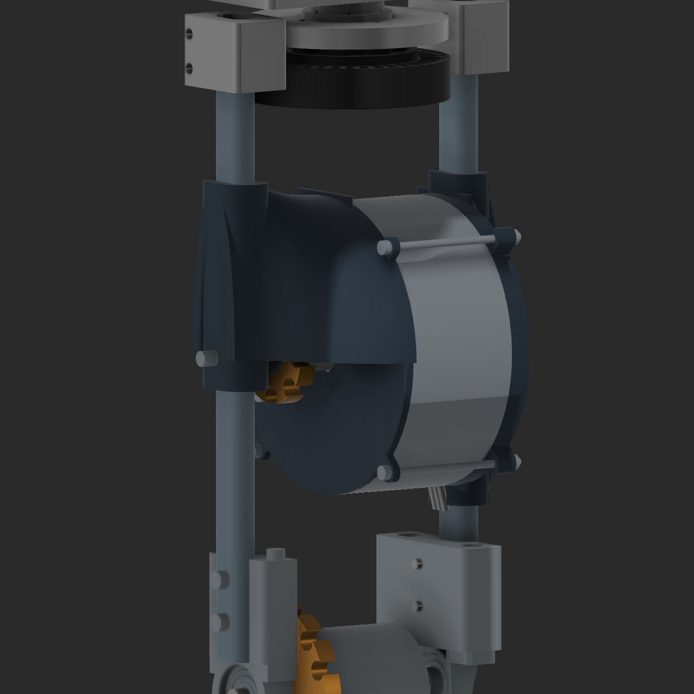
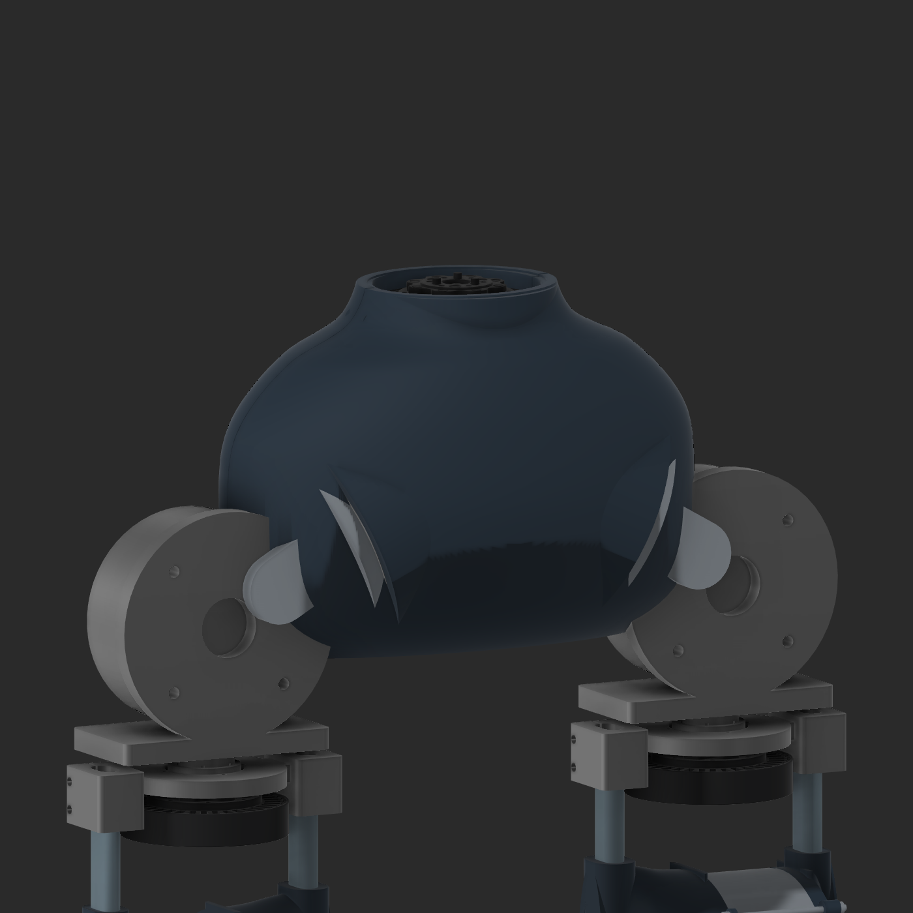

# V15 slide-on motor mounts and waist layout

September 21, 2026. Built from the live v14 native design, preserved as `v15/Input_live_v14_preserved.f3d`. Native archive: `E:\Aditya\robot_sim\outputs\shin_cad_20260912\v15\deliverables\Legs_and_waist_v15.f3d`. The original timeline, components and 101 native joints per leg are retained.

## Implemented geometry

- **Rear knee-motor mount:** continuous 125 mm oval sleeve with broad curved material spreading into the circular backplate. The passage is 10.2 × 18.2 mm for the existing 10 × 18 mm thigh oval. Outer sleeve section is 18 × 26 mm (nominal 3.9 mm wall before local reliefs). The four motor mounting bores and counterbores remain accessible. Three small phase-wire reliefs were cut. Obsolete enclosed clamp screw pockets were filled.
- **Sprocket side:** continuous 78 mm slide-on sleeve, outer 20 × 28 mm section, with the same oval passage. A curved upper 180° shell joins the top and both sides to the cover. Its loft sections use nominal 6 mm offsets; this is not a certified minimum wall thickness. The lower half of the new bridge remains open. The existing cover, sprocket, 6 mm support-pin reference and its 6.6 mm passage remain. No chain dimensions or chain route were calculated.
- The five former split-cap/support components per leg are hidden, and their M4 clamp hardware is removed. Four external M3 case ties per leg remain. Assembly is by sliding the continuous sleeves over the oval tubes before fitting the end structures. Final axial retention, fits and assembly access still need detailing.
- **Hip-pitch references:** 110 mm outside diameter × 50 mm axial depth, retaining the 25° tilt. The mounting/front face stays fixed; the extra 10 mm extends only behind the old 40 mm envelope. These are unselected motor envelopes, not a new vendor motor specification.
- **Waist yaw:** one duplicate of the existing GWK7010 geometry, centered between the legs at X0/Y23.343134, vertical shaft. Body bottom Z876; output top approximately Z904. This follows the user's explicit yaw-axis clarification.
- **Waist casing:** curved front and rear plastic halves surrounding both pitch envelopes and the waist yaw reference. Nominal section offsets are 5 mm, with 6 mm radial pitch-motor barrels, motor-shaped pockets, a yaw collar, four M4 seam-hole provisions, a 0.4 mm seam and a rear wiring opening. Detached slivers from bracket subtraction were removed; each half is one closed connected solid. No seam fasteners have been modeled or selected.

The 106 mm ID / 110 mm OD aluminum knee housing, knee position CAD Z430.6, motor axis Z560, 260 mm leg spacing, shin adapter enclosure and the previous 5 mm lowering are retained. CAD Z is not a measured ground height.

## Verification and limits

`evidence/v15/validation.json` records targeted intersections against visible neighboring parts, ten sleeve enclosure sections per leg, connected closed solids, native-joint validity and mount following at knee positions 0° and 30°. The waist casing has no measured solid overlap with the standing-pose motor/bracket references; the opposing pitch references and casing seam also do not overlap. `archive_reopen_verification.json` verifies the exported native file and its retained joints after reopening. Images were inspected after cleanup.

The waist group is an independent standing-pose reference, not a fully constrained pelvis or articulated hip assembly. The hip motor references still follow their respective thigh groups. There is no whole-body motion-clearance claim. The new plastic is not strength-, fatigue-, thermal- or print-qualified.

Fusion exited on the first archive-reopen attempt while several earlier designs were loaded. Recovery reopened the saved archive in a fresh Fusion session; the recovery report records its outcome. Existing recovered documents were left available. The cause of the process exit was not diagnosed.

**Encoder packaging changed:** the thicker rear sleeve occupies the former 5 mm encoder reservation behind the DJI hub. The hub itself clears the new mount, but the earlier encoder-space claim no longer applies. Revisit the encoder location before detailing electronics or machining interfaces.

The price-free [BOM_V15.csv](BOM_V15.csv) lists active modeled component/assembly groups for two legs and one waist. Hidden retired caps and construction lofts are excluded. Group quantities are not counts of every individual fastener, and ownership remains unaudited. The original price-free [BOM.csv](BOM.csv) and historical revision records remain available.

## Images

