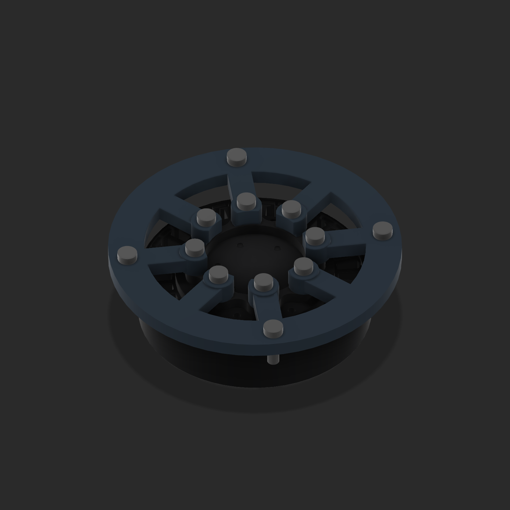

# V16 waist yaw, pitch and roll prototype

**Superseded interface correction:** V16 incorrectly used the 40.5 mm pitch-circle gearbox assembly screws for the fixed mount and three locating features for the output. [V18](HIP_WAIST_V18.md) uses the curved stationary interface with eight small holes on 48 mm PCD, and six small output holes on 25 mm PCD. The descriptions below record the historical v16 implementation, not the current mounting specification.

September 25, 2026. The native Fusion archive is `E:\Aditya\robot_sim\outputs\shin_cad_20260912\v16\deliverables\Legs_waist_gimbal_v16.f3d`. The recovered live v15 source was exported before editing as `v16/Input_live_v15_recovered_preserved.f3d`; the earlier v15 release remains in `v15/deliverables`. V16 preserves both legs and their 101 native joints per leg.

The existing curved PA12-CF waist casing now has four reinforced mounting points for a one-piece printed plate. That plate uses all eight **fixed** GWK7010 holes measured on a 20.25 mm radius; its central opening leaves the separate motor output free to rotate. Four casing bolts lie on a 43 mm radius. The fixed and rotating portions of the vendor motor are separate Fusion components.

The **rotating** 7010 output carries a CNC 7075 pitch yoke using its measured three-hole, 10.2 mm radius pattern. A smooth nominal 10 mm steel pitch pin runs in two replaceable 10 mm ID × 12 mm OD bushings and a double-shear yoke. A solid orthogonal CNC link carries the upper roll pivot: a nominal 8 mm smooth pin with two 8 mm ID × 10 mm OD bushings. The roll eye is integral to a fully enclosed, slide-on 18 × 10 mm oval-spine socket with two transverse bolt references. The 8 mm roll pin passes through the **solid aluminum roll eye**, not directly through the thin oval tube wall. The pitch and roll axes are 37 mm apart in the standing reference. Shaft retention, bushing fits, hardware lengths and tube crush protection remain design details.

Three native Fusion revolute joints represent yaw (vertical), pitch (horizontal X) and roll (horizontal Y). The additional nine native joints retain the shown mount, bushings, pins and fastener references. The differential drive motors, rods, motion stops, wiring and upper-torso structure have not been added in this revision.

The exported F3D archive was reopened and checked: 16 waist components, 12 valid waist joints, solid waist bodies, and 101 valid joints in each leg. The neutral, individual yaw/pitch/roll at ±15°, and a combined +10°/+10°/+10° pose had no intersection among the selected structural neighboring components. These sampled poses do **not** establish full-range clearance or strength. The source reports are in `evidence/v16`.

Before making load-bearing hardware, obtain the actual 7010 mounting thread engagement and **yaw output radial/axial/moment bearing ratings**. The present upper-body load path reaches the moving motor output through three bolts; an independent yaw bearing may be necessary. Also size the pitch/roll pins and bushings for actuator and landing loads, specify their fits and retention, verify oval wall and crossbolt/crush-sleeve design, and sweep the completed torso and differential actuators through their full motion. This is a mechanical packaging prototype, not a strength-qualified assembly.
