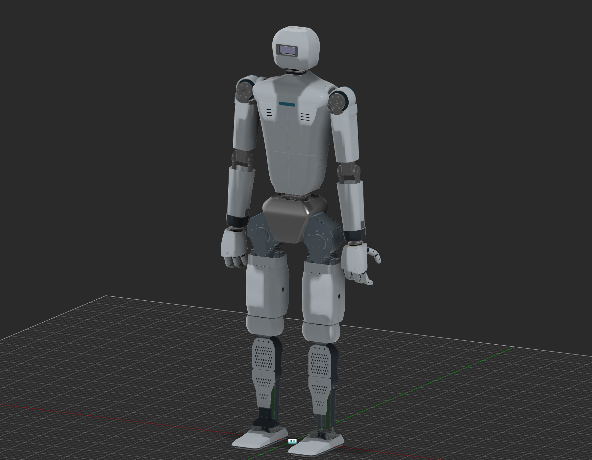

<!-- shoulder44_verified -->
## Oval shoulder crossmember and continuous neck cradle — October25,2026

Saved **Humanoid_foc68_upper_clearance_v42, version6** in the same V42 lineage, one cloud save. Two76mm18×10mm obround tubes and separate central/end adapters replace the wide shoulder beam. New tapered10mm neck cheeks/R3 transitions give9.8mm bearing-root engagement. Existing motor interfaces and83active joints remain; full robot covers/hands restored. Knee boards were hidden, not absent; both hip-roll boards fit without motor moves or redesign.15FOC boards and shin ODrives/separate encoders retained.

17 scoped native poses pass;20native/20STEP parts and the full assembly independently reopen. 4635 original unique BReps preserved. Final stance is neutral; the initial exact fractional-degree pose remains in its input archive after native drive/snapshot restoration failed. Prototype only: physical strength/manufacture/continuous clearance and electrical qualification remain open. [Report and CAD](E:/Aditya/robot_sim/outputs/shin_cad_20260912/shoulder44/REPORT.md). Training stays stopped; no new automation or shutdown.

<!-- shin_odrive43_completed -->
## Shin ODrive restoration, wrist bevels and mount roots — October 25, 2026

The four fixed shin motors are restored to two ODrive boards and four independent AS5047P encoder/carrier assemblies. The custom foc-controller-68 remains at 15 non-shin motors: six 6010, three 7010 yaw and six 10018. Both wrists now use 16-tooth, module 1.5 bevel sets. The existing 24 mm pitch diameter, 1:1 ratio, 18-tooth module 1.5 spur gears and hand interfaces are retained. Knee tie-bolt ears move 3 mm inward, from 60 to 57 mm radius. R3 boss roots and R2 oval-holder transitions replace abrupt connections. Eight hip cap/support bodies have R3 boss roots, with local relief where added material touched the approved hoods. Motor positions, approved adapters, the 12 mm upper/waist rise and all 83 active joints are unchanged.

Saved **Humanoid_foc68_upper_clearance_v42, version5**, one final save in the existing lineage. Full native archive,18 native parts and12 accepted STEP parts reopen; six STEP exports remain diagnostic with exact native alternatives. Native42 wrist poses and15 scoped mount poses pass. Prototype geometry only: strength, manufacture, loaded gears, thermal/electrical and continuous whole-body motion remain unqualified. [Report, images, files and checks](E:/Aditya/robot_sim/outputs/shin_cad_20260912/shin_odrive43/REPORT.md). Older all19-FOC statements below describe the superseded shin arrangement; the user rejected FOC boards at the four ankles. Training remains stopped. The authorized one-time follow-up is consumed; shutdown is requested separately after final checks.

<!-- foc68_42_completed -->
## Actual foc-controller-68 integration V42 — October24local/25UTC, 2026

The actual foc-controller-68 populated STEP is installed at all 19 BLDC motors: six 6010, seven 7010 including all four fixed ankles, and six 10018. Fusion source **Humanoid_foc68_upper_clearance_v42**, saved version **4**. Waist-yaw fixed motor and the complete upper body are raised 12 mm. Approved V41 adapters and every leg motor placement remain. The failed shared-hierarchy placement is replaced by verified flat exact-source geometry. All 19 sensor/hole placements, 27 sampled motor-following poses, 4233 original bodies, 83 active joints and the full native archive, 30 STEP parts and 2 native knee-part reopens pass; two knee STEP files remain diagnostic. Whole-body continuous motion and structural, thermal/electrical and physical encoder qualification remain open.

[CAD, views and measured checks](E:/Aditya/robot_sim/outputs/shin_cad_20260912/foc68_42/REPORT.md). Available Fusion recovery files were preserved before the authorized restart. Original sources and failed attempts remain. Training stays stopped; computer on.

<!-- clearance41_20261024 -->
## Clearance repairs and redesigned hip adapters V41 — October 24, 2026

Both yaw-to-hip-roll adapters are redesigned in **Humanoid_clearance_adapter_redesign_v41**, saved Fusion version 2. They use tapered 8 mm cheeks, an 8.5 mm base and R12 primary root blends, with measured local clearance pockets instead of thin right-angle attachments. Both yaw bearing seats and their bearings/retainers are lowered 6.3 mm axially; motor placements and all 83 joints remain unchanged. The right output hub is realigned to its motor axis as explicitly requested; its shape is preserved. The electronics holder is shortened for a 2 mm battery gap, shoulder fasteners are recessed and both inner waist caps/tube tips are trimmed for triangular clearance. The V40 chains are preserved.

Final visible-assembly checks pass 17 hip poses with zero absolute adapter contacts and 15 shoulder/waist poses with no added interference. All 4, 175 original bodies remain recoverable; the full F3D and 25 single-solid STEP files independently reopen. This is a CAD prototype: material choice, tolerances, strength, fatigue, fastening, manufacture and continuous whole-body clearance remain unqualified.

[V41 CAD, images and measured checks](E:/Aditya/robot_sim/outputs/shin_cad_20260912/clearance41/REPORT.md). Input live edits and all rejected attempts are preserved. Training stays stopped; computer stays on.

<!-- chains40_20261024 -->
## Straight-run knee chains V40 — October24, 2026

Current native source **Humanoid_tensioned_knee_chains_v40**, saved v2. The user-rejected V39 oval layout is replaced with36-pitch ANSI40 chains and complete knee motor/mount assemblies lowered7.83755 mm. Both spans are straight;151.56245 mm centres, 12.7 mm pitch, 18inner/18outer links and 180 active solids per knee. No stretched or offset link. Lower knee axes/rails/ankles and 83joints retained; adapter overlap remains intentionally for the user's later repair. Native placement/tooth checks, independent fullF3D and two180-body STEP reopen pass. Static geometry only; preload, dynamics, load and manufacture unqualified. [CAD, views and evidence](E:/Aditya/robot_sim/outputs/shin_cad_20260912/chains40/REPORT.md). V38 remains preserved below; V39 is rejected evidence. Training stopped, computer on, unrelated unsaved Fusion work preserved.

<!-- adapter38_20261024 -->
## Refined yaw-to-hip-roll cradles V38 — October 24, 2026

Current source **Humanoid_refined_hip_cradles_v38**, saved version 2. Both Q02 cradles gain editable R8 cheek-to-base root blends and R2 base corners. Original 10 mm cheeks, 8 mm base, 5 mm blind caps and all 39 cylindrical surfaces per part remain; all V37 motors, driver/encoder mounts and 83 joints are retained. Native neutral and 16 sampled hip poses show no added contact; full F3D and two STEP parts independently reopen. The original bodies and all failed probes remain recoverable. This is prototype geometry, with strength/material/fatigue/manufacturing and continuous full-body clearance unqualified.

[Before/after images, CAD and measured checks](E:/Aditya/robot_sim/outputs/shin_cad_20260912/adapter38/REPORT.md). The one-time follow-up is consumed; no ongoing schedule or training restart. Computer remains on. V37 below is preserved history.

<!-- drivers_encoders37_20261024 -->
## Leg drivers and ankle encoders v37 — October23 local /24UTC, 2026

Current native source **Humanoid_leg_drivers_encoders_v37**, saved v4. Six additional GDS68 envelope mounts are integrated behind the10018 knee/roll/pitch motors, with reversible axial motor-solid moves8.5/14.5/14 mm and attached support/fastener changes. Four visible official Arbite AS5047P boards mount on revised S06 carriers at1 mm sensor-face gaps to the unchanged stock ankle magnet CAD. All ankle motors and 83 native joints remain;3, 221original solids are retained. Neutral clearance and independent F3D/14 STEP reopen pass.26/28sampled poses have no added moving-group contact; the two crossed-leg30deg poses were already invalid. First sampled cross-leg contact remains11deg in both original/revised geometry. Continuous motion, material/mass/load, exact driver PCB holes, 10018 electrical/firmware/thermal and real gearbox/encoder operation remain unqualified.

[CAD, previews, sources and measured checks](E:/Aditya/robot_sim/outputs/shin_cad_20260912/drivers_encoders37/REPORT.md). Q02 yaw-to-hip-roll adapter refinement is explicitly deferred to the same one-time Oct24, 01:41local follow-up. Training and custom FOC PCB remain unchanged. Older v36 is preserved below.

<!-- steadywin36_20261023 -->
## SteadyWin enclosure prototypes v36 — October 23, 2026

Current native source: **Humanoid_SteadyWin_enclosures_v36**, saved version 2. Nine separate mounted cases replace visible XDrives for six 6010 and three non-ankle 7010 motors. Original motors, four excluded ankles and all 83 joints remain. Published GDS68 envelopes are used because the downloaded official motor/cap CAD has no standalone PCB; exact 7010 configuration, board holes, encoder stack and thermal/electrical duty remain unverified. Separate flanges, radial screw mounts, split oval-rail clamps and removable vented lids are modeled. W07/local fixed supports and a 140 mm electronics bay are revised with originals retained hidden.

All 3, 096 input solids are preserved; neutral solid clearance, full archive reopen and all 15 STEP roundtrips pass; actual motion finds two unresolved inward-arm/waist-case contacts. Continuous motion, material/mass, strength and manufacture remain unqualified. [CAD, images and evidence](E:/Aditya/robot_sim/outputs/shin_cad_20260912/steadywin36/REPORT.md). V35 below is historical. Training and the custom FOC PCB remain unchanged.

# Humanoid robot — current build

<!-- xdrive35_20261023 -->
## XDrive controller placements v35 — October 23, 2026

Current native source: **Humanoid_XDrive_mounts_v35**, saved version 3.
Nine linked Mini CAD references: four shoulders, two waist differential motors,
two hip-yaw and one waist-yaw. Per the user's steering, the original mechanics
are retained and fit conflicts remain for the user to adjust. No mount brackets,
case reliefs or electronics-box relocation are retained. All nine placements and
the native reopen pass; 1733 original body bounds
and all 83 joints are preserved. Encoder/thermal-stack fit remains unverified.
The two green screw-terminal assemblies per board are disabled for direct
soldering, with their solids retained hidden. Wire/solder envelopes are not modeled.

[Canonical CAD, previews and evidence](E:/Aditya/robot_sim/outputs/shin_cad_20260912/xdrive35/REPORT.md).
The previous compact wrist v34 is preserved below. Training is unchanged.

<!-- wrist34_20261023 -->
## Compact differential wrists v34 — October 23, 2026

Current mechanical source: **Humanoid_compact_wrists_v34_release**, saved version 3, `urn:adsk.wipprod:dm.lineage:hcNjF0evQJSGkyUjzb6yow`. Each wrist removes one idler from both spur paths and uses 18T/module1.5 spurs. The pitch-to-hand lever is 37.5 mm (was54); hand-plane-to-cassette-end distance is157.5 mm (was193). The original hand mounting plane and head-type servos remain. Two compact 688 roll bearings replace two608 per wrist. Mitres remain24T/module1; the spur paths remain1:1.

Native motion, actual forearm solid-clearance, spur-period samples and independent F3D/STEP reopen pass. Hardware/load and continuous mesh-hand clearance remain unqualified. [Canonical CAD and evidence](E:/Aditya/robot_sim/outputs/shin_cad_20260912/wrist34/REPORT.md). The v33 record below is historical; all original archives and failed/repaired evidence remain preserved. Training assets are unchanged.

<!-- wrist33_20261023 -->
## Differential wrists v33 — October 23, 2026

Current mechanical source: **Humanoid_differential_wrists_v33**, saved version 3. Two head-type STS3215 servos per wrist are staggered 48 mm lengthwise, using spur idlers and a bevel differential. The hands retain their original size and mounting plane. M3 sleeved idlers, bearing-supported outputs and service openings are included. Twelve native poses, 18 selected solid-clearance poses and independent native reopen pass; this is prototype CAD, with hardware/load and continuous mesh-hand clearance still unqualified. The exact v32 version-4 input is preserved.

[Canonical wrist report and CAD](E:/Aditya/robot_sim/outputs/shin_cad_20260912/wrist33/REPORT.md). Prior v32 leg/waist mechanisms remain; the frozen simulation is not migrated. The report below records the earlier v32 baseline.

**CAD v32 · October 1, 2026 · local documentation only.**

V32 replaces the bulky all-side shin covers with four 2.5 mm perforated front plates. Six existing carrier bores per leg locate the upper attachments; shallow saddles and strap slots secure the lower plates to the existing 18 × 10 mm oval rails. Rear skins, calf accents and ankle cowls are hidden. The carrier, motors, rods and steel rails stay in their original positions.

Both hip-yaw collars now fit the existing oval rails and crossheads. The envelope is 131.6 × 84 × 36.5 mm; the old right collar was about 141.6 × 128 × 53 mm. Each collar has separate front/rear halves, a 0.6 mm seam, 2.5 mm nominal skin and two integral oval clamp pads. The previously missing left collar is restored. Broader thigh panels below the collar and the enlarged continuous v31 waist remain unchanged.

All 439 original occurrence transforms and 65 native joint definitions are preserved. Twelve leg axes and eight paired hip movements were checked in a disposable reopened archive; cover ownership followed correctly. New covers passed the recorded neutral mechanism checks and discrete hip-yaw sweep. Full native export independently reopens. These checks do not qualify strength, fastener preload, print retention or continuous full-body clearance.

Training remains on frozen physical_v29 with the provisional 34.46 kg mass estimate. CAD v32 is not loaded into the active policy. The existing supervisor retains its 300 MiB reserve, 180-second headroom rule and 8192 ceiling; inspect its live monitor before quoting status.

[CAD and STEP parts](EXPORTS.md) · [Casings](CASING_DESIGN.md) · [BOM](BOM.md) · [Evidence](EVIDENCE.md) · [Previous v31](history/v31/STATUS.md).
