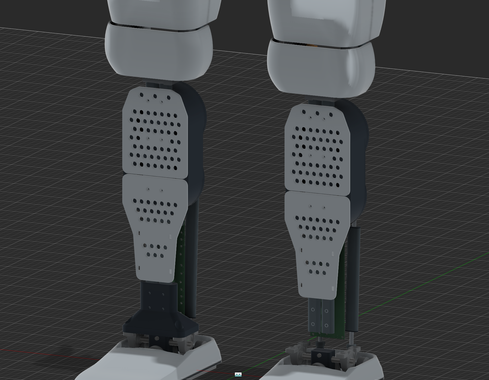
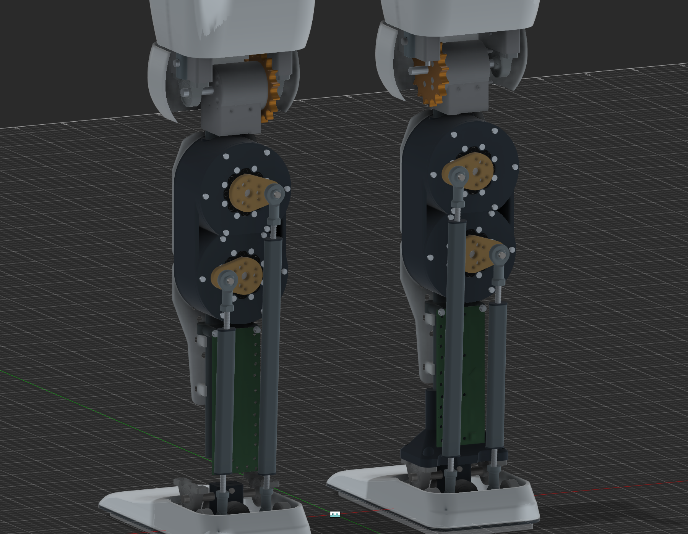
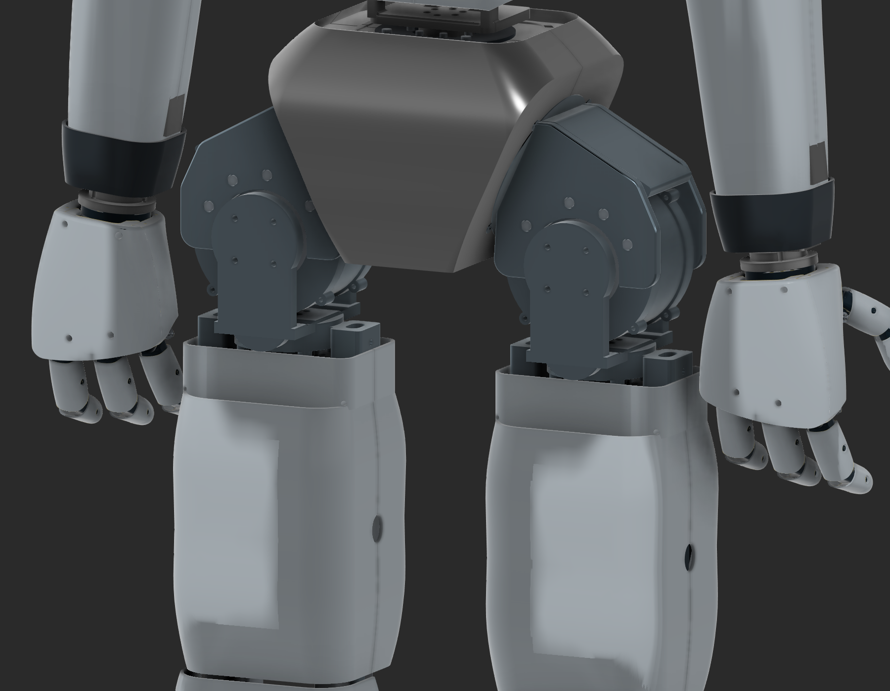

<!-- clearance41_20261024 -->
## Clearance repairs and redesigned hip adapters V41 — October 24, 2026

Both yaw-to-hip-roll adapters are redesigned in **Humanoid_clearance_adapter_redesign_v41**, saved Fusion version 2. They use tapered 8 mm cheeks, an 8.5 mm base and R12 primary root blends, with measured local clearance pockets instead of thin right-angle attachments. Both yaw bearing seats and their bearings/retainers are lowered 6.3 mm axially; motor placements and all 83 joints remain unchanged. The right output hub is realigned to its motor axis as explicitly requested; its shape is preserved. The electronics holder is shortened for a 2 mm battery gap, shoulder fasteners are recessed and both inner waist caps/tube tips are trimmed for triangular clearance. The V40 chains are preserved.

Final visible-assembly checks pass 17 hip poses with zero absolute adapter contacts and 15 shoulder/waist poses with no added interference. All 4,175 original bodies remain recoverable; the full F3D and 25 single-solid STEP files independently reopen. This is a CAD prototype: material choice, tolerances, strength, fatigue, fastening, manufacture and continuous whole-body clearance remain unqualified.

[V41 CAD, images and measured checks](E:/Aditya/robot_sim/outputs/shin_cad_20260912/clearance41/REPORT.md). Input live edits and all rejected attempts are preserved. Training stays stopped; computer stays on.

<!-- adapter38_20261024 -->
## Refined yaw-to-hip-roll cradles V38 — October 24, 2026

Current source **Humanoid_refined_hip_cradles_v38**, saved version 2. Both Q02 cradles gain editable R8 cheek-to-base root blends and R2 base corners. Original 10 mm cheeks, 8 mm base, 5 mm blind caps and all 39 cylindrical surfaces per part remain; all V37 motors, driver/encoder mounts and 83 joints are retained. Native neutral and 16 sampled hip poses show no added contact; full F3D and two STEP parts independently reopen. The original bodies and all failed probes remain recoverable. This is prototype geometry, with strength/material/fatigue/manufacturing and continuous full-body clearance unqualified.

[Before/after images, CAD and measured checks](E:/Aditya/robot_sim/outputs/shin_cad_20260912/adapter38/REPORT.md). The one-time follow-up is consumed; no ongoing schedule or training restart. Computer remains on. V37 below is preserved history.

<!-- drivers_encoders37_20261024 -->
## Leg drivers and ankle encoders v37 — October23 local /24UTC,2026

Current native source **Humanoid_leg_drivers_encoders_v37**, saved v4. Six additional GDS68 envelope mounts are integrated behind the10018 knee/roll/pitch motors, with reversible axial motor-solid moves8.5/14.5/14mm and attached support/fastener changes. Four visible official Arbite AS5047P boards mount on revised S06 carriers at1mm sensor-face gaps to the unchanged stock ankle magnet CAD. All ankle motors and83native joints remain;3,221original solids are retained. Neutral clearance and independent F3D/14STEP reopen pass.26/28sampled poses have no added moving-group contact; the two crossed-leg30deg poses were already invalid. First sampled cross-leg contact remains11deg in both original/revised geometry. Continuous motion, material/mass/load, exact driver PCB holes,10018 electrical/firmware/thermal and real gearbox/encoder operation remain unqualified.

[CAD, previews, sources and measured checks](E:/Aditya/robot_sim/outputs/shin_cad_20260912/drivers_encoders37/REPORT.md). Q02 yaw-to-hip-roll adapter refinement is explicitly deferred to the same one-time Oct24,01:41local follow-up. Training and custom FOC PCB remain unchanged. Older v36 is preserved below.

# Casings — v32

Use the root **Casings** eye to show/hide the cosmetic parts. Original physical-owner constraints are unchanged. Hidden obsolete parts stay hidden when the root toggle is restored.

The shin covers are two front plates per leg, 2.5 mm thick, with rounded outlines and 6.4 mm perforations. Their maximum width is 96 mm and the lower end tapers to 54 mm. Upper plate Z263–384 mm; lower plate Z118–262 mm. Conformal standoffs fit the existing carrier and steel rail surfaces, with M3 clearance bores at X±10 mm relative to each leg and Z244/314/366 mm. Lower locating saddles use 18.6 × 10.6 mm oval clearance; strap slots retain them without drilling the rails. Screw lengths, removable straps, printing material and fatigue/retention require a physical trial.

Sides and rear are open. The old rear shell halves, ankle cowls and two blue calf accents are retained hidden. Existing straight carrier side walls remain structural frame parts.

The hip-yaw collars are 131.6 × 84 × 36.5 mm around the original rails/crossheads, about 34% less depth than the previous 128 mm collar. Each splits into two pieces with a 0.6 mm seam, 2.5 mm nominal skin, 10.6 × 18.6 mm clamp bores and M3 seam bores. The bottom is Z666 mm; the top ends at Z702.5 mm below the moving cradle. Final clamp hardware and fit remain provisional.

The four broader thigh skins, v31 continuous waist, hip adapters, shoulders, knee covers, hands and shoes are unchanged. Motor spacings and joint axes are preserved. No mass/contact update was made to training.
