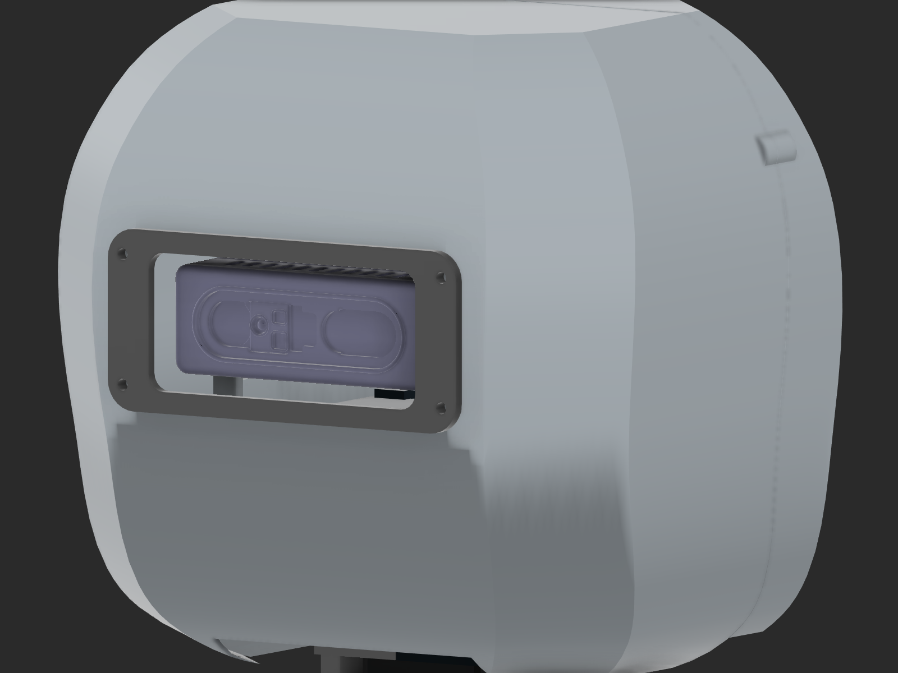
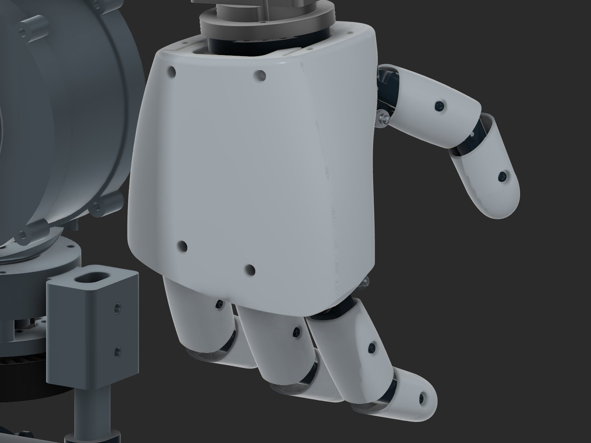

# Inspection evidence — v26

[Current build report](../../BUILD_REPORT.md). These local records support the stated checks. A record being present does not establish a passing verdict; use its explicit results and the scope recorded in the report.

## Head, vision and neck

- [head_refinement.json](../../evidence/v26/head_refinement.json)
- [rear_head_relief.json](../../evidence/v26/rear_head_relief.json)
- [neck_mount_refinement.json](../../evidence/v26/neck_mount_refinement.json)
- [pitch_case_mount_geometry.json](../../evidence/v26/pitch_case_mount_geometry.json)
- [head_self_fit.json](../../evidence/v26/head_self_fit.json)
- [head_clearance.json](../../evidence/v26/head_clearance.json)

## Hands and wrist interfaces

- [SOURCE.json](../../evidence/v26/SOURCE.json)
- [hand_import.json](../../evidence/v26/hand_import.json)
- [hand_assembly_current.json](../../evidence/v26/hand_assembly_current.json)
- [left_hand_assembly.json](../../evidence/v26/left_hand_assembly.json)
- [wrist_mount_refinement.json](../../evidence/v26/wrist_mount_refinement.json)

## Whole-body joints and saved pose

- [hip_articulation.json](../../evidence/v26/hip_articulation.json)
- [physical_hip_frames.json](../../evidence/v26/physical_hip_frames.json)
- [whole_robot_motion.json](../../evidence/v26/whole_robot_motion.json)
- [differential_pair_motion.json](../../evidence/v26/differential_pair_motion.json)
- [recovery_serial_motion.json](../../evidence/v26/recovery_serial_motion.json)
- [dynamic_elbow_frames.json](../../evidence/v26/dynamic_elbow_frames.json)
- [rest_pose.json](../../evidence/v26/rest_pose.json)
- [recovered_rest_pose.json](../../evidence/v26/recovered_rest_pose.json)
- [rest_envelope_independent.json](../../evidence/v26/rest_envelope_independent.json)
- [capture_rest_pose.json](../../evidence/v26/capture_rest_pose.json)
- [neutral_ankles_capture.json](../../evidence/v26/neutral_ankles_capture.json)

## Materials, structure and export checks

- [color26_state_7f475c6a6b4a.json](../../evidence/v26/color26_state_7f475c6a6b4a.json)
- [printed_reducer_color_correction.json](../../evidence/v26/printed_reducer_color_correction.json)
- [complete_state.json](../../evidence/v26/complete_state.json)
- [saved_release.json](../../evidence/v26/saved_release.json)
- [saved_v3_before_localization.json](../../evidence/v26/saved_v3_before_localization.json)
- [open_saved_cloud26.json](../../evidence/v26/open_saved_cloud26.json)
- [saved_source_comparison26.json](../../evidence/v26/saved_source_comparison26.json)
- [full_f3z_integrity_audit.json](../../evidence/v26/full_f3z_integrity_audit.json)
- [final_native_handoff26.json](../../evidence/v26/final_native_handoff26.json)
- [manufacturing_export_review26.json](../../evidence/v26/manufacturing_export_review26.json)
- [release_independent_file_review.json](../../evidence/v26/release_independent_file_review.json)
- [upper_archive_pose_analysis.json](../../evidence/v26/upper_archive_pose_analysis.json)
- [upper_archive_context_independent_comparison.json](../../evidence/v26/upper_archive_context_independent_comparison.json)
- [upper_placed_baseline26_evidence.json](../../evidence/v26/upper_placed_baseline26_evidence.json)
- [release26_reopen_upper_context_comparison.json](../../evidence/v26/release26_reopen_upper_context_comparison.json)
- [upper_context_manifest_amendment26.json](../../evidence/v26/upper_context_manifest_amendment26.json)
- [automation_shutdown26.json](../../evidence/v26/automation_shutdown26.json)
- [documentation_recovery_state.json](../../evidence/v26/documentation_recovery_state.json)
- [archive_format_audit.json](../../evidence/v26/archive_format_audit.json)
- [native_saved_checkpoint.json](../../evidence/v26/native_saved_checkpoint.json)

## Bounded native archive baselines and reopen results

- [release26_baseline_full.json](../../evidence/v26/release26_baseline_full.json)
- [release26_baseline_upper.json](../../evidence/v26/release26_baseline_upper.json)
- [release26_reopen_full.json](../../evidence/v26/release26_reopen_full.json)
- [release26_reopen_upper.json](../../evidence/v26/release26_reopen_upper.json)

## Superseded or rejected construction evidence

- [pitch_mount_bolt_probe.json](../../evidence/v26/pitch_mount_bolt_probe.json)
- [historical_blend_suppression.json](../../evidence/v26/historical_blend_suppression.json)

The [initial mirrored-left hand record](../../evidence/v26/initial_attempts/hand_assembly_mirrored_left.json) is preserved as history. The official left-source assembly and combined current record above supersede it.

The recovery archive format audit establishes ZIP/CRC/hash integrity and named design markers. It does not establish successful native Fusion recovery, portable external references or current joint/pose validity.

## Current preview

## Head preview

Actual native geometry and material-role colors.

## Hand and wrist preview

The imported source mechanism is a static packaging reference; its fingers are not articulated in Fusion.

