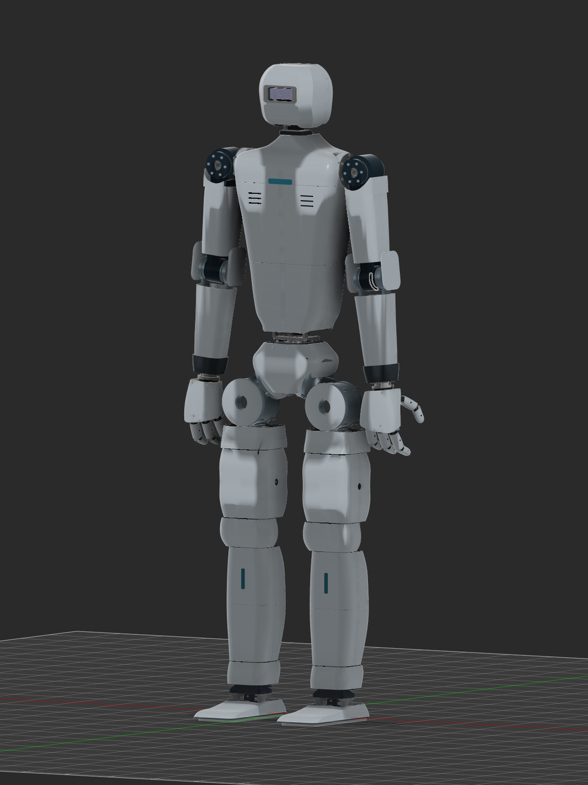

# Humanoid robot — current physical build

**v28 · September 30, 2026 · local documentation only.**

`Humanoid_complete_v28` is saved, complete and unmodified as **Fusion version 2**. This pass adds recognizable shoe casings, replaces the blocking elbow wrap with open side guards, makes both waist halves visible through reinforced replacement holders, and refines the knee, ankle, cuff and lower-torso transitions. The existing robot geometry and native joints remain preserved.

## Current design

The robot remains **1590.2 mm tall** from its original sole to the head. It retains the old waist motor arrangement, straight rearward oval spine, battery/electronics reservations, four supplier 6010 shoulder motors, supported arm forks, stereo-camera head and AmazingHand references. The saved pose is neutral except for the existing ±6° shoulder abduction. No actuator, joint limit or original frame dimension changed in this pass.

The active C27/C28 exterior now contains **58 single connected solids: 56 cosmetic parts and two structural waist halves**. Twenty-five of those parts are new active C28 geometry; 33 older C27 pieces remain active. Twelve rejected prototypes are retained hidden. The earlier head shell and hands are not included in this 58-part count.

| Dimension or interface | Current geometry |
|---|---|
| Standing height | 1590.2 mm / approximately 1.59 m |
| Shoulder height above sole / roll-center spacing | 1340.2 mm / 394 mm |
| Upper-arm / forearm pivot lengths | 260 / 240 mm |
| Spine | 18×10 mm oval; retained 0.55 mm wall is provisional |
| Battery reservation | 140×85×160 mm, 36-cell 12S3P concept |
| Electronics bay | 150×86×93 mm outside; 144×80×87 mm main cavity before bosses |
| Shoulder pitch / roll bearings | 6810, 50×65×7 mm / 6005, 25×47×12 mm |
| New shoe envelope | Approximately 118 mm wide ×258 mm long; low rounded upper with open instep |
| Shoe wall / rim | 3 mm nominal upper; raised dark rim above the original sole |
| Waist housing | Nominal 6 mm new envelope with 8 mm ribs; complete original interfaces included |

The source has **1,855 BRep bodies, eight hand meshes, 437 occurrences and 333 native joint constraints**, including **23 controlled body axes**. Those raw counts include hidden source/history and passive/rigid constraints; they are not procurement quantities.

## Changes and qualification

The shoe uppers cover the full original sole outline, with rounded toes, a shallow vamp and a heel/instep opening. Original sole, plate and ankle shafts stay unchanged. Swept instep relief addresses the tested pitch/roll travel. The dark rim was raised after a contact check found that an earlier rim could reach the floor first.

Elbows now have two separate 3 mm side cheeks per arm, without a front/back bridge across the bending path. Waist replacements preserve the full old W02/W03 structural interfaces; their original bodies remain hidden for reference. Both replacement halves are visible. Lower torso hems were relieved to clear the tested waist bends, leaving a deliberate functional joint gap.

| Verification | Recorded result and scope |
|---|---|
| Original v27 preservation | PASS: all 1,828 BRep signatures, eight meshes, 410 existing placements/grounds, 333 joint configurations and 23 body-axis values unchanged |
| Final static fit | PASS: 25 active new parts, 867 selected BRep comparisons including new-part pairs; final sole rims subsequently shrunk, verified as subsets and rechecked |
| Elbow bending | PASS: conservative continuous clearance against nine adjacent moving parts per side through −135° to 0°; minimum axial separation approximately 3 mm |
| Knees / hip-yaw collars | PASS: five selected native-frame poses per side for each |
| Shoulder cuffs | PASS: six in-limit mirrored samples per side against 35 selected torso/frame/carrier targets |
| Neck collar | PASS: 13 head-pitch samples against 33 actual head/camera shell solids |
| Shoes and ankle hardware | PASS: 15 pitch/roll combinations per foot against 93 selected fixed-neighbor solids |
| Sole contact order | PASS: nine selected tilted orientations per foot; minimum casing-above-sole margin **0.794 mm** |
| Waist / torso / hip caps | PASS: nine selected torso bends with 13 torso solids, plus ten hip-cap samples against the two new waist holders |
| Portable casing archive | PASS: independent native reopen of all 58 connected solids, same-coordinate bounds/volume signatures/topology/colors retained |
| Full robot archive | CRC, members, saved root version 2 and explicit dependency graph PASS; **native full-package reimport not performed** |

The checks use temporary BRep motion copies and measured physical shaft/bore frames, preserving the saved source pose. Except for the stated conservative elbow proof, motion results qualify selected samples, not every continuous combined pose. Small inherited bearing-center offsets were recorded, not silently corrected. Original source signature matching is not exact BRep identity or a load certificate.

## Fabrication status

These are concept/fit CAD parts. Cosmetic mounting details, printer orientation, actual polymer, minimum walls, tolerances, cable travel and strength still need a physical trial. The waist is structural: its thicker envelope and preserved interfaces do not establish printed load capacity. Existing sections can remain 5 mm thick despite the nominal 6 mm new envelope.

The new casings still have **Steel physical-material placeholders** in Fusion. Pale, graphite and teal appearances describe intended roles, not certified materials. Their geometric solid volume is not an appropriate native mass model for printed parts. Added casing mass requires a new dynamics/torque evaluation; the older 1.524 m / 22-axis Isaac model remains separate.

## Files and report map

The handoff folder is [Humanoid_v28_CAD](C:/Users/rshan/Downloads/Humanoid_v28_CAD). It includes the full F3Z, independently reopened casing-only F3D, geometry-only STEP, 25 changed-part STEP files, native previews and current report/BOM. Fusion is left open on the saved v28 source, with TextCommands hidden and the temporary watcher/startup disabled.

| Reference | Purpose |
|---|---|
| [Casing design](CASING_DESIGN.md) / [inventory](CASING_INVENTORY.csv) | Exact current cover groups, dimensions, palette, active/hidden status and limits |
| [BOM](BOM.md) / [CSV](BOM.csv) | Current parts/status; prices unverified and blank |
| [Mechanical architecture](MECHANICAL_OVERVIEW.md) | Preserved motor, bearing, frame, head/camera and wiring interfaces |
| [Torque notes](TORQUE_NOTES.md) | Older simulation demands and unverified planning arithmetic |
| [Hand design](HAND_OPTIONS.md) | Original source/license, microservo integration and MG90 limitations |
| [Evidence](EVIDENCE.md) / [exports](EXPORTS.md) | Completed checks, hashes, saved source and file qualification |
| [Open decisions](OPEN_ITEMS.md) | Questions for the next detailing pass |
| [v27 history](../v27/BUILD_REPORT.md) / [v26 history](../v26/BUILD_REPORT.md) | Preserved earlier design records |

Saved source: `urn:adsk.wipprod:dm.lineage:MsQkWo2RS0WYAsfp69Rfzw`, version 2. Construction and raw iteration evidence: `E:/Aditya/robot_sim/outputs/shin_cad_20260912/v28`.

Documentation and BOM edits are **local only**. No Git commit, push or repository publication was performed. Saving CAD in the user's existing Fusion project is separate from publishing to GitHub.
