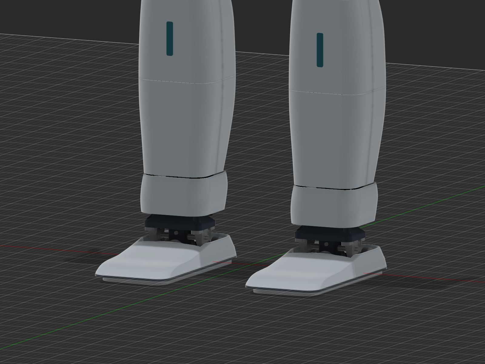
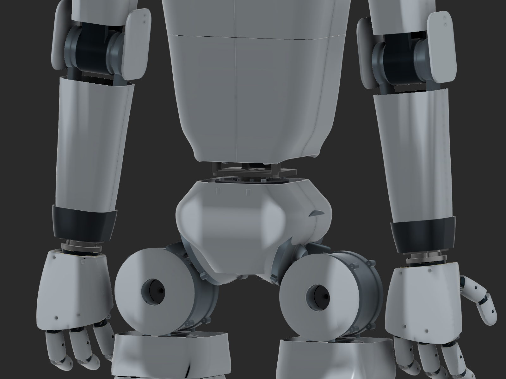

# Current casing design — v28

[Build report](BUILD_REPORT.md) · [Inventory](CASING_INVENTORY.csv) · [BOM](BOM.md).

## Shape and ownership

The active C27/C28 set has 58 connected solids, including two structural waist halves. Covers remain on one physical rigid link each, grounded relative to that parent. No new body joint or original geometry change was introduced. Twelve older prototypes remain hidden rather than deleted. The native inventory preserves both world and owner-local placement evidence.

| Group | Active solids |
|---|---:|
| Ankle shrouds | 2 |
| Elbow side guards | 4 |
| Forearm skins | 4 |
| Hip-roll caps | 2 |
| Hip-yaw collars | 2 |
| Identifiers | 2 |
| Knee shrouds | 2 |
| Neck collar | 1 |
| Shin skins | 8 |
| Shoes | 4 |
| Shoulder cuffs | 2 |
| Structural waist | 2 |
| Thigh skins | 4 |
| Torso panels | 13 |
| Upper-arm skins | 4 |
| Wrist guards | 2 |

Pale RGB 213/223/230, graphite RGB 70/84/95 and teal RGB 26/139/165. The old dark knee/ankle coins and pelvis nose are replaced by pale curved shrouds and the thicker integrated waist housing. Neck/wrist transitions and shoe rims remain dark to show joint breaks.

## Shoes

Each foot has a rounded low-profile upper and a separate raised sole rim, approximately 118×258 mm overall. The original actual sole is approximately 101.5×238.4 mm; the smaller ankle-mount plate alone was not used as the foot outline. Upper extent is Z−2.5 to +27.8 mm in the saved world pose; rim is Z−6 to −3 mm. Original floor datum remains Z−14.83656864 mm. Nominal upper wall is 3 mm and upper/rim split is 0.5 mm.

Instep openings include conservative measured-axis motion relief, with 1.5 mm clearance to selected hardware bounds. The ankle cowl starts at Z68 mm to preserve movement rather than connecting rigidly to the shoe across the ankle. Fifteen discrete ankle samples per foot clear 93 fixed-neighbor solids. Nine tilted contact orientations per foot give a minimum casing-over-sole height margin of 0.794 mm. The final rim is a verified subset of the previously checked geometry. Compression, print error and untested contact orientations need physical validation. Final shoe attachment is not designed yet.

## Elbows and joint transitions

Four separate 3 mm elbow cheeks replace the wraparound bridge that blocked bending. Two D3.4 mm M3 clearance positions per cheek are modeled; standoffs, removable retention and fastener lengths are provisional. A conservative continuous axial/radial envelope test covers nine adjacent moving parts per side across −135° to 0°, with approximately 3 mm minimum axial separation.

Knee shrouds end 2 mm short of the adjoining thigh/shin skins and are open rearward for the chain/structure. Rounded hip-yaw collars, ankle cowls, inboard-open scalloped shoulder cuffs, wrist guards and a rectangular yaw collar cover additional exposed interfaces while preserving tested travel. Their independent motion test scopes are in [Evidence](EVIDENCE.md).

## Waist and lower torso

Two new pale waist housings include the complete original W02/W03 body geometry, preserving mounting/bearing interfaces. Added skins are relieved around original forks and moving motor caps. Both are one connected solid, with nominal 6 mm new envelope sections and 8 mm ribs. Old holder bodies remain hidden and the corresponding components remain on. Original-minus-new missing volume is zero in the native containment evidence. Existing source sections can remain 5 mm; no minimum section or printed strength guarantee is made.

Four lower torso panels replace their hidden C27 predecessors. Conservative inverse-transformed waist envelopes plus 2 mm relief clear nine measured native-frame bend samples. Their lower edge is near Z928.5 mm, leaving approximately 26.5 mm above the holder's Z902 mm top at rest. This deliberate functional gap replaces a visually smoother but interfering earlier hem. No structural frame or joint range was changed.

## Printing and material limits

Exact native-component dimensions are in the inventory. Torso panels retain three height bands split front/rear and left/right; calves remain split upper/lower. Separate part files are STEP geometry, not validated print orientations. Bed margin, supports, dimensional compensation, retaining hardware and service access require a prototype.

The 58 active source root-frame solids total approximately **3482.1 cm³** geometric volume. This includes the replacement structural waist bodies and is not a print filament quantity or added-mass estimate. All retain Steel physical-material placeholders. Polymer grade, density, infill and solid regions must be specified before mass/inertia or strength analysis.

The source-proxy volume integration differs for some rotated curved solids from integration of identical temporary geometry in root coordinates. Portable export/reopen comparison uses the unchanged source root-copy geometry in the same coordinate domain, with strict bounds, volume and topology checks. Diagnostic history documents the mismatch; no source change or tolerance relaxation was used.

The full robot package and compact casing archive have separate qualification. Native casing reopen passed; full package reimport was not performed. Continuous combined whole-body motion, cables, load/impact/thermal tests and manufacture remain unqualified. Styling references and their provenance are retained in [v27 design reference notes](../../evidence/v27/design_reference_notes.md).
